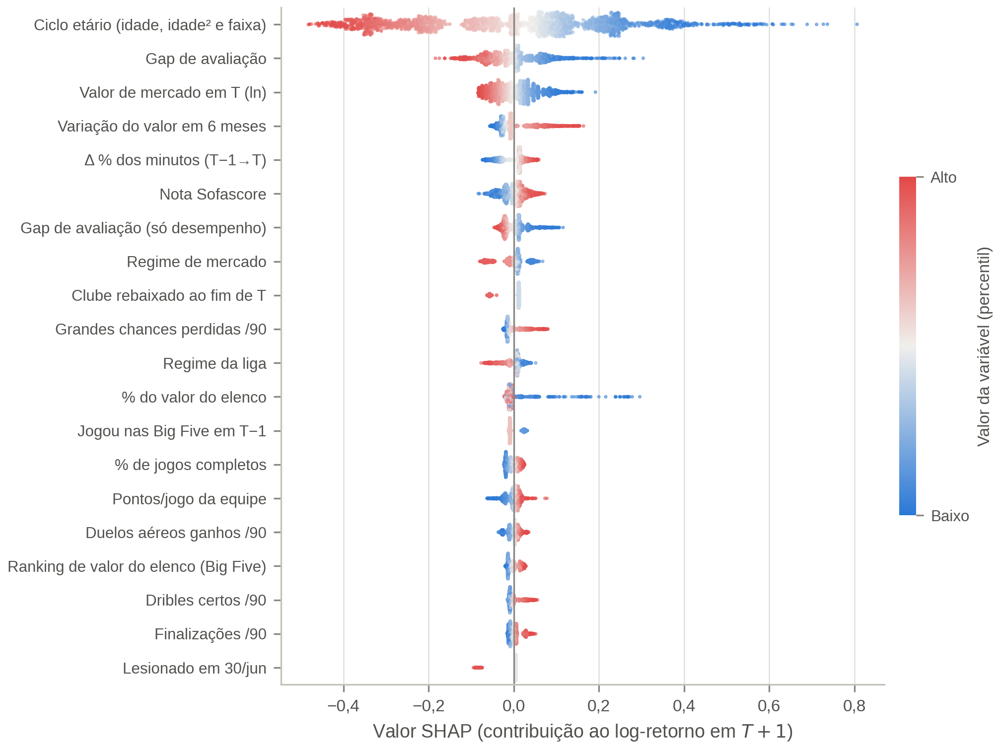
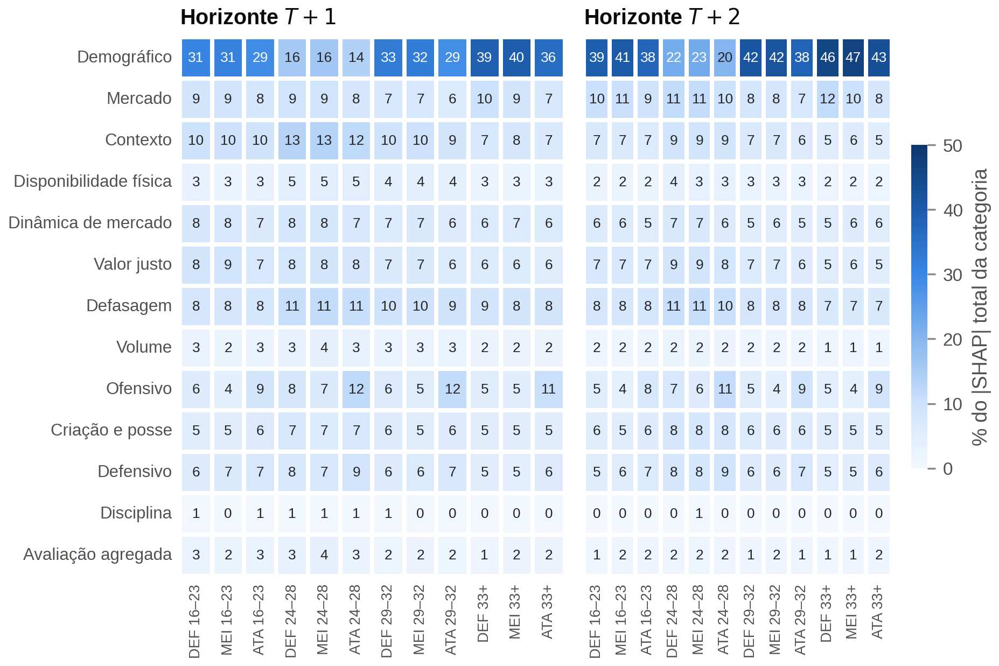
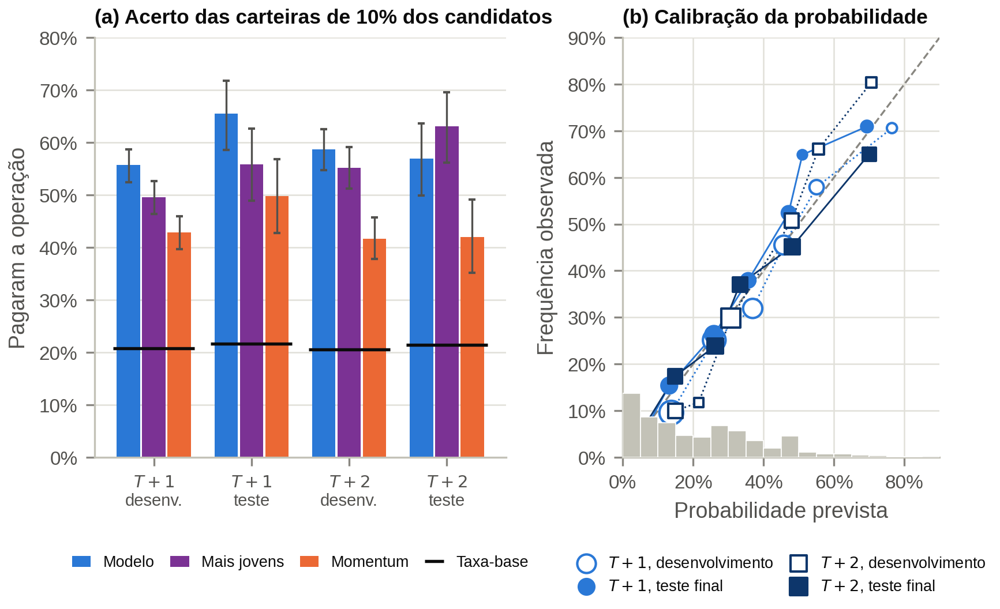

<!-- Fonte do artigo. Gere o .docx com: .venv/bin/python article/build_docx.py -->
<!-- Números conferidos com reports/tables (execução de referência da versão 3, 23/10/2026). -->

::: resumo
Clubes que adotam o modelo de *player trading* precisam identificar, antes do mercado, os atletas que vão se valorizar. Este estudo avalia em que medida a variação do valor de mercado de jogadores de linha das cinco principais ligas europeias pode ser prevista uma e duas temporadas à frente (T+1 e T+2) com informação disponível ao fim da temporada de referência. A amostra reúne 13.748 observações jogador–temporada de 5.007 atletas, de 2018/19 a 2024/25, restritas aos 90% de menor valor e a quem jogou ao menos 90 minutos, com dados do FBref, do Understat, do Sofascore e do Transfermarkt. Foram comparados seis algoritmos e arquiteturas globais e segmentadas por idade e posição, sob validação em janela expandida e com o teste de T+1 (2024/25) pré-registrado. No teste, o modelo explicou 33% da variância do log-retorno em T+1 e 37% em T+2, e 67% dos atletas do decil superior previsto valorizaram-se o bastante para cobrir custos de transação de 10% na compra e na venda, contra 22% na média. O desempenho em campo agregou poder preditivo ao próprio Transfermarkt, sobretudo no auge da carreira, mas a idade foi o principal determinante, e modelos separados por categoria não superaram um modelo único. Em simulação líquida de custos, as carteiras do modelo superaram o acaso, o *momentum* e a compra dos atletas mais jovens em todas as temporadas. O aprendizado de máquina explicável mostrou-se útil para triar e ordenar oportunidades, e não para precificar atletas individualmente.
:::

# Introdução

O mercado de transferências do futebol europeu combina inflação dos valores negociados, endividamento dos clubes e regras de sustentabilidade financeira cada vez mais rigorosas (Hill et al., 2025). Nesse ambiente, clubes de médio porte e clubes formadores adotam o modelo de *player trading*: adquirir atletas subavaliados, desenvolvê-los e revendê-los com ágio, segundo a lógica *buy-low/sell-high* que organizações como o FC Midtjylland e o TSG Hoffenheim associam ao uso sistemático de dados (Müller et al., 2017).

A execução dessa estratégia depende de uma previsão: quais atletas, disponíveis hoje a preços compatíveis com o orçamento, valerão mais em uma ou duas temporadas. A literatura de valoração concentra-se, porém, em estimar o nível atual do valor de mercado ou do preço de transferência (*nowcasting*), por regressão (Müller et al., 2017) ou por aprendizado de máquina (McHale; Holmes, 2023; Khalife et al., 2025). Estimar bem o nível não garante prever a variação: um modelo que reproduz o valor publicado pelo Transfermarkt herda a inércia da avaliação da plataforma, sujeita a ancoragem e a cascatas de informação (Herm et al., 2014; Coates; Parshakov, 2022).

Dois problemas metodológicos agravam essa lacuna. O primeiro é a avaliação: com dados longitudinais, a validação cruzada aleatória e a reutilização do conjunto de teste durante o desenvolvimento produzem métricas otimistas (Kaufman et al., 2011; Kapoor; Narayanan, 2023). O segundo é a opacidade: quem decide a contratação precisa saber por que um atleta é recomendado, o que motiva explicações aditivas como o SHAP (Lundberg; Lee, 2017).

Este artigo tem como objetivo prever a variação absoluta e percentual do valor de mercado, uma e duas temporadas à frente (T+1 e T+2), dos jogadores de linha das cinco principais ligas europeias (*Big Five*) situados entre os 90% de menor valor e com ao menos 90 minutos na temporada de referência, e avaliar se essas previsões sustentam decisões de recrutamento e revenda. As contribuições são quatro: tratar o problema como previsão temporal estrita, com o teste final de T+1 (2024/25) pré-registrado; testar se o desempenho em campo agrega informação ao que o Transfermarkt já incorpora; submeter a teste formal a segmentação em 12 categorias de idade e posição, em lugar das nove de Khalife et al. (2025); e avaliar as previsões como regra de decisão, líquida de custos de transação, com explicações SHAP.

# Revisão da literatura

## Desempenho, ciclo de vida e valor de mercado

A revisão sistemática de Franceschi et al. (2024) organiza os determinantes do valor de jogadores em características do atleta (idade, posição, desempenho e experiência), do contrato, do clube e de popularidade. A idade mantém relação em U invertido com a remuneração e o valor (Frick, 2007), e o desempenho é medido cada vez mais por métricas de eventos por 90 minutos. No topo da distribuição, porém, a economia das superestrelas (Rosen, 1981; Lucifora; Simmons, 2003) gera prêmios desproporcionais ao desempenho, e Müller et al. (2017) observaram que modelos baseados em dados superam as estimativas da comunidade justamente abaixo do percentil 90 dos valores.

Hill et al. (2025) distinguem o valor de um atleta, associado ao desempenho esportivo em relação ao custo, do preço, resultado de uma negociação influenciada pelo tempo de contrato, pela liquidez dos clubes e pelo poder de barganha. Como o fluxo de caixa de um único atleta não é isolável e o valor residual se anula ao fim do contrato, os autores adaptam ao futebol as tipologias de valoração relativa e probabilística de Damodaran (2012), arcabouço em que este estudo se insere.

## Transfermarkt e a sabedoria das multidões

Na ausência de preços contínuos de transação, o valor publicado pelo Transfermarkt tornou-se a *proxy* padrão da literatura. Sua lógica remete à sabedoria das multidões, que exige diversidade, independência, descentralização e agregação dos julgamentos (Surowiecki, 2004). Herm et al. (2014) mostraram, contudo, que a plataforma opera pelo "princípio do juiz": avaliadores designados ponderam propostas de usuários que conhecem as estimativas anteriores, o que favorece a ancoragem (Tversky; Kahneman, 1974) e as cascatas de informação (Bikhchandani et al., 1992). Ainda assim, esses valores correlacionam-se com os preços de transferência e antecipam resultados esportivos (Herm et al., 2014; Peeters, 2018), e Coates e Parshakov (2022) examinam sua relação com os valores efetivamente pagos. Para um estudo de previsão, o valor do Transfermarkt é o alvo observável, mas a trajetória das suas revisões pode carregar inércia própria, que precisa ser separada da informação de desempenho.

## Aprendizado de máquina na valoração de atletas

Müller et al. (2017) estimaram valores de mercado por regressão multinível com desempenho e popularidade; McHale e Holmes (2023), valores de transferência com métricas avançadas e aprendizado de máquina; e Khalife et al. (2025) segmentaram modelos de *gradient boosting* em nove grupos, cruzando três faixas etárias e três posições, com coeficientes de determinação de 74% a 84% e queda para 59% entre atacantes acima de 30 anos. Esses valores referem-se ao nível do valor, e não à sua variação futura, alvo muito mais ruidoso.

Com dados longitudinais, a avaliação exige validação que respeite a ordem temporal (Bergmeir et al., 2018; Cerqueira et al., 2020), barreiras contra o vazamento de informação futura (Kaufman et al., 2011) e comparações que considerem a incerteza amostral das diferenças de erro (Diebold; Mariano, 1995; Hansen et al., 2011). O vazamento e a seleção de modelos no próprio conjunto de teste inflam resultados publicados (Kapoor; Narayanan, 2023), e o pré-registro do protocolo de análise é uma das respostas a esse problema (Nosek et al., 2018).

## Explicabilidade na tomada de decisão

Os valores SHAP decompõem cada previsão em contribuições aditivas das variáveis, com base nos valores de Shapley da teoria dos jogos cooperativos (Lundberg; Lee, 2017), e têm algoritmo exato e eficiente para conjuntos de árvores (Lundberg et al., 2020). No recrutamento, permitem verificar se uma recomendação decorre do desempenho, da idade, do preço ou do contexto do clube. Duas ressalvas orientam o seu uso: as explicações descrevem o modelo, e não relações causais, e variáveis correlacionadas dividem entre si a contribuição atribuída.

# Problema e objetivos

Para um clube que opera *player trading*, o problema não é saber quanto um atleta vale hoje, mas se ele vai se valorizar o bastante, entre a compra e a revenda, para pagar a operação. A pergunta de pesquisa é: em que medida a variação do valor de mercado, absoluta (ΔV) e percentual (ΔV%), em T+1 e T+2, dos 90% jogadores de linha mais baratos das *Big Five* com ao menos 90 minutos em T pode ser prevista com informação disponível em T, de modo a fundamentar decisões de recrutamento e revenda?

O objetivo geral é desenvolver e validar modelos de aprendizado de máquina para essa previsão e avaliá-los como instrumento de decisão. Os objetivos específicos são:

- integrar e verificar dados de desempenho, demografia, contexto do clube e valor de mercado dos atletas elegíveis;
- treinar e comparar algoritmos lineares e de conjuntos de árvores, em arquiteturas globais e segmentadas, sob validação temporal sem vazamento;
- identificar, com SHAP, os determinantes da valorização nas 12 categorias de idade e posição;
- avaliar o desempenho econômico de uma estratégia *buy-low/sell-high* baseada nas previsões, líquida de custos.

As hipóteses e seus critérios de decisão foram fixados no protocolo pré-registrado:

- H1: o desempenho em T tem poder preditivo incremental além do Transfermarkt (nível e trajetória do valor) e da idade;
- H2: a matriz de 12 categorias (4 × 3) supera a de nove categorias (3 × 3) de Khalife et al. (2025) e o modelo global;
- H3: atletas subavaliados pelo desempenho valorizam-se mais, premissa da compra a preço baixo;
- H4: a carteira selecionada pelo modelo supera heurísticas e o acaso, líquida de custos e incluindo os atletas que saem da base;
- H5: o desempenho pesa mais na valorização no auge da carreira do que entre os veteranos.

# Diferencial do estudo

O estudo difere da literatura de referência no objeto, pois prevê a variação do valor, e não o nível atual; no rigor da avaliação, com janela expandida, teste pré-registrado, inferência por *clusters* e correção para comparações múltiplas; e no uso, pois avalia as previsões como regra de compra, líquida de custos, e testa as premissas das especificações, inclusive as que os dados não confirmaram. O @qua-diferencial sintetiza essas diferenças.

[quadro#qua-diferencial] Contribuições do estudo frente à literatura de referência
| Estudo | Abordagem | Limitação para o *player trading* | Contribuição deste estudo |
|---|---|---|---|
| Müller et al. (2017) | Regressão multinível do valor com desempenho e popularidade | Estima o nível do valor (*nowcasting*) | Prevê a variação em T+1 e T+2 nos 90% de menor valor |
| Coates e Parshakov (2022) | Avaliação coletiva do Transfermarkt e valores de transferência | Não propõe um previsor alternativo | Testa se o desempenho agrega informação ao Transfermarkt (H1) |
| McHale e Holmes (2023) | Aprendizado de máquina com métricas avançadas de desempenho | Estima o nível, sem avaliar decisões | Avalia carteiras com custos e intenção de tratar (H4) |
| Khalife et al. (2025) | *Gradient boosting* segmentado em nove grupos (3 × 3) | Queda de precisão nos atacantes acima de 30 anos | Testa formalmente as matrizes 4 × 3 e 3 × 3 e o modelo global (H2) |
| Hill et al. (2025) | Tipologias de valoração de Damodaran aplicadas ao futebol | Proposta conceitual, sem validação empírica | Operacionaliza a valoração relativa e probabilística com previsões e intervalos calibrados |
[fonte] Elaboração própria.

# Verificação dos dados

## Fontes e integração

O FBref fornece a espinha dorsal da amostra (minutos, jogos, gols, assistências, finalizações e cartões). Como a plataforma retirou, em janeiro de 2026, as métricas avançadas licenciadas da Opta, inclusive das temporadas passadas, o vetor tático-técnico foi completado com o Understat (gols e assistências esperados) e o Sofascore (passes, dribles, duelos, desarmes, grandes chances e nota). O Transfermarkt fornece os valores de mercado datados, o perfil dos atletas e as transferências. Foram coletadas as temporadas de 2018/19 a 2024/25, além de 2017/18 para as defasagens, num total de 22.419 registros jogador–clube–temporada.

Na ausência de identificador comum, os registros foram pareados por resolução de entidades: normalização dos nomes, similaridade de Levenshtein e de Jaro-Winkler, restrições de ano de nascimento e de minutagem e 45 correspondências manuais. O pareamento com o Transfermarkt alcançou 99,94% do universo-alvo. O valor em T (V~T~) é a última avaliação publicada até 30 de junho do ano de término da temporada, com defasagem máxima de 183 dias, e V~T+1~ e V~T+2~ seguem a mesma regra um e dois anos depois; assim, nenhuma variável explicativa incorpora informação posterior à data da decisão.

## Amostra

A @tab-funil apresenta o funil amostral, que resulta em 13.748 observações jogador–temporada de 5.007 atletas.

[tabela#tab-funil] Funil amostral (2018/19 a 2024/25)
| Etapa | Observações | Atletas | Retenção |
|---|---:|---:|---:|
| Registros do FBref (jogador–clube–temporada) | 19.727 | 6.643 | — |
| Jogador–temporada | 18.808 | 6.643 | 95,3% |
| Pareados com o Transfermarkt | 18.763 | 6.609 | 99,8% |
| Exclusão de goleiros | 17.339 | 6.101 | 92,4% |
| Minutagem de ao menos 90 minutos em T | 15.286 | 5.138 | 88,2% |
| Com V~T~ observado | 15.184 | 5.088 | 99,3% |
| Corte no percentil 90 de V~T~ | 13.748 | 5.007 | 90,5% |
[fonte] Elaboração própria com dados de FBref e Transfermarkt.

Três verificações merecem destaque. O percentil 90 de V~T~, calculado por temporada, situa-se entre € 27 e € 32 milhões, acima dos € 18 milhões de Müller et al. (2017), que correspondem ao percentil 81 desta amostra; o corte é assimétrico, pois exclui 21% das observações da Premier League e 4% das da Ligue 1. O filtro de 90 minutos remove sobretudo jovens (23% dos atletas de 16 a 23 anos), de modo que as conclusões sobre essa faixa valem para jovens já integrados ao elenco principal. As 12 categorias têm tamanhos desiguais, de 2.233 observações (defensores de 24 a 28 anos) a 341 (atacantes de 33 anos ou mais), com faixas definidas pelos anos completos em 30 de junho (16–23, 24–28, 29–32 e 33 anos ou mais), o que resolve a sobreposição dos rótulos das especificações aos 28 anos.

## Variáveis-alvo

A variação percentual é extremamente assimétrica: nas temporadas de desenvolvimento, a mediana de ΔV% em T+1 é −20,0% e a média, +5,8%, com assimetria de 19,8. Por isso, o alvo de treino é o log-retorno (assimetria de 1,10), e as previsões são reconvertidas para ΔV% e ΔV. Cerca de um em cada quatro atletas se valoriza por ano; a exceção é 2018/19, cujo V~T+1~ coincide com a revisão extraordinária de abril de 2020, na pandemia, quando 82% dos atletas perderam valor. A ausência do alvo concentra-se nos veteranos (de 22% a 26% sem V~T+2~ aos 33 anos ou mais), um viés de sobrevivência tratado na simulação por intenção de tratar.

# Metodologia e design do modelo

## Variáveis

Para o atleta i na temporada T, o alvo no horizonte k ∈ {1, 2} é o log-retorno do valor, definido na equação @eq-alvo:

$$ y_{i,k} = \ln\left(\frac{V_{i,T+k}}{V_{i,T}}\right), \qquad \Delta V\%_{i,k} = e^{y_{i,k}} - 1 $$ {#eq-alvo}

O vetor explicativo reúne 108 variáveis medidas até 30 de junho de T: demografia (idade decimal e seu quadrado, altura e pé preferido), mercado (log V~T~ e peso no valor do elenco), contexto do clube (desempenho da equipe, promoção, rebaixamento e participação europeia), dinâmica do valor (revisões recentes e distância ao pico), defasagens (*momentum* e desempenho em T−1) e 52 métricas de desempenho por 90 minutos e de eficiência, além de liga, faixa etária e posição.

Como as taxas de quem joga pouco são dominadas pelo acaso, cada métrica foi encolhida para a média da sua posição na temporada por métodos empírico-bayesianos (Efron; Morris, 1975): nas contagens, pelo estimador gama–Poisson de Clayton e Kaldor (1987), na equação @eq-shrink, em que c~i~ é a contagem, e~i~ são os minutos divididos por 90 e α e β são parâmetros *a priori* estimados por momentos; nos percentuais, pelo análogo beta–binomial. Encolhidas, as métricas tornaram-se mais estáveis: a correlação de postos entre T−1 e T aumentou em 50 das 52 métricas.

$$ \tilde{r}_i = \frac{\alpha + c_i}{\beta + e_i} $$ {#eq-shrink}

Duas variáveis sintetizam a premissa *buy-low*. O valor justo é a previsão de ln V~T~ pelo desempenho, pela idade, pela posição e pelo contexto, ajustada por *gradient boosting* com validação cruzada dentro de cada temporada (R^2^ fora da dobra de 0,79); o *gap* de avaliação é a diferença entre ln V~T~ e o valor justo, negativa para atletas subavaliados. O tempo restante de contrato ficou fora do vetor, porque o Transfermarkt publica apenas o contrato vigente na data da coleta, e sua reconstrução em T depende de eventos posteriores, o que antecipa o desfecho.

## Validação temporal e pré-registro

A validação usa janela expandida: cada dobra treina com as temporadas anteriores e testa na seguinte. Há seis dobras em T+1, com testes de 2019/20 a 2024/25, e quatro em T+2, com purga de uma temporada entre treino e teste, já que o alvo de T+2 só é conhecido duas temporadas depois. Imputação, winsorização e padronização são ajustadas dentro de cada dobra.

O teste final de T+1 (2024/25, com alvo em 30 de junho de 2026) foi pré-registrado (Nosek et al., 2018): as decisões de modelagem foram tomadas nas dobras de desenvolvimento, com esses alvos ocultos, e o protocolo (*hash* dos dados e do código, variáveis, dobras, hiperparâmetros, arquitetura e critérios das hipóteses) foi versionado antes da revelação, condicionada à verificação automática de que ele era idêntico ao reproduzido. O teste de T+2 (2023/24) é semi-independente, pois foi consultado em versões anteriores do estudo.

## Algoritmos, arquiteturas e otimização

Foram comparados uma referência ingênua (mediana do treino por categoria), mínimos quadrados ordinários, Ridge (Hoerl; Kennard, 1970), floresta aleatória (Breiman, 2001), XGBoost (Chen; Guestrin, 2016) e CatBoost (Prokhorenkova et al., 2018). O modelo principal é um *ensemble* fixado *a priori*, a média simples de CatBoost, XGBoost e Ridge, pois combinações simples tendem a superar pesos estimados (Smith; Wallis, 2009). Para testar a segmentação, os modelos foram ajustados em três arquiteturas: global, com idade e posição como variáveis; segmentada, com um modelo por categoria nas matrizes 4 × 3 e 3 × 3; e *pooling* parcial, que combina o segmento c e o modelo global com peso crescente no tamanho n~c~ do segmento (equação @eq-pool):

$$ \hat{y}_i = w_c\,\hat{y}^{\mathrm{seg}}_i + (1 - w_c)\,\hat{y}^{\mathrm{glob}}_i, \qquad w_c = \frac{n_c}{n_c + \kappa} $$ {#eq-pool}

A regra pré-declarada só substituiria o *ensemble* global por uma alternativa com erro de validação menor e diferença significativa após a correção de Holm. Os hiperparâmetros foram escolhidos por otimização bayesiana com processo gaussiano (Snoek et al., 2012), com 20 avaliações nos modelos globais e minimização da raiz do erro quadrático médio (RMSE) das três últimas dobras de validação; no *boosting*, a taxa de aprendizado foi fixada em 0,05, e o número de árvores, definido por parada antecipada temporal.

## Magnitude e incerteza

Uma camada de magnitude converte o log-retorno previsto em ΔV%, com recalibração linear (parâmetros a e b) e fator de *smearing* de Duan (1983) por faixa etária, f~g~, estimados apenas com as dobras anteriores (equação @eq-smear). Intervalos de previsão de 80% foram obtidos por regressão quantílica com CatBoost e conformalização sequencial (Romano et al., 2019).

$$ \widehat{\Delta V\%}_i = f_g \exp\left(a + b\,\hat{y}_i\right) - 1 $$ {#eq-smear}

## Inferência, explicabilidade e avaliação da decisão

As incertezas foram estimadas por *bootstrap* de *clusters* clube × temporada, pois atletas do mesmo clube compartilham choques (Cameron et al., 2008). Os modelos foram comparados por teste pareado de perdas do tipo Diebold–Mariano, com erro-padrão agrupado e correção para pequenas amostras (Diebold; Mariano, 1995; Harvey et al., 1997), correção de Holm (1979) e conjunto de confiança de modelos (Hansen et al., 2011). A H1 foi testada por ablação de blocos de variáveis (Lei et al., 2018). As previsões do *ensemble* foram explicadas por valores SHAP, que decompõem cada previsão em um valor-base φ~0~ e contribuições aditivas φ~ij~ das M variáveis (equação @eq-shap), com o algoritmo exato para árvores e a forma fechada linear no Ridge.

$$ \hat{y}_i = \phi_0 + \sum_{j=1}^{M} \phi_{ij} $$ {#eq-shap}

Por fim, a simulação *buy-low/sell-high* compra, em cada temporada de teste, os 10% de candidatos com maior retorno esperado e os avalia em T+k. No cenário principal, compra-se por V~T~(1 + c~b~) e vende-se por V~T+k~(1 − c~v~), com c~b~ = c~v~ = 10%, e quem sai da base vale zero (intenção de tratar). Uma operação só é lucrativa se a valorização superar o ponto de equilíbrio dos custos (equação @eq-breakeven), de 22,2% no cenário principal. Esse limiar define a "valorização significativa" na avaliação das previsões como regra de compra, feita pela área sob a curva ROC, ou AUC (Fawcett, 2006), pelo escore de Brier (Brier, 1950) e por probabilidades calibradas com regressão isotônica (Zadrozny; Elkan, 2002).

$$ \Delta V\% > \frac{1 + c_b}{1 - c_v} - 1 $$ {#eq-breakeven}

# Resultados e discussão

## Desempenho preditivo

A @tab-teste resume o desempenho no teste final.

[tabela#tab-teste] Desempenho no teste final, por modelo (log-retorno)
| Modelo | RMSE T+1 | R^2^ T+1 | ρ T+1 | RMSE T+2 | R^2^ T+2 | ρ T+2 |
|---|---:|---:|---:|---:|---:|---:|
| Sem variação (V~T+k~ = V~T~) | 0,673 | −0,03 | — | 0,992 | −0,17 | — |
| Mediana por categoria | 0,614 | 0,14 | 0,46 | 0,789 | 0,26 | 0,52 |
| Mínimos quadrados | 0,551 | 0,31 | 0,53 | 0,731 | 0,37 | 0,58 |
| Ridge | 0,544 | 0,33 | 0,56 | 0,728 | 0,37 | 0,59 |
| Floresta aleatória | 0,547 | 0,32 | 0,55 | 0,733 | 0,36 | 0,60 |
| XGBoost | 0,546 | 0,32 | 0,55 | 0,728 | 0,37 | 0,60 |
| CatBoost | 0,548 | 0,32 | 0,55 | 0,730 | 0,37 | 0,60 |
| *Ensemble* | 0,543 | 0,33 | 0,56 | 0,724 | 0,38 | 0,60 |
| *Pooling* 3 × 3 | 0,545 | 0,33 | 0,56 | 0,728 | 0,37 | 0,60 |
[fonte] Elaboração própria.
[nota] T+1: teste pré-registrado de 2024/25 (n = 1.952); T+2: 2023/24 (n = 1.879). ρ: correlação de Spearman. Arquitetura final: *ensemble* em T+1 e *pooling* 3 × 3 em T+2.

A variação futura do valor é parcialmente previsível. No teste pré-registrado, o *ensemble* explica 33% da variância do log-retorno em T+1 (IC 95%: 29% a 36%) e reduz a RMSE em 19% frente à hipótese de valor constante; em T+2, a arquitetura final explica 37%. O desempenho cresce com a janela de treino, de R^2^ de 0,18 na primeira dobra de T+1 a 0,29 na última de desenvolvimento, tendência que o teste de 2024/25 continua. Árvores e modelos lineares empatam: o *ensemble* é o único modelo sempre presente no conjunto de confiança, mas sua vantagem sobre Ridge, XGBoost e floresta aleatória não é significativa, e os hiperparâmetros-padrão produziram o mesmo erro que os otimizados. O sinal está nas variáveis, e não no algoritmo.

O maior valor do modelo está em ordenar os atletas: em todas as dobras de teste de T+1, 63% do decil superior previsto se valorizou, contra 1,6% do inferior e 27,7% na média; no teste de 2024/25, 71% do decil superior. As magnitudes são menos confiáveis: a média de ΔV% é acertada até o 9º decil, mas os maiores saltos seguem subestimados (+96% previstos contra +194% observados no 10º decil), e o erro absoluto mediano é de 21,5 pontos percentuais. Os intervalos de 80% cobriram 82% dos casos nos dois horizontes.

## Hipóteses

O @qua-hipoteses, ao fim desta seção, apresenta os vereditos, obtidos com os critérios do protocolo.

A H1 é o achado central. Retirar o desempenho em T e T−1 e o valor justo aumenta o erro com significância nos dois horizontes, e o caminho aninhado de especificações quantifica o ganho: o R^2^ de T+1 sobe de 0,251, com idade e contexto, para 0,290 com o nível de preço, 0,300 com a trajetória do valor no Transfermarkt e 0,329 com desempenho e valor justo. Diante do desempenho, a trajetória do valor (*momentum*, revisões e volatilidade) torna-se redundante. Parte da informação de campo, portanto, ainda não está nos valores publicados, embora o ganho seja modesto, coerente com um mercado parcialmente eficiente.

A H2 contraria a inovação prevista nas especificações. Os modelos por categoria erraram mais que o global nas duas matrizes, e o *pooling* parcial apenas empatou com ele; sua vantagem nas dobras de desenvolvimento de T+2 não se repetiu no teste. A queda de precisão nos atacantes veteranos relatada por Khalife et al. (2025) não se converteu em ganho da matriz 4 × 3, salvo nos atacantes de 33 anos ou mais em T+2, categoria pequena e sem teste formal. A heterogeneidade por idade e posição existe (H5), mas é mais bem capturada como variável de um modelo único, que compartilha informação entre categorias.

[quadro#qua-hipoteses] Hipóteses, critérios pré-registrados e vereditos
| Hipótese | Critério (teste final) | Resultado | Veredito |
|---|---|---|---|
| H1. O desempenho agrega ao Transfermarkt e à idade | Retirar desempenho e valor justo aumenta a RMSE (Holm < 0,05) | +0,011 em T+1 (p < 0,001); +0,010 em T+2 (p = 0,015) | Sustentada |
| H2. A matriz 4 × 3 supera a 3 × 3 e o modelo global | O conjunto de confiança contém a 4 × 3 e exclui o global e a 3 × 3 | O conjunto contém o global e as 3 × 3 nos dois horizontes | Não sustentada |
| H3. Subavaliados valorizam-se mais | Medianas dos quintis extremos do *gap* com IC 95% disjuntos | T+1: −5,9% contra −20,0%; em T+2, os ICs tocam-se em −33,3% | Sustentada em T+1 |
| H4. A carteira do modelo supera heurísticas e o acaso | Vence o acaso nas 6 temporadas de T+1 e supera, na média, *momentum* e juventude | 6 de 6 (p = 0,016); ROI de 46% contra 9%, 6,5% e −19% | Sustentada |
| H5. O desempenho pesa mais no auge que nos veteranos | Diferença de participação no SHAP (24–28 menos 33+) com IC acima de zero | +10,4 p.p. [10,0; 10,8] em T+1 e +10,5 p.p. em T+2 | Sustentada |
[fonte] Elaboração própria.

## Determinantes da valorização

A @fig-shap mostra as 20 variáveis mais importantes em T+1. A idade é o determinante isolado mais importante, com efeito quase linear, de cerca de +0,30 aos 19 anos a −0,25 aos 36. Seguem-se o *gap* de avaliação, de efeito monotônico e assimétrico (até +35% para os mais subavaliados), e o log V~T~, de efeito negativo, sinal de reversão de nível compatível com a premissa *buy-low*. Por grupos, o desempenho tático-técnico responde por 29% da explicação em T+1 (25% em T+2), a demografia por 27% (34%), o contexto do clube por 11% (7%), com destaque para o rebaixamento, e o valor justo por 10%. Entre as métricas de desempenho, lideram a nota média do Sofascore e a regularidade, seguidas, nos atacantes, da presença em grandes chances, das finalizações e dos dribles.

[figura#fig-shap] Valores SHAP das 20 variáveis mais importantes para o log-retorno em T+1

[fonte] Elaboração própria com dados de FBref, Understat, Sofascore e Transfermarkt.
[nota] Cada ponto é uma observação atleta–temporada; a cor indica o valor da variável.

A @fig-grupos detalha a participação dos grupos nas 12 categorias. No auge, dos 24 aos 28 anos, o desempenho alcança de 31% a 40% da explicação e o *gap* de avaliação supera a idade; entre os veteranos, a idade responde por 37% a 41%. A diferença de participação do desempenho entre o auge e os veteranos, de 10 pontos percentuais, mantém-se entre 6,8 e 10,7 pontos nos modelos reajustados em cada dobra, cujos *rankings* de importância são estáveis (τ de Kendall médio de 0,64 em T+1 e de 0,74 em T+2). O resultado contraria a premissa de que o rendimento operacional governaria o valor dos veteranos: o mercado premia o desempenho sobretudo enquanto ele sinaliza trajetória futura.

[figura#fig-grupos] Participação de cada grupo de variáveis na explicação SHAP da valorização em T+1, por categoria

[fonte] Elaboração própria com dados de FBref, Understat, Sofascore e Transfermarkt.

## Premissa *buy-low* e decisão de compra

A premissa *buy-low* encontra apoio em T+1: no teste, o quintil mais subavaliado pelo *gap* teve mediana de ΔV% de −5,9% (IC 95%: −12,5% a 0,0%), e o mais sobreavaliado, de −20,0% (−25,0% a −16,7%), com correlação parcial de −0,20 entre *gap* e log-retorno, controlada por idade e preço; em T+2, o sentido se mantém, mas os intervalos se tocam. A @tab-backtest apresenta a simulação de carteiras.

[tabela#tab-backtest] ROI médio das carteiras, por estratégia, no cenário principal
| Estratégia | T+1, todos | T+1, € 2–15 mi | T+2, todos | T+2, € 2–15 mi |
|---|---:|---:|---:|---:|
| Modelo (maior retorno esperado) | 46% | 40% | 89% | 70% |
| Modelo prudente (maior percentil 10) | 19% | 21% | 54% | 50% |
| 10% mais jovens^a^ | 26% | 26% | 55% | 56% |
| *Momentum* | 9% | 16% | 15% | 28% |
| Jovens de 16 a 23 anos ao acaso | 6,5% | 10% | 22% | 29% |
| Aleatória | −19% | −19% | −24% | −22% |
[fonte] Elaboração própria.
[nota] Carteiras com 10% dos candidatos de cada temporada; custos de 10% na compra e na venda; atletas sem V~T+k~ valem zero. Médias de seis temporadas em T+1 (2019/20 a 2024/25) e de quatro em T+2 (2020/21 a 2023/24). ^a^ Referência acrescentada após a revelação do teste.

A carteira do modelo supera todas as alternativas, líquida de custos, e vence a aleatória e o *momentum* nas seis temporadas de T+1 (teste do sinal, p = 0,016) e nas quatro de T+2 (p = 0,063), em todos os cenários de custo e de tratamento dos ausentes. No teste pré-registrado de 2024/25, o ROI foi de 87%, contra −16% ao acaso. O resultado resiste à concentração: sem os três maiores acertos de cada carteira, o ROI sem custos de T+1 fica acima de 34% em todas as temporadas.

Como o objetivo gerencial é decidir quem comprar, as previsões foram também avaliadas como regra de decisão, em análise secundária definida após a revelação do teste (@fig-regra). Cerca de 21% dos atletas se valorizam o bastante para pagar a operação; o modelo os separa com AUC de 0,82 (IC 95%: 0,80 a 0,84) em T+1 e de 0,83 em T+2, e 67% e 62% do seu decil superior pagaram a operação, contra praticamente nenhum atleta do decil inferior.

Boa parte dessa separação vem da idade: comprar os 10% mais jovens já atinge AUC de 0,80 em T+1 e de 0,84 em T+2. O modelo supera essa heurística em T+1 (+0,020 de AUC, IC 95% de 0,009 a 0,031) e empata em T+2. Sua contribuição própria aparece no auge da carreira, em que de 39% a 42% do seu decil superior pagaram a operação, contra 19% a 25% dos mais jovens da faixa; no retorno, em que suas carteiras superam as dos mais jovens em todas as temporadas; e na probabilidade calibrada, confiável em T+1 (70% dos atletas com probabilidade acima de 60% pagaram a operação) e otimista em T+2.

O risco permanece relevante: num orçamento de € 40 milhões, com até seis atletas de € 2 a 15 milhões diversificados por posição e idade, o ROI do modelo em T+1 variou de +5% a +173% entre as temporadas, com probabilidade de perda de até 43% nos anos fracos, contra perdas em 73% a 89% das carteiras com ordem de compra aleatória. Além disso, as maiores oportunidades concentram-se em promessas de clubes de elite, cujo V~T~ dificilmente corresponde ao preço de venda.

Para diretores de futebol e departamentos de *scouting*, portanto, os resultados sugerem usar o modelo para triagem, e não para precificação individual: o decil inferior previsto funciona como lista de exclusão, e o superior concentra oportunidades cuja análise deve combinar o intervalo de 80%, a diversificação da carteira e o preço efetivo de compra. O desempenho merece mais peso na avaliação de atletas no auge; entre os veteranos, a idade domina, e pagar por desempenho recente tende a não ser recompensado na revenda.

[figura#fig-regra] Desempenho do modelo como regra de compra: acerto das carteiras e calibração da probabilidade de a valorização pagar os custos da operação

[fonte] Elaboração própria com dados de FBref, Understat, Sofascore e Transfermarkt.
[nota] Pagar a operação: ΔV% acima de 22,2% (custos de 10% na compra e na venda). Probabilidade calibrada por regressão isotônica apenas com as temporadas anteriores.

# Conclusão

Este artigo investigou em que medida a variação do valor de mercado dos jogadores de linha mais baratos das *Big Five* pode ser prevista uma e duas temporadas à frente. Num teste temporal pré-registrado, o modelo explicou 33% da variância do log-retorno em T+1 e 37% em T+2, ordenou os atletas de forma consistente e sustentou carteiras que superaram o acaso, o *momentum* e a compra dos mais jovens em todas as temporadas, líquidas de custos. A resposta à pergunta de pesquisa é afirmativa quanto à ordenação e à decisão, e cautelosa quanto à magnitude: o erro individual permanece alto, e os maiores saltos de valor seguem subestimados.

O estudo mostra que o desempenho em campo agrega informação ao próprio Transfermarkt, sobretudo no auge da carreira, embora a idade seja o principal determinante; que a segmentação em 12 categorias não melhora a previsão; e que previsões de valorização devem ser avaliadas como regra de compra, com limiar derivado dos custos e comparação explícita com a heurística de idade.

Entre as limitações, o valor do Transfermarkt é uma *proxy* do preço, sujeita à inércia dos avaliadores, e o retorno simulado é de valor de mercado, e não de caixa; apenas a temporada 2024/25 é inteiramente independente das decisões de modelagem, e a avaliação como regra de compra foi definida após a revelação do teste; faltam lesões, convocações e histórico contratual; e a amostra é afetada pela revisão de valores da pandemia. Como trabalhos futuros, recomendam-se a verificação da lista prospectiva emitida para junho de 2027, um novo protocolo pré-registrado com as métricas de decisão, a incorporação de dados contratuais e de lesões e modelos específicos para os saltos extremos de valor.

# Referências {-}

BERGMEIR, C.; HYNDMAN, R. J.; KOO, B. A note on the validity of cross-validation for evaluating autoregressive time series prediction. **Computational Statistics & Data Analysis**, v. 120, p. 70–83, 2018.

BIKHCHANDANI, S.; HIRSHLEIFER, D.; WELCH, I. A theory of fads, fashion, custom, and cultural change as informational cascades. **Journal of Political Economy**, v. 100, n. 5, p. 992–1026, 1992.

BREIMAN, L. Random forests. **Machine Learning**, v. 45, n. 1, p. 5–32, 2001.

BRIER, G. W. Verification of forecasts expressed in terms of probability. **Monthly Weather Review**, v. 78, n. 1, p. 1–3, 1950.

CAMERON, A. C.; GELBACH, J. B.; MILLER, D. L. Bootstrap-based improvements for inference with clustered errors. **The Review of Economics and Statistics**, v. 90, n. 3, p. 414–427, 2008.

CERQUEIRA, V.; TORGO, L.; MOZETIČ, I. Evaluating time series forecasting models: an empirical study on performance estimation methods. **Machine Learning**, v. 109, p. 1997–2028, 2020.

CHEN, T.; GUESTRIN, C. XGBoost: a scalable tree boosting system. *In*: ACM SIGKDD INTERNATIONAL CONFERENCE ON KNOWLEDGE DISCOVERY AND DATA MINING, 22., 2016, San Francisco. **Proceedings** [...]. New York: ACM, 2016. p. 785–794.

CLAYTON, D.; KALDOR, J. Empirical Bayes estimates of age-standardized relative risks for use in disease mapping. **Biometrics**, v. 43, n. 3, p. 671–681, 1987.

COATES, D.; PARSHAKOV, P. The wisdom of crowds and transfer market values. **European Journal of Operational Research**, v. 301, n. 2, p. 523–534, 2022.

DAMODARAN, A. **Investment valuation**: tools and techniques for determining the value of any asset. 3. ed. Hoboken: Wiley, 2012.

DIEBOLD, F. X.; MARIANO, R. S. Comparing predictive accuracy. **Journal of Business & Economic Statistics**, v. 13, n. 3, p. 253–263, 1995.

DUAN, N. Smearing estimate: a nonparametric retransformation method. **Journal of the American Statistical Association**, v. 78, n. 383, p. 605–610, 1983.

EFRON, B.; MORRIS, C. Data analysis using Stein's estimator and its generalizations. **Journal of the American Statistical Association**, v. 70, n. 350, p. 311–319, 1975.

FAWCETT, T. An introduction to ROC analysis. **Pattern Recognition Letters**, v. 27, n. 8, p. 861–874, 2006.

FRANCESCHI, M. *et al*. Determinants of football players' valuation: a systematic review. **Journal of Economic Surveys**, 2024. [Conferir volume, número e páginas na versão publicada.]

FRICK, B. The football players' labor market: empirical evidence from the major European leagues. **Scottish Journal of Political Economy**, v. 54, n. 3, p. 422–446, 2007.

HANSEN, P. R.; LUNDE, A.; NASON, J. M. The model confidence set. **Econometrica**, v. 79, n. 2, p. 453–497, 2011.

HARVEY, D.; LEYBOURNE, S.; NEWBOLD, P. Testing the equality of prediction mean squared errors. **International Journal of Forecasting**, v. 13, n. 2, p. 281–291, 1997.

HERM, S.; CALLSEN-BRACKER, H.-M.; KREIS, H. When the crowd evaluates soccer players' market values: accuracy and evaluation attributes of an online community. **Sport Management Review**, v. 17, n. 4, p. 484–492, 2014.

HILL, [iniciais] *et al*. [Título]. **[Periódico]**, 2025. [Referência a completar pelo autor.]

HOERL, A. E.; KENNARD, R. W. Ridge regression: biased estimation for nonorthogonal problems. **Technometrics**, v. 12, n. 1, p. 55–67, 1970.

HOLM, S. A simple sequentially rejective multiple test procedure. **Scandinavian Journal of Statistics**, v. 6, n. 2, p. 65–70, 1979.

KAPOOR, S.; NARAYANAN, A. Leakage and the reproducibility crisis in machine-learning-based science. **Patterns**, v. 4, n. 9, 100804, 2023.

KAUFMAN, S.; ROSSET, S.; PERLICH, C. Leakage in data mining: formulation, detection, and avoidance. *In*: ACM SIGKDD INTERNATIONAL CONFERENCE ON KNOWLEDGE DISCOVERY AND DATA MINING, 17., 2011, San Diego. **Proceedings** [...]. New York: ACM, 2011. p. 556–563.

KHALIFE, [iniciais] *et al*. [Título]. **[Periódico]**, 2025. [Referência a completar pelo autor.]

LEI, J. *et al*. Distribution-free predictive inference for regression. **Journal of the American Statistical Association**, v. 113, n. 523, p. 1094–1111, 2018.

LUCIFORA, C.; SIMMONS, R. Superstar effects in sport: evidence from Italian soccer. **Journal of Sports Economics**, v. 4, n. 1, p. 35–55, 2003.

LUNDBERG, S. M.; LEE, S.-I. A unified approach to interpreting model predictions. *In*: ADVANCES IN NEURAL INFORMATION PROCESSING SYSTEMS, 30., 2017, Long Beach. **Proceedings** [...]. Red Hook: Curran Associates, 2017. p. 4765–4774.

LUNDBERG, S. M. *et al*. From local explanations to global understanding with explainable AI for trees. **Nature Machine Intelligence**, v. 2, n. 1, p. 56–67, 2020.

McHALE, I. G.; HOLMES, B. Estimating transfer fees of professional footballers using advanced performance metrics and machine learning. **European Journal of Operational Research**, v. 306, n. 1, p. 389–399, 2023.

MÜLLER, O.; SIMONS, A.; WEINMANN, M. Beyond crowd judgments: data-driven estimation of market value in association football. **European Journal of Operational Research**, v. 263, n. 2, p. 611–624, 2017.

NOSEK, B. A. *et al*. The preregistration revolution. **Proceedings of the National Academy of Sciences**, v. 115, n. 11, p. 2600–2606, 2018.

PEETERS, T. Testing the Wisdom of Crowds in the field: Transfermarkt valuations and international soccer results. **International Journal of Forecasting**, v. 34, n. 1, p. 17–29, 2018.

PROKHORENKOVA, L. *et al*. CatBoost: unbiased boosting with categorical features. *In*: ADVANCES IN NEURAL INFORMATION PROCESSING SYSTEMS, 31., 2018, Montréal. **Proceedings** [...]. Red Hook: Curran Associates, 2018. p. 6638–6648.

ROMANO, Y.; PATTERSON, E.; CANDÈS, E. Conformalized quantile regression. *In*: ADVANCES IN NEURAL INFORMATION PROCESSING SYSTEMS, 32., 2019, Vancouver. **Proceedings** [...]. Red Hook: Curran Associates, 2019. p. 3543–3553.

ROSEN, S. The economics of superstars. **The American Economic Review**, v. 71, n. 5, p. 845–858, 1981.

SMITH, J.; WALLIS, K. F. A simple explanation of the forecast combination puzzle. **Oxford Bulletin of Economics and Statistics**, v. 71, n. 3, p. 331–355, 2009.

SNOEK, J.; LAROCHELLE, H.; ADAMS, R. P. Practical Bayesian optimization of machine learning algorithms. *In*: ADVANCES IN NEURAL INFORMATION PROCESSING SYSTEMS, 25., 2012, Lake Tahoe. **Proceedings** [...]. Red Hook: Curran Associates, 2012. p. 2951–2959.

SUROWIECKI, J. **The wisdom of crowds**. New York: Doubleday, 2004.

TVERSKY, A.; KAHNEMAN, D. Judgment under uncertainty: heuristics and biases. **Science**, v. 185, n. 4157, p. 1124–1131, 1974.

ZADROZNY, B.; ELKAN, C. Transforming classifier scores into accurate multiclass probability estimates. *In*: ACM SIGKDD INTERNATIONAL CONFERENCE ON KNOWLEDGE DISCOVERY AND DATA MINING, 8., 2002, Edmonton. **Proceedings** [...]. New York: ACM, 2002. p. 694–699.
