# 02 — Verificação dos Dados e Análise Exploratória

**Notebook:** `notebooks/02_eda.ipynb` · **Código:** `src/football_analytics/sample.py`
**Saídas:** 14 figuras em `figures/02_eda/` e 18 tabelas em `tables/02_eda/`

[← Índice](README.md)

## 1. Objetivo

O notebook valida empiricamente as decisões amostrais da especificação: o corte $p_{90}$, os 90
minutos mínimos, a exclusão de goleiros e as 12 categorias. Também diagnostica a qualidade dos dados
e caracteriza as variáveis-alvo. As regras de amostra ficam em `sample.py` e são as mesmas usadas
pelo notebook 03.

### Convenções adotadas

| Elemento | Definição |
|---|---|
| Unidade de análise | jogador–temporada. Transferidos entre clubes das Big Five têm os minutos somados e os atributos do clube com mais minutos |
| $V_T$, $V_{T+k}$ | último valor do Transfermarkt publicado até 30/jun do ano de término da temporada, com defasagem máxima de 183 dias |
| Idade | anos completos em 30/jun de $T$, a mesma âncora de $V_T$ |
| Posição | posição granular do Transfermarkt → DEF/MEI/ATA (fallback: 1ª posição do FBref) |
| Faixas etárias | leitura formal dos intervalos da Tabela 6.2: 16–23, 24–28, 29–32 e 33+ anos completos |
| Corte $p_{90}$ | percentil 90 de $V_T$ **por temporada**, após as exclusões de goleiros e de minutagem |

### Mapa das figuras: a pergunta que cada uma responde

| Fig. | Pergunta | Resposta em uma frase |
|---|---|---|
| 1 | Quantas observações sobram depois de cada filtro? | 9.810 jogador–temporadas de 4.084 atletas, próximo do previsto na especificação |
| 2 | Como o valor de mercado se distribui e onde fica o corte? | É log-normal; o $p_{90}$ real é € 27–32 mi, não € 18 mi, e é estável entre temporadas |
| 3 | O limiar seria o mesmo em todas as ligas? | Não: vai de € 16 mi (Ligue 1) a € 55 mi (Premier League) |
| 4 | Quem o corte remove? | Desproporcionalmente Premier League, atacantes e atletas de até 28 anos |
| 5 | O filtro de 90 minutos remove quem? | Sobretudo jovens de 16–23 anos com aparições esporádicas |
| 6 | Onde faltam dados, e por quê? | Em métricas que a fonte não publicava em anos antigos e no contrato atual; alvos faltam nos veteranos |
| 7 | As 12 categorias têm dados suficientes? | Sim, mas desbalanceadas: de 268 (C12) a 1.567 (C4) |
| 8 | Como a idade se distribui por posição? | Medianas de 26–27 anos; os limites das faixas cortam regiões densas |
| 9 | Qual é a forma do alvo? | $\Delta V\%$ é extremamente assimétrico; o log-retorno é bem-comportado |
| 10 | O jogador típico valoriza ou desvaloriza? | Desvaloriza: ~62% perdem valor em um ano e só ~25% ganham |
| 11 | A variação muda entre categorias? | Muito entre faixas etárias, pouco entre posições |
| 12 | Como valor e variação dependem da idade? | Valor em U invertido com pico em 23–26 anos; variação cruza zero aos 22–24 |
| 13 | Desempenho em $T$ se associa à valorização? | Só depois de controlar idade e valor: nota e minutagem com $\rho \approx 0{,}15$–$0{,}20$ |
| 14 | Quão atualizados estão os valores usados? | Cerca de 25 dias antes de 30/jun, exceto 2019/20 (revisão de abril de 2020) |

### Conceitos usados nos gráficos

| Conceito | O que é | Por que importa aqui |
|---|---|---|
| **Escala logarítmica** | Cada marca do eixo multiplica o valor por 10 (€ 100 mil → € 1 mi → € 10 mi) | Valores de mercado vão de dezenas de milhares de euros a € 180 mi; em escala linear, 90% dos atletas ficariam espremidos à esquerda |
| **Percentil $p$** | Valor abaixo do qual estão $p$% das observações | O $p_{90}$ é o valor que separa os 10% mais caros |
| **Distribuição acumulada** | Para cada valor $x$, a fração de observações $\le x$ | Permite ler qualquer percentil diretamente e comparar distribuições sobrepondo curvas |
| **Assimetria (skewness)** | 0 = simétrica; positiva = cauda longa à direita | Com assimetria alta, a média é puxada por poucos casos extremos e deixa de representar o caso típico |
| **Curtose em excesso** | 0 = caudas iguais às da Normal; positiva = mais extremos que a Normal | Curtose alta indica que erros enormes em poucas observações vão dominar métricas quadráticas (RMSE) |
| **Log-retorno** | $\ln(V_{T+k}/V_T)$; reconverte-se com $\Delta V\% = e^{r} - 1$ | Torna simétricos ganhos e perdas equivalentes (dobrar = +0,69; cair à metade = −0,69) |
| **$\rho$ de Spearman** | Correlação entre as *posições no ranking* de duas variáveis, de −1 a +1 | Robusta a valores extremos e invariante a transformações monotônicas |
| **Correlação parcial** | Correlação depois de remover das duas variáveis o efeito de controles | Separa o efeito do desempenho do efeito da idade e do nível de preço |
| **Viés de sobrevivência** | Só se observa o resultado de quem "sobreviveu" (continuou sendo avaliado) | Faz a depreciação dos veteranos parecer menor do que é |
| **Taxa-base** | Frequência de um desfecho sem nenhum modelo | É a referência que o modelo precisa superar (ex.: 25% de valorizações) |

## 2. Funil amostral

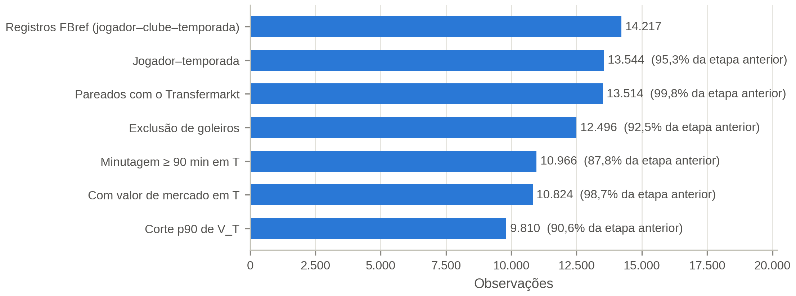

| Etapa | Observações | Atletas | Retenção |
|---|---|---|---|
| Registros FBref (jogador–clube–temporada) | 14.217 | 5.483 | — |
| Jogador–temporada | 13.544 | 5.483 | 95,3% |
| Pareados com o Transfermarkt | 13.514 | 5.462 | 99,8% |
| Exclusão de goleiros | 12.496 | 5.049 | 92,5% |
| Minutagem ≥ 90 min em $T$ | 10.966 | 4.248 | 87,8% |
| Com $V_T$ observado | 10.824 | 4.180 | 98,7% |
| **Corte $p_{90}$ de $V_T$** | **9.810** | **4.084** | 90,6% |

**O que está no gráfico.** Cada barra é uma etapa de filtragem, aplicada em sequência de cima para
baixo. O comprimento é o número de observações que sobrevivem até ali. O percentual ao lado é a
retenção **em relação à barra imediatamente anterior**, e não em relação ao total.

**Como ler.** A primeira barra conta linhas jogador–**clube**–temporada (um atleta que trocou de
clube no meio da temporada aparece duas vezes). Da segunda barra em diante, a unidade é
jogador–temporada. Quanto menor o percentual de retenção, mais o filtro cortou.

**O que mostra.** O filtro que mais remove é o de minutagem (−12,2%), seguido do corte $p_{90}$
(−9,4%) e da exclusão de goleiros (−7,5%). O pareamento com o Transfermarkt quase não perde nada
(99,8%), o que indica que a resolução de entidades do notebook 01 funcionou.

**Implicação.** A amostra final fica próxima da projeção da especificação (10.350 observações;
4.217 atletas). As estimativas intermediárias da especificação ($N_0 \approx 21.200$) pressupunham o
elenco inscrito inteiro. Aqui o universo parte do FBref, que só lista quem entrou em campo, e por
isso começa menor. Das 142 observações sem $V_T$, 70 são de atletas da correspondência manual ainda
sem coleta (bloqueio do Transfermarkt).

## 3. O corte do percentil 90

### Figura 2 — Distribuição de $V_T$ e limiar

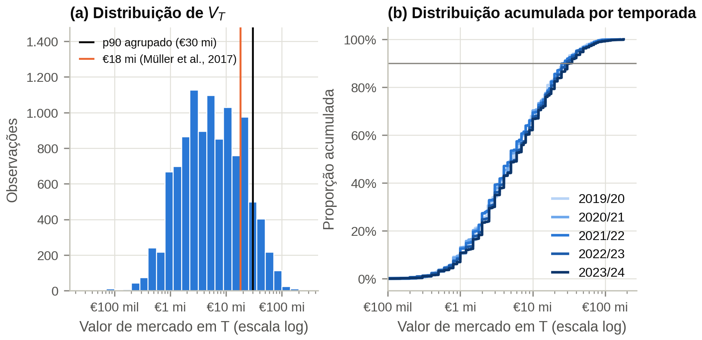

**O que está no gráfico.** A população é a de **antes** do corte (jogadores de linha com ≥ 90 min e
$V_T$ observado, 10.824 observações), porque o objetivo é ver onde o corte cai.
- **(a)** Histograma de $V_T$ com eixo horizontal em escala log. A linha preta é o $p_{90}$ agrupado
  (€ 30 mi) e a laranja, os € 18 mi de Müller et al. (2017).
- **(b)** Distribuição acumulada de $V_T$, uma curva por temporada. A linha horizontal cinza marca
  90%.

**Como ler (a).** A altura da barra é quantos atletas têm valor naquela faixa. O formato de sino
**em escala log** é a assinatura de uma distribuição log-normal. As barras alternam alturas
("pente") porque o Transfermarkt publica valores redondos (€ 1 mi, € 1,5 mi, € 2 mi, € 5 mi...), que
caem desigualmente nas classes. Tudo à direita da linha preta é excluído; tudo à direita da laranja
seria excluído com o limiar de € 18 mi.

**Como ler (b).** Escolha um valor no eixo horizontal e suba até a curva: a altura é a fração de
atletas que vale **até** aquele valor. Por exemplo, a curva passa por cerca de 50% em € 5 mi: metade
dos atletas vale € 5 mi ou menos. O ponto em que cada curva cruza a linha de 90% é o $p_{90}$ daquela
temporada. As curvas são em degraus pelo mesmo motivo do "pente" em (a).

**O que mostra.**
- **Forma da distribuição.** $V_T$ é aproximadamente **log-normal**: a assimetria é 3,39 em nível
  e −0,03 em $\log_{10}$, o que justifica o uso de $\log V_T$.
- **Limiar.** O $p_{90}$ efetivo é de **€ 27–32 milhões** por temporada (€ 30 mi agrupado), e não os
  € 18 mi de Müller et al. (2017). Na amostra, € 18 mi corresponde ao percentil 81 (18,7% das
  observações ficam acima). A diferença reflete o universo de referência (transações até 2016 em
  Müller et al.; estoque de atletas avaliados em 2020–2024 aqui) e a inflação do mercado.
- **Estabilidade.** As cinco curvas de (b) são quase sobrepostas. Há apenas um leve deslocamento
  para a direita em 2023/24 (mediana de € 5 mi → € 6 mi; $p_{90}$ de € 27 mi → € 32 mi). Por isso o
  limiar por temporada e o limiar único produzem amostras quase idênticas (9.810 contra 9.851).

**Implicação.** Os € 18 mi devem ser apresentados como referência histórica; o $p_{90}$ por temporada
é a regra operacional. A log-normalidade justifica usar $\log V_T$ como *feature*.

### Figura 3 — $p_{90}$ por liga e temporada

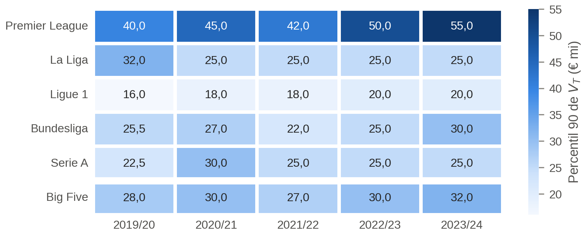

**O que está no gráfico.** Cada célula é o percentil 90 de $V_T$ calculado **dentro** de uma liga e
temporada, em € milhões. Quanto mais escura, maior o limiar. A última linha (Big Five), separada por
uma faixa branca, é o limiar **efetivamente aplicado** na amostra.

**Como ler.** Compare cada célula com a célula da linha Big Five na mesma coluna. Se a liga tem
$p_{90}$ interno **acima** do limiar aplicado, mais de 10% dos seus atletas ficam acima do corte e
são excluídos. Se tem $p_{90}$ **abaixo**, menos de 10% são excluídos.

**O que mostra.** A Premier League está acima do limiar em todas as temporadas (€ 40–55 mi contra
€ 27–32 mi), e a distância cresce com o tempo. A Ligue 1 está sempre abaixo (€ 16–20 mi). As outras
três ligas ficam próximas do limiar.

### Figura 4 — Perfil dos excluídos

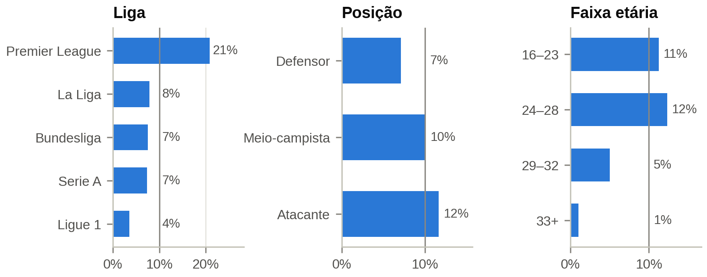

**O que está no gráfico.** Cada barra é o percentual das observações de um grupo (liga, posição ou
faixa etária) que fica **acima** do $p_{90}$ e, portanto, é excluído. A linha vertical cinza marca 10%,
o percentual que cada grupo perderia se o corte atingisse todos igualmente.

**Como ler.** Barra além da linha = grupo **sobre-excluído** (perde mais que a média). Barra aquém
da linha = grupo protegido pelo corte. A exclusão global é 9,4%, e não exatamente 10%, porque a regra
mantém $V_T \le p_{90}$ e muitos atletas têm valor exatamente igual ao limiar redondo.

**O que mostra.** **O corte não é neutro.** Por liga, ele exclui **21% da Premier League** e 4% da
Ligue 1. Por posição e idade, exclui mais os atacantes (12%) e os atletas de até 28 anos (11–12%) do
que os de 33+ (1%), simplesmente porque veteranos raramente valem mais de € 30 mi. Isso é coerente
com a motivação do corte: os prêmios de *branding* se concentram em atacantes jovens de clubes ricos.

**Implicação.** A Premier League fica sub-representada na amostra final (17,2%). Os excluídos
também se valorizam um pouco mais (31,6% contra 27,6% dos mantidos; mediana de $\Delta V\%_{T+1}$ de
−11% contra −20%), de modo que o corte retira um grupo levemente mais "valorizável". A tabela de
sensibilidade mostra que um corte por liga e temporada restauraria a participação inglesa:

| Cenário de corte | Limiar | Observações | % da Premier League na amostra |
|---|---|---|---|
| **$p_{90}$ por temporada (adotado)** | € 27–32 mi | 9.810 | 17,2% |
| $p_{90}$ único | € 30 mi | 9.851 | 17,2% |
| € 18 mi fixo | € 18 mi | 8.799 | 14,9% |
| $p_{90}$ por liga e temporada | € 16–55 mi | 9.865 | 19,7% |

## 4. Minutagem mínima

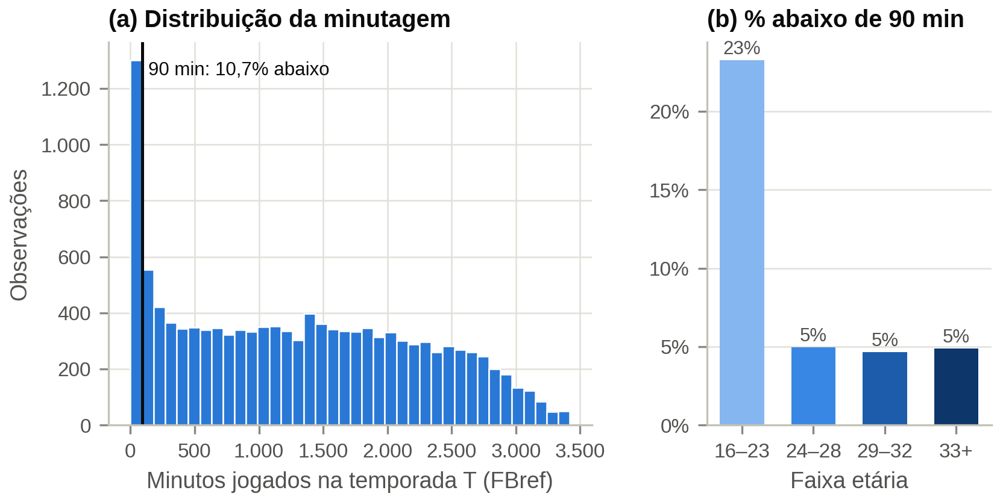

**O que está no gráfico.** A população é a de jogadores de linha com $V_T$, **antes** do filtro de
minutos.
- **(a)** Histograma dos minutos jogados em $T$, em classes de 90 minutos (o equivalente a uma
  partida inteira). A linha preta marca o limiar de 90 min; a primeira barra é exatamente o grupo
  removido.
- **(b)** Percentual de cada faixa etária abaixo de 90 min.

**Por que o filtro existe.** As métricas são padronizadas por 90 minutos ($\text{contagem} /
(\text{minutos}/90)$). Com poucos minutos, um único evento explode a taxa: um atleta com 30 minutos e
um gol registra 3 gols/90, o que é ruído e não talento.

**Como ler (a).** O pico isolado na primeira barra (≈ 1.300 observações) são atletas que mal
entraram em campo. Depois dele, a distribuição forma um **platô** quase plano até cerca de 2.500
minutos e cai depois de ~2.700, porque poucos atletas jogam todas as rodadas. O teto físico de uma
temporada é de 3.060 a 3.420 minutos (34 ou 38 rodadas × 90).

**O que mostra.** Entre os jogadores de linha com $V_T$, **10,7% têm menos de 90 minutos**. A
remoção atinge sobretudo os 16–23 anos (23% da faixa, contra cerca de 5% nas demais) e, por posição,
mais atacantes (14,6%) do que defensores (6,9%). Como o limiar cai antes do platô, ele não corta
nenhuma concentração natural: funciona como um piso técnico, e não como critério substantivo de
seleção.

**Implicação.** O filtro **seleciona jovens já integrados ao elenco**, e não o universo dos jovens
com potencial. As conclusões sobre C1–C3 devem ser lidas como "jovens com minutagem na elite", uma
limitação de generalização. O piso de 90 min elimina só o caso extremo: atletas com 90–500 minutos
continuam com taxas por 90 ruidosas, e por isso a minutagem entra também como *feature* (Seção 8),
para que o modelo possa ponderar essas taxas.

## 5. Valores ausentes

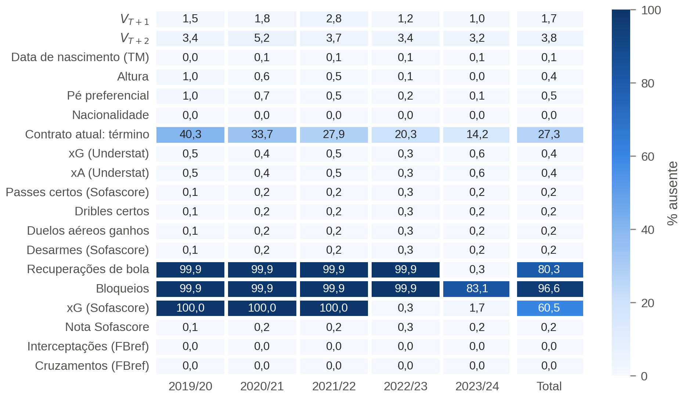

**O que está no gráfico.** Mapa de calor sobre a amostra analítica final. Cada linha é uma
variável, cada coluna uma temporada (a última, separada, é o total). O número é o percentual de
valores ausentes; quanto mais escuro, mais falta.

**Como ler.** O padrão importa mais do que o número:
- **linha clara inteira** = ausência baixa e espalhada (pareamento falho ou atleta sem dado),
  tratável;
- **linha escura só em algumas colunas** = ausência **estrutural**: a fonte não publicava aquela
  métrica naquela temporada;
- **gradiente ao longo das colunas** = ausência que depende do tempo.

**O que mostra.**
- **Atributos demográficos e métricas centrais:** menos de 1% de ausência.
- **Ausência estrutural no Sofascore:** xG/xA só existe a partir de 2022/23 e recuperações só em
  2023/24; os bloqueios faltam em 83% das observações mesmo em 2023/24. Essas variáveis foram
  **descartadas**: imputá-las criaria um sinal artificial de temporada (o modelo aprenderia que
  "valor imputado" significa "temporada antiga"). O xG/xA usado vem do Understat, que cobre as cinco
  temporadas.
- **Contrato atual:** 27,3% de ausência, com gradiente de 40% em 2019/20 a 14% em 2023/24. O
  Transfermarkt só mostra o contrato vigente **hoje**. Quanto mais antiga a temporada, mais atletas já
  se aposentaram ou estão sem clube e, portanto, não têm contrato atual. O notebook 03 reconstrói o
  contrato em $T$.
- **Alvos:** $V_{T+1}$ e $V_{T+2}$ faltam em 1,7% e 3,8% das observações. A figura mostra a média,
  mas a ausência se concentra por idade (tabela abaixo).

| Faixa etária | Sem $V_{T+1}$ | Sem $V_{T+2}$ |
|---|---|---|
| 16–23 | 0,3% | 0,5% |
| 24–28 | 0,5% | 0,9% |
| 29–32 | 1,7% | 3,9% |
| 33+ | **9,7%** | **24,0%** |

**Implicação.** A ausência do alvo é **informativa**: o veterano some porque se aposentou ou foi
para uma liga sem avaliação, e esses são justamente os casos de maior depreciação. Isso gera **viés
de sobrevivência**: a depreciação observada em C10–C12 é a dos que continuaram sendo avaliados e
provavelmente **subestima** a real. As linhas sem alvo são excluídas, sem imputação, e a limitação é
reportada.

## 6. Matriz de 12 categorias

### Figura 7 — Tamanho das categorias

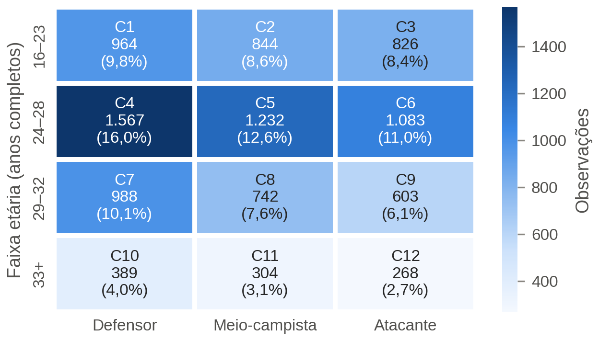

**O que está no gráfico.** Linhas = faixas etárias, colunas = posições. Cada célula traz o código da
categoria, o número de observações e o percentual da amostra. A cor acompanha o tamanho.

**O que mostra.** Todas as células têm tamanho suficiente, mas há forte desbalanceamento:
- **C4 (DEF 24–28):** 1.567 observações (16,0%);
- **C12 (ATA 33+):** 268 observações (2,7%);
- **veteranos (C10–C12):** 9,8% da amostra no total.

**Por que o desbalanceamento.** Duas causas. (i) Por posição, há mais defensores (39,8% da amostra)
do que meio-campistas (31,8%) e atacantes (28,3%), porque as formações usam mais defensores. (ii) Por
idade, a faixa 24–28 cobre o miolo mais denso da distribuição (Figura 8), enquanto poucos atletas
seguem na elite depois dos 33.

**Implicação.** Na janela expandida, a primeira dobra treina com uma única temporada: C12 teria
cerca de 40 observações de treino. Isso pede um mínimo de observações por dobra e a comparação com
um modelo global que recebe faixa e posição como *features*.

### Figura 8 — Idade por posição

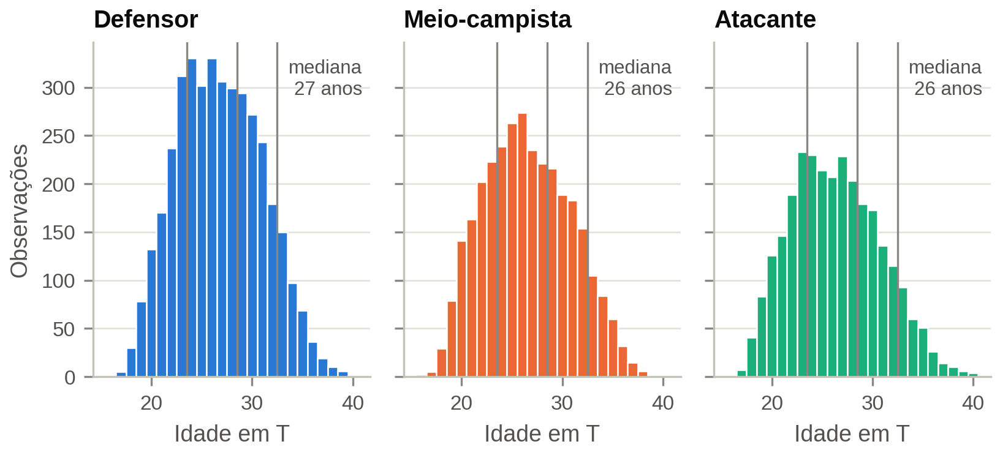

**O que está no gráfico.** Um histograma de idade (classes de 1 ano) por posição. As três linhas
verticais são os limites das faixas (entre 23 e 24, 28 e 29, 32 e 33 anos).

**Como ler.** A área entre duas linhas é o tamanho da faixa naquela posição. Note que as linhas
caem em regiões altas do histograma.

**O que mostra.** As idades medianas são 27 anos (DEF) e 26 anos (MEI e ATA). As distribuições são
parecidas entre posições, com cauda à direita até ~40 anos. Como os limites das faixas cortam regiões
densas, mover a data de referência da idade em poucos meses mudaria a faixa de muitos atletas.

**Implicação.** A convenção de idade (anos completos em 30/jun de $T$, mesma âncora de $V_T$) precisa
constar no texto, porque a classificação nas categorias é sensível a ela.

*Nota sobre as especificações.* A numeração C1–C12 segue as Tabelas 5.2 e 6.2. A Tabela 3.1 da
Metodologia numera por coluna e precisa ser uniformizada no artigo.

## 7. Variáveis-alvo

### Figura 9 — Forma da distribuição do alvo

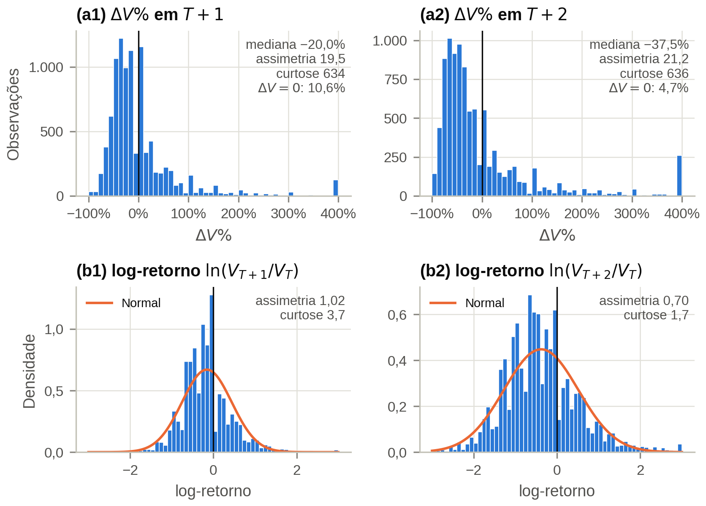

**O que está no gráfico.**
- **Linha de cima (a1, a2):** histogramas de $\Delta V\%$ em $T+1$ e $T+2$, em classes de 10 pontos
  percentuais. O eixo começa em −100% (não é possível perder mais que todo o valor). **A barra em 400%
  não é um pico real**: ela acumula todos os atletas que valorizaram 400% ou mais, para o eixo caber
  na figura.
- **Linha de baixo (b1, b2):** histogramas do log-retorno $\ln(V_{T+k}/V_T)$, em densidade, com uma
  curva Normal (laranja) de mesma média e desvio-padrão para comparação. Valores além de ±3 (×20 ou
  ÷20) foram acumulados nas pontas.

**Por que $\Delta V\%$ é assimétrico por construção.** A queda máxima é −100%, mas a alta não tem
teto. Movimentos equivalentes viram números desiguais: cair à metade é −50%, dobrar é +100%. O
log-retorno corrige isso: cair à metade é −0,69, dobrar é +0,69. A conversão é $\Delta V\% = e^{r} -
1$; por exemplo, $r = -0{,}22 \Rightarrow -20\%$ e $r = -0{,}47 \Rightarrow -37{,}5\%$.

**Como ler (a).** A maior parte da massa está entre −60% e 0%; a cauda direita é longa e fina. Os
picos isolados em 0%, +25%, +50%, +100%, +200% e +300% aparecem porque o Transfermarkt revisa em
degraus redondos (€ 2 mi → € 4 mi é exatamente +100%). A barra em 0% são os atletas cujo valor não
mudou.

**Como ler (b).** Quanto mais o histograma azul se parecer com a curva laranja, mais "bem-comportado"
é o alvo. O histograma é um pouco mais pontudo que a Normal (curtose em excesso de 3,7 em $T+1$),
mas aproximadamente simétrico.

| | $\Delta V\%$ $T+1$ | $\Delta V\%$ $T+2$ | log-retorno $T+1$ | log-retorno $T+2$ |
|---|---|---|---|---|
| Mediana | −20,0% | −37,5% | −0,22 | −0,47 |
| Média | +8,9% | +17,1% | −0,16 | −0,38 |
| Assimetria | 19,5 | 21,2 | 1,02 | 0,70 |
| Curtose (excesso) | 634 | 636 | 3,7 | 1,7 |
| Variação nula | 10,6% | 4,7% | — | — |

**O que mostra.** $\Delta V\%$ é extremamente assimétrico, e **média e mediana têm sinais opostos**:
o atleta típico perde 20% do valor em um ano, mas a média é positiva porque 6,7% dos atletas mais
que dobram de valor e puxam a média para cima. A curtose de 634 (a Normal tem 0) indica que poucos
valores extremos dominam a variância.

**Implicação.** Com perda quadrática (MSE), o modelo treinado em $\Delta V\%$ gastaria seu esforço
tentando acertar os poucos casos de +400%. Por isso o **log-retorno** foi adotado como **alvo de
treino**, e as previsões são reconvertidas para $\Delta V\%$. Como a transformação é monotônica, a
mediana se preserva exatamente na reconversão ($e^{-0{,}22} - 1 = -20\%$); a média, não.

### Figura 10 — Direção da variação por temporada

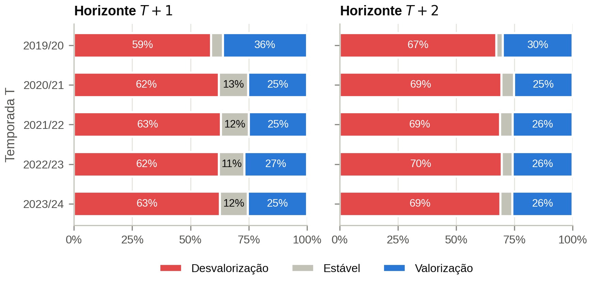

**O que está no gráfico.** Uma barra empilhada por temporada de referência $T$, somando 100%:
vermelho = perdeu valor, cinza = valor idêntico, azul = ganhou valor. Esquerda: até $T+1$; direita:
até $T+2$. Percentuais abaixo de 8% não são rotulados. Para $T$ = 2023/24, o $V_{T+2}$ é o valor de
30/06/2026.

**O que mostra.**
- **Desvalorização típica.** De 2020/21 em diante, 62–63% dos atletas perdem valor até $T+1$
  (59% em 2019/20) e cerca de 11–13% ficam estáveis. Em $T+2$, a desvalorização sobe a 67–70%, e os
  estáveis caem a ~5%, porque em dois anos quase todo valor é revisado.
- **Por que tanta desvalorização?** A idade mediana da amostra é 26–27 anos, e a Figura 12 mostra
  que a variação mediana fica negativa a partir de 22–24 anos: a maior parte da amostra já passou do
  ponto em que o mercado valoriza. Uma hipótese complementar é a regressão à média: todos estão na
  amostra porque jogaram na elite em $T$, e parte deles não sustenta esse nível.
- **Exceção da pandemia.** Em 2019/20, 36% se valorizam e só 5% ficam estáveis: o $V_T$ foi medido
  logo após a revisão geral para baixo de abril de 2020 (Figura 14), e a variação seguinte inclui a
  recuperação.

**Implicação.** Esta é a **taxa-base** do problema de negócio: escolhendo atletas ao acaso, apenas
~1 em cada 4 se valoriza em um ano. Um modelo útil para *buy-low/sell-high* precisa identificar
valorizações com frequência claramente superior a 25%. A anomalia de 2019/20 recomenda **efeitos de
temporada** nos modelos.

### Figura 11 — Alvo por categoria

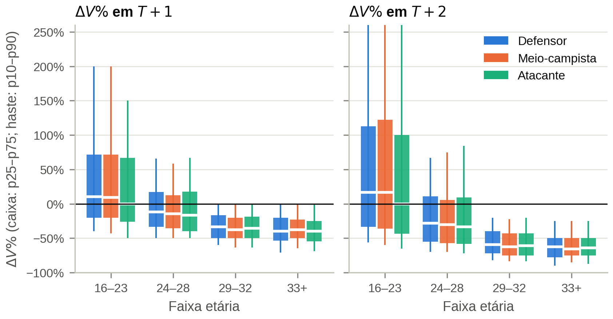

**O que está no gráfico.** Um resumo da distribuição de $\Delta V\%$ para cada uma das 12 categorias
(faixa no eixo horizontal, posição pela cor). **Não é um boxplot padrão:**
- **caixa** = do percentil 25 ao 75 (a metade central dos atletas);
- **linha branca** = mediana;
- **haste** = do percentil 10 ao 90 (os 80% centrais).

O eixo vertical foi cortado em [−100%, 260%]; em $T+2$, as hastes dos 16–23 anos passam do limite
(o p90 chega a +289% a +369%).

**Como ler.**
- Caixa que **atravessa** a linha do zero: a direção é incerta (há muitos casos dos dois lados).
- Caixa **inteira abaixo** do zero: ao menos 75% da categoria desvaloriza.
- Topo da haste **no zero**: ao menos 90% da categoria não se valoriza.
- **Altura** da caixa e da haste: dispersão, ou seja, quão imprevisível é a categoria.

Exemplo: em C1 (DEF 16–23), $T+1$, a caixa vai de −20% a +71% com mediana +10%, e 52% se valorizam.
Em C7 (DEF 29–32), a caixa vai de −50% a −17% e o p90 é 0%: só 7,5% se valorizam.

**O que mostra.**
- **A idade é o eixo dominante.** As caixas descem degrau a degrau entre faixas etárias, mas, dentro
  da mesma faixa, as três posições são quase iguais.
- Só as faixas de 16–23 anos têm mediana positiva (cerca de +10% em $T+1$ para DEF e MEI; 0% para
  ATA), com 45–52% de valorizações.
- Nas de 29 anos ou mais, menos de 8% se valorizam, e a mediana fica entre −33% e −40% ao ano.
- A dispersão é muito maior nos jovens: em C2 (MEI 16–23), a média é +87% contra mediana de +9%.

**Implicação.**
- **Modelagem:** a segmentação por idade se justifica. Os maiores erros absolutos de previsão vão
  ocorrer em C1–C3, então métricas por categoria precisam ser comparadas levando em conta essa
  dispersão.
- **Negócio:** o potencial de valorização está nos jovens, mas com risco real (p10 de −40% a −50%):
  é uma aposta de alta variância, que é exatamente onde um modelo agrega valor. Para atletas de 29+,
  nem o p90 é positivo, então comprá-los para revenda quase nunca funciona; seu valor é esportivo,
  não de *trading*.

### Figura 12 — Curva de idade

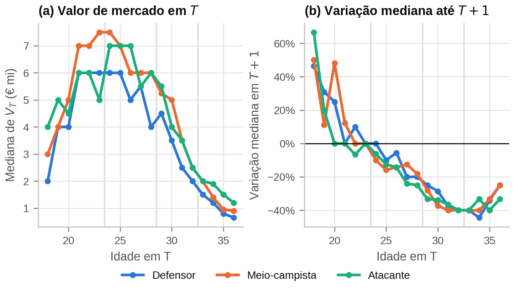

**O que está no gráfico.** Uma linha por posição; cada ponto é uma idade com pelo menos 25
observações (idades extremas agregadas em 17 e 36). As faixas verticais claras são os limites das
faixas etárias.
- **(a)** Mediana de $V_T$ (€ mi) em cada idade.
- **(b)** Variação mediana até $T+1$, calculada como $e^{\text{mediana do log-retorno}} - 1$.

**Cuidado de leitura.** É um **corte transversal**: o ponto dos 30 anos não é o mesmo jogador dos
20 anos dez anos depois, mas outro grupo de atletas. Além disso, (a) já está depois do corte $p_{90}$,
o que achata o pico (os mais caros, sobretudo atletas de até 28 anos, saíram). Os valores em degraus (5, 6,
7) refletem os valores redondos do Transfermarkt.

**Como ler (a) com (b).** (b) diz se o valor está subindo ou caindo naquela idade; (a) mostra o
nível. O pico de (a) deve coincidir com o ponto em que (b) cruza o zero, e é o que se observa.

**O que mostra.**
- **(a)** O valor mediano tem forma de **U invertido**, com pico entre 23 e 26 anos (nos defensores, um
  platô já a partir dos 21) e queda acentuada depois dos 29.
- **(b)** A variação cai quase continuamente com a idade: de +46% a +67% aos 18 anos para zero por
  volta dos 22–24 e cerca de −40% entre 31 e 34. A leve subida aos 35–36 é provavelmente efeito de
  sobrevivência (quem ainda é avaliado aos 36 é exceção) e de amostras pequenas.

**Implicação.** O U invertido em (a) é a justificativa empírica para incluir **idade e idade²**: uma
função quadrática é a forma mais simples de U invertido. A queda e o achatamento em (b) sustentam a
separação das faixas 29–32 e 33+.

## 8. Associação entre desempenho e valorização

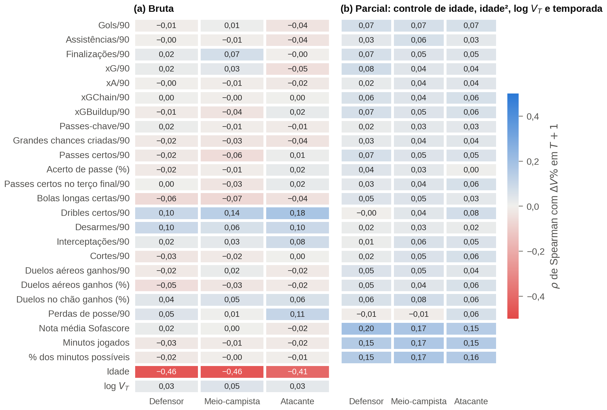

**O que está no gráfico.** Dois mapas de calor com o $\rho$ de Spearman entre cada métrica de
desempenho em $T$ (linhas) e $\Delta V\%_{T+1}$, calculado separadamente por posição (colunas). Azul =
associação positiva, vermelho = negativa, branco = nenhuma. A escala vai de −0,5 a +0,5.
- **(a) Bruta:** correlação direta, sem controles.
- **(b) Parcial:** antes de correlacionar, remove-se das duas variáveis a parte explicada por idade,
  idade², $\log V_T$ e temporada. Na prática, a pergunta passa a ser: *entre atletas da mesma idade,
  do mesmo nível de preço e da mesma temporada, quem tem a métrica mais alta valoriza mais?*

Como o Spearman usa só a ordem dos valores, ele dá o mesmo resultado para $\Delta V\%$ e para o
log-retorno, e não é distorcido pelos casos de +400%.

**Como ler a magnitude.** Com ~2.700–3.900 observações por posição, valores acima de cerca de
$2/\sqrt{n} \approx 0{,}04$ são distinguíveis de zero. Mas são 75 correlações testadas, então um 0,04
isolado pode ser acaso; um padrão consistente nas três posições é mais convincente. Em termos de
força, $\rho = 0{,}20$ ainda é uma associação fraca ($\rho^2 = 4\%$ da variação dos postos).

**O que mostra.**
- **Sem controles,** as métricas de desempenho praticamente não se associam a $\Delta V\%_{T+1}$
  ($|\rho| \le 0{,}10$), enquanto a idade tem $\rho \approx -0{,}45$.
- **Controlando idade, idade², $\log V_T$ e temporada** (Spearman parcial), surge um sinal positivo
  consistente:
  - **nota do Sofascore:** 0,15–0,20;
  - **minutagem:** 0,15–0,17;
  - **métricas ofensivas e de construção:** 0,04–0,08.

**Por que o sinal "aparece" só no painel (b).** A idade age como **confundidor** em sentidos opostos.
Atletas mais velhos jogam mais minutos e têm notas melhores, mas desvalorizam pela idade; jovens
jogam menos, mas valorizam. Na correlação bruta, os dois efeitos se cancelam e a minutagem parece
irrelevante (−0,01 a −0,03). Com a idade controlada, aparece o efeito real: no mesmo grupo etário, quem joga
mais valoriza mais (+0,15 a +0,17). O caminho inverso acontece com dribles certos/90: a correlação
bruta positiva (0,10–0,18) some para defensores no painel (b) (−0,00), porque driblar é, em boa parte,
um traço de jogador jovem.

**Implicação.** Condicionado à idade e ao preço, o mercado premia sobretudo **titularidade** e
**desempenho agregado**, mais do que qualquer métrica tática isolada. Três consequências:
1. idade e $\log V_T$ precisam estar no modelo, ou o sinal de desempenho fica mascarado;
2. a minutagem, que a especificação trata como filtro, também é uma *feature* informativa;
3. com efeitos bivariados modestos, o ganho preditivo deve vir de **interações** (desempenho × idade
   × posição), que os modelos de árvore capturam e o SHAP decompõe no notebook 05.

A análise é exploratória e orienta a engenharia de *features*; não estabelece causalidade.

## 9. Defasagem das avaliações

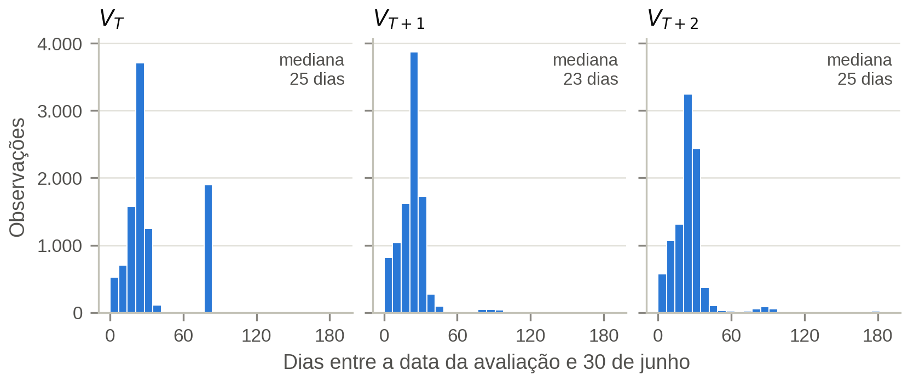

**O que está no gráfico.** Para cada valor usado ($V_T$, $V_{T+1}$, $V_{T+2}$), o número de dias entre
a data da avaliação do Transfermarkt e a data-âncora de 30/jun, em classes de 7 dias. A regra aceita
no máximo 183 dias.

**Como ler.** Barras perto de zero = valor atualizado. O pico em ~20–30 dias corresponde à revisão
de fim de temporada que o Transfermarkt publica no início de junho.

**O que mostra.** A mediana da defasagem é de 23–25 dias, e 75% das avaliações têm no máximo cerca
de 30 dias. A exceção é o pico isolado em ~83 dias no painel $V_T$: **99% dos $V_T$ de 2019/20 datam
de 08/04/2020**, a revisão extraordinária do Transfermarkt na pandemia, sem atualização até a âncora.

**Implicação.** Na prática, "valor em 30/jun" significa "valor da revisão de início de junho". Como a
defasagem é a mesma nos três horizontes, $\Delta V$ mede variações de ~12 e ~24 meses de forma
consistente. A exceção é 2019/20, cujo intervalo até $T+1$ é de ~14 meses e parte de um valor
deprimido pela pandemia. Isso explica a anomalia da Figura 10 e deve constar nas limitações.

## 10. Perguntas prováveis da banca

**Por que cortar no $p_{90}$ e não nos € 18 mi da literatura?** Porque € 18 mi corresponde ao
percentil 81 na amostra atual (inflação e universo diferente de Müller et al.). O objetivo do corte é
excluir as superestrelas, e o $p_{90}$ por temporada faz isso de forma estável no tempo (Figura 2b).

**O corte não enviesa a amostra?** Sim, e isso é reportado: exclui 21% da Premier League e
sobretudo atacantes jovens (Figura 4). O corte por liga e temporada fica como teste de robustez.

**Por que modelar o log-retorno se o objetivo é $\Delta V\%$?** Porque $\Delta V\%$ tem assimetria de
19,5 e curtose de 634: com perda quadrática, poucos casos extremos dominariam o ajuste. O
log-retorno é uma transformação monotônica, então as previsões são reconvertidas sem perda
($\Delta V\% = e^{\hat r} - 1$).

**Por que a média de $\Delta V\%$ é positiva se a maioria desvaloriza?** Porque a cauda direita é
ilimitada: 6,7% dos atletas mais que dobram de valor e puxam a média. A mediana (−20%) descreve o
atleta típico.

**Se o desempenho quase não se correlaciona com a valorização, para que usá-lo?** A correlação
bruta é mascarada pela idade. Controlando idade, preço e temporada, nota e minutagem têm $\rho$ de
0,15–0,20 de forma consistente nas três posições (Figura 13b).

**Os resultados dos veteranos são confiáveis?** São otimistas: até 24% dos atletas de 33+ não têm
$V_{T+2}$, e quem some é quem mais se depreciou (viés de sobrevivência). Além disso, C12 tem só 268
observações.

**Por que 2019/20 é diferente?** O $V_T$ dessa temporada é a revisão de abril de 2020, deprimida
pela pandemia (Figura 14); a variação seguinte inclui a recuperação (Figura 10).

**O filtro de 90 minutos não exclui justamente os jovens promissores?** Exclui 23% dos 16–23 anos.
Os resultados para C1–C3 valem para jovens com minutagem na elite, o que é registrado como limitação
de generalização.

## 11. Conclusões para o artigo

1. Os filtros reproduzem as ordens de grandeza da especificação, mas o limiar real do $p_{90}$ é de
   € 27–32 mi.
2. O corte é assimétrico entre ligas. O corte por liga e temporada fica como teste de robustez.
3. O alvo de treino deve ser o log-retorno. A especificação trata $\Delta V\%$ como alvo primário,
   mas a assimetria (19,5) e a curtose (634) o tornam inadequado para perda quadrática.
4. A idade é o eixo dominante da variação de valor (Figuras 11 e 12), e o sinal de desempenho só
   aparece condicionado a ela (Figura 13).
5. Há viés de sobrevivência nas categorias de veteranos, um efeito de regime em 2019/20 e
   variáveis do Sofascore sem cobertura histórica, que foram descartadas.
