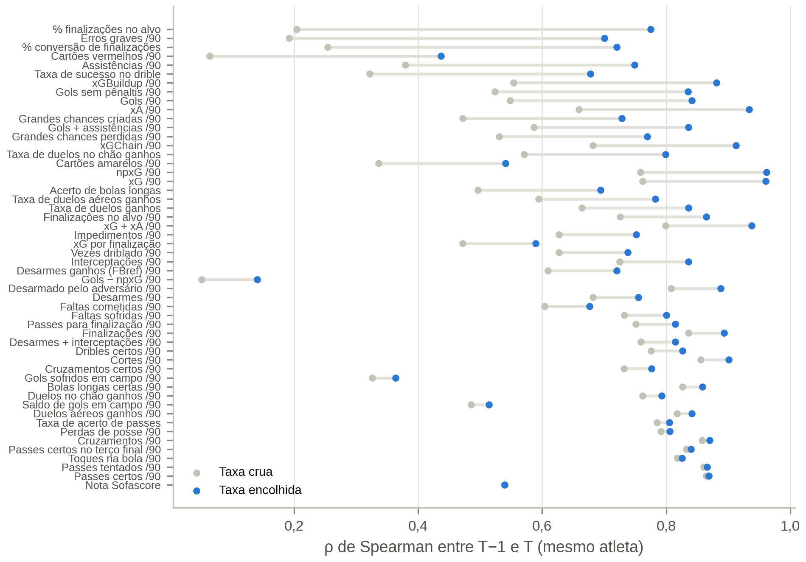

# 03 — Pré-processamento, Engenharia de *Features* e Estrutura de Painel

**Notebook:** `notebooks/03_preprocessing.ipynb` ·
**Código:** `src/football_analytics/{features,contracts,club_context,feature_catalog,validation}.py`
**Saídas:** `data/processed/train_test_lags.parquet` (painel), `data/processed/feature_sets.json`,
figuras em `figures/03_preprocessing/` e tabelas em `tables/03_preprocessing/`
(inclui o dicionário completo de variáveis, `tab12_dicionario_variaveis.csv`)

[← Índice](README.md)

## 1. Princípios

- **Unidade:** jogador–temporada $T$, com o vetor explicativo medido até 30/06 de $T$ e os alvos em
  $T+1$ e $T+2$.
- **Não antecipação.** Toda *feature* usa só informação disponível na data-âncora de $T$. Variáveis cuja
  construção depende de eventos posteriores ficam no painel como **auditoria** ou **sensibilidade**
  (`lookahead`), fora do vetor principal.
- **Teste pré-registrado.** Os alvos de $T+1$ de 2024/25 ficam ocultos em todos os diagnósticos deste
  notebook (`sample.mask_holdout_targets`).
- **Imputação e escalonamento** são ajustados dentro de cada dobra, no notebook 04.
- **Regra de cobertura.** Uma variável cuja fonte esteja incompleta (cobertura < 90%) em alguma
  temporada sai do vetor, para não criar um padrão de ausência próprio de uma temporada
  (`feature_catalog.OPTIONAL_FEATURES`).

## 2. Painel resultante

- **Dimensões:** 13.748 linhas × 198 colunas, de 5.007 atletas (2018/19 a 2024/25).
- **Variáveis:** 108 *features* numéricas, 7 categóricas (inclui a faixa e a categoria da matriz
  3 × 3 de Khalife, usadas só no teste da H2), 2 de sensibilidade e 6 alvos.
- **Fora do vetor pela regra de cobertura:** Elo e variação do Elo (0%, API do ClubElo fora do ar);
  tempo de casa e empréstimo em $T$ (80% em 2024/25, histórico de transferências não coletado por
  bloqueio do Transfermarkt).

| Grupo | Nº | Exemplos |
|---|---|---|
| Demográfico | 12 | idade (decimal), idade², altura, pé, confederação, passaporte da UE, atleta nacional |
| Mercado | 5 | $\log V_T$, valor do elenco, % do valor do elenco, *ranking* do elenco |
| Contexto | 8 | pontos/jogo da equipe, regime de mercado, **posição final, saldo por jogo, promovido, rebaixado, participação europeia** |
| Dinâmica de mercado | 8 | variação em 6 meses, última revisão, revisões ↑/↓, volatilidade, distância ao pico |
| Valor justo | 2 | valor justo pelo desempenho, gap de avaliação |
| Defasagem | 15 | *momentum* T−1→T e T−2→T, desempenho em T−1, variações |
| Volume | 6 | minutos, % dos minutos possíveis, titularidade |
| Ofensivo / Criação e posse / Defensivo / Disciplina / Nota | 16 / 18 / 14 / 3 / 1 | taxas por 90 e eficiências, **com encolhimento** |

## 3. Contrato vigente em T

O contrato em $T$ é reconstruído cruzando o perfil atual com o histórico de transferências
(`contracts.py`). Atletas sem histórico coletado ficam com método `not_collected` (tempo de casa e
empréstimo ausentes, em vez de "nenhuma transferência").

- **Cobertura:** observado em 45,8% das linhas (saída livre 40,9%; contrato atual já vigente 4,8%);
  estimado no restante; não coletado em 19,7% de 2024/25 e em menos de 1% das demais temporadas.
- **Validação da estimativa:** erro médio de **1,01 ano** (mediana global: 1,17); acerto do status
  Bosman de 61%.
- **Vazamento confirmado:** atletas "observados por saída livre" têm log-retorno mediano de −0,377 em
  $T+1$ (13% se valorizam), contra −0,105 dos "estimados por venda" (36%). Tempo restante de contrato e
  Bosman seguem com papel `lookahead`, usados só num modelo de robustez.

## 4. Mercado, contexto e regime

O **regime de mercado** (log-retorno médio aparado de todos os atletas avaliados entre T−1 e T)
substitui efeitos fixos de temporada:

| Temporada | 2018/19 | 2019/20 | 2020/21 | 2021/22 | 2022/23 | 2023/24 | 2024/25 |
|---|---|---|---|---|---|---|---|
| Regime das Big Five | +0,145 | **−0,176** | +0,033 | −0,055 | −0,040 | −0,003 | −0,035 |

O **contexto do clube** (relatório 01, §5) tem cobertura de 100% em todas as temporadas.

## 5. Desempenho por 90 minutos e multicolinearidade

Entre as 52 métricas de desempenho, **60 pares têm $|\rho| \ge 0{,}85$** (17 na versão 2): o
encolhimento aproxima as métricas de quem joga pouco da média da posição e, com isso, aumenta as
correlações entre elas. O Ridge e as árvores lidam com isso; o OLS usa um vetor compacto.

### 5.1 Encolhimento empírico-bayesiano

Com poucos minutos, uma taxa por 90 é dominada pelo acaso. Cada taxa e eficiência é encolhida para a
média da posição na temporada, com peso crescente na exposição do atleta:

| Tipo de métrica | Modelo | Estimativa a posteriori |
|---|---|---|
| Contagens por 90 | Gamma–Poisson (Clayton e Kaldor, 1987; Marshall, 1991) | $(\alpha + c)/(\beta + e)$, $e$ = minutos/90 |
| Percentuais | Beta–binomial | $(s + \kappa\bar p)/(n + \kappa)$ |
| Nota e métricas com sinal | normal–normal | $\mu + B(x - \mu)$, $B = \tau^2/(\tau^2 + \sigma^2/w)$ |

As distribuições a priori são estimadas por momentos em cada temporada × posição, com os atletas de
pelo menos 90 minutos, **sem nenhum alvo**. A nota zero do Sofascore (atleta não avaliado) é tratada
como ausente.

**Validação externa:** a correlação de postos da mesma métrica entre $T-1$ e $T$ (10.934 pares) sobe em
**50 das 52 métricas**, com ganho mediano de $\rho$ = +0,11 e nenhuma piora; os maiores ganhos estão nas
métricas raras (% de finalizações no alvo 0,20 → 0,78; erros graves 0,19 → 0,70; assistências 0,38 →
0,75). A nota do Sofascore não muda (0,54).

## 6. Defasagens, *momentum* e dinâmica de reavaliações

| Defasagem | Cobertura |
|---|---|
| $V_{T-1}$ | 96,4% |
| $V_{T-2}$ | 91,4% |
| Desempenho em T−1 | 72,5% |

Há *momentum* até os 32 anos (mediana de $T \to T+1$ cresce com o quintil da variação passada), e as
variáveis de dinâmica se associam à valorização seguinte: distância ao pico $\rho$ = 0,31 ($T+1$) e
0,34 ($T+2$); variação em 6 meses 0,28; revisões para baixo −0,25.

## 7. Valor justo e gap de avaliação

O **valor justo** (previsão de $\ln V_T$ pelo desempenho, idade, posição e contexto, por XGBoost dentro de
cada temporada, com validação cruzada) explica **78,7% da variância de $\ln V_T$** fora da dobra (75% na
v2). O **gap** é $\ln V_T$ menos o valor justo. Em todas as faixas etárias, o quintil mais subavaliado
se valoriza mais que o mais sobreavaliado (16–23 anos: +30% contra −10% na mediana de $T+1$).

## 8. Alvos e estrutura temporal

| Horizonte | Dobras | Treino (obs.) | Teste |
|---|---|---|---|
| $T+1$ | 6 | 1.849 → 11.531 | 2019/20 a 2024/25 (teste final pré-registrado: **2024/25**) |
| $T+2$ | 4, com purga de uma temporada | 1.793 → 7.430 | 2020/21 a 2023/24 (teste final: 2023/24) |

As dobras usam só temporadas com alvo observável (`config.target_seasons`), e a última de cada horizonte
é o teste final declarado (assert no notebook).

## 9. Verificações automáticas

- Toda coluna do painel tem entrada no catálogo, e vice-versa.
- Nenhum alvo, coluna de auditoria ou variável `lookahead` entra no vetor explicativo.
- Nenhuma data de avaliação usada como $V_T$ é posterior à âncora de $T$.
- Não há valores infinitos, e a chave (temporada, jogador) é única.
- O painel é gravado de forma determinística (mesmo hash em reexecuções), o que permite registrá-lo no
  protocolo.
