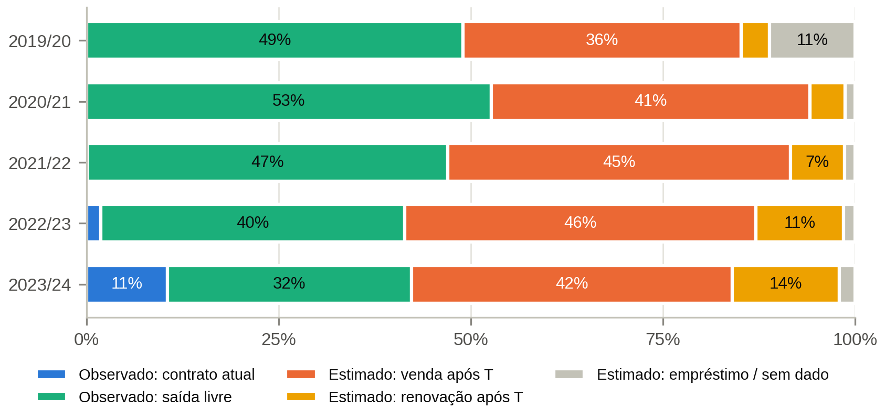
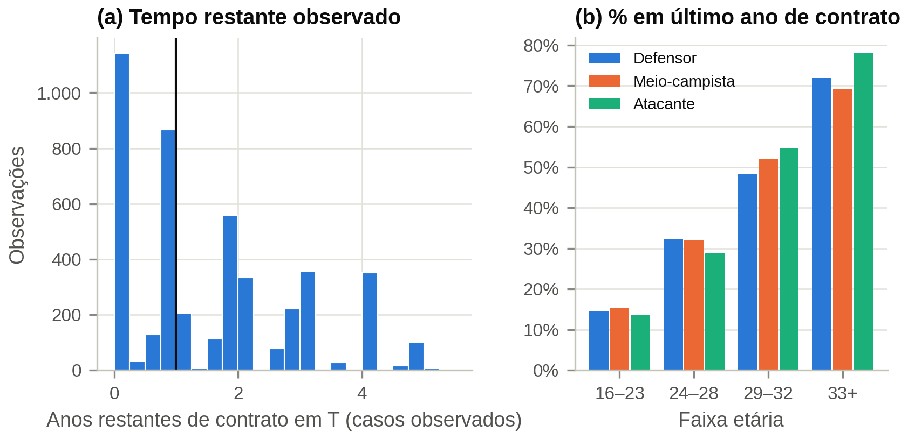
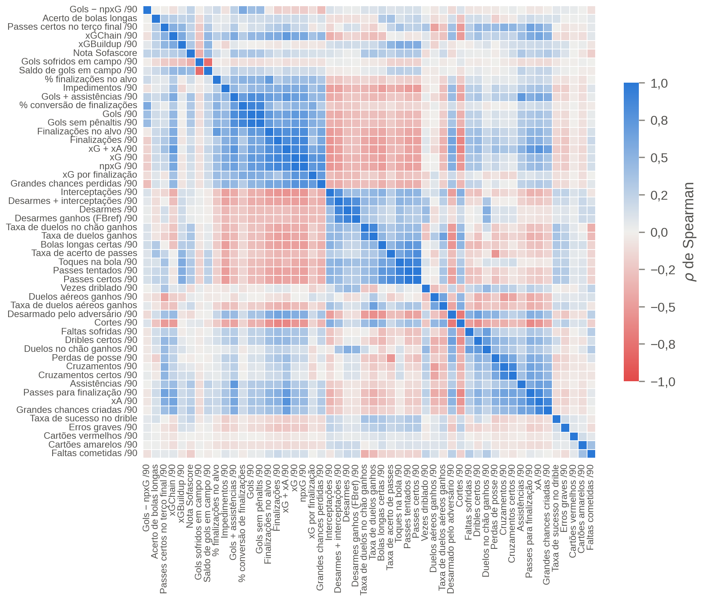
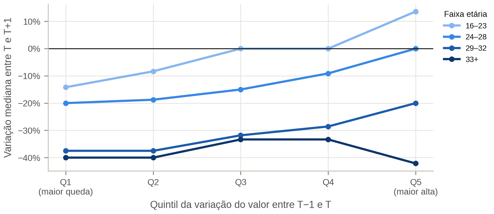
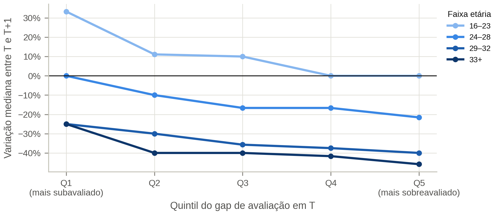
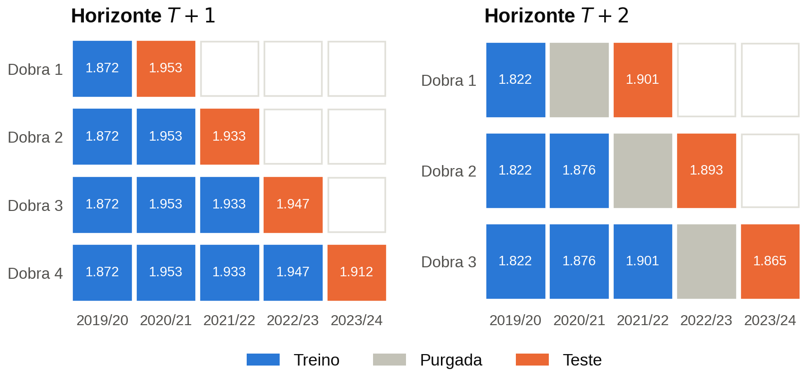
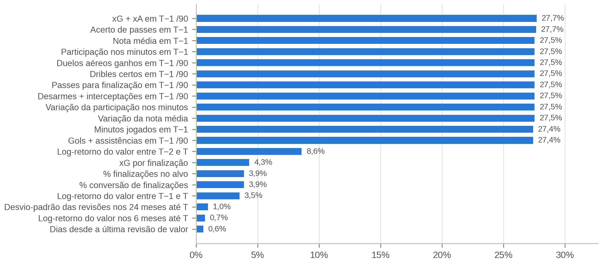

# 03 — Pré-processamento, Engenharia de *Features* e Estrutura de Painel

**Notebook:** `notebooks/03_preprocessing.ipynb` ·
**Código:** `src/football_analytics/{features,contracts,feature_catalog,validation}.py`
**Saídas:** `data/processed/train_test_lags.parquet` (painel), `data/processed/feature_sets.json`,
7 figuras em `figures/03_preprocessing/` e 15 tabelas em `tables/03_preprocessing/`
(inclui o dicionário completo de variáveis, `tab12_dicionario_variaveis.csv`)

[← Índice](README.md)

## 1. Princípios

- **Unidade:** jogador–temporada $T$, com o vetor explicativo medido até 30/06 de $T$ e os alvos em
  $T+1$ e $T+2$.
- **Não antecipação.** Toda *feature* usa só informação disponível na data-âncora de $T$. As
  variáveis cuja construção depende de eventos posteriores ficam no painel como **auditoria** ou
  **sensibilidade** (`lookahead`), fora do vetor principal.
- **Imputação e escalonamento** são ajustados dentro de cada dobra, no notebook 04, para evitar
  vazamento entre dobras.

## 2. Painel resultante

- **Dimensões:** 9.810 linhas × 135 colunas.
- **Variáveis:** 105 *features* numéricas, 5 categóricas, 2 de sensibilidade e 6 alvos.

| Grupo | Nº | Exemplos |
|---|---|---|
| Demográfico | 12 | idade, idade², altura, pé, confederação, passaporte da UE, atleta nacional |
| Contratual | 2 | tempo de casa, empréstimo em $T$ |
| Mercado | 5 | $\log V_T$, valor do elenco, % do valor do elenco, *ranking* de valor do elenco |
| Contexto | 3 | pontos/jogo da equipe, regime de mercado (Big Five e liga) |
| Dinâmica de mercado | 8 | variação em 6 meses, última revisão, revisões ↑/↓, volatilidade, distância ao pico |
| Valor justo | 2 | valor justo pelo desempenho, gap de avaliação |
| Defasagem | 15 | *momentum* T−1→T e T−2→T, desempenho em T−1, variações |
| Volume | 6 | minutos, % dos minutos possíveis, titularidade |
| Ofensivo | 16 | gols, xG, npxG, xA, finalizações, finalização acima do esperado |
| Criação e posse | 18 | passes-chave, grandes chances, passes, terço final, dribles |
| Defensivo | 14 | desarmes, interceptações, cortes, duelos aéreos e no chão |
| Disciplina | 3 | cartões, faltas |
| Avaliação agregada | 1 | nota média do Sofascore |

**Agregação.** Para atletas transferidos dentro das Big Five (604 na amostra), as contagens das três
fontes são somadas e as taxas, recalculadas. Uma linha do Understat ou do Sofascore compartilhada
pelos dois clubes é contada uma vez. As taxas por 90 minutos usam os **minutos da própria fonte**.

**Correspondência com a especificação** (`tab06_mapeamento_especificacao_features.csv`). As
variáveis tático-técnicas da especificação foram classificadas assim:
- **disponíveis diretamente ou por fonte alternativa:** minutos, gols e assistências, passes e
  acerto, dribles, duelos aéreos, desarmes e interceptações, cartões, xG;
- **aproximadas por *proxy*:** *clean sheets* (gols sofridos e saldo com o atleta em campo), SCA,
  passes progressivos e conduções;
- **não coletadas:** convocação para a seleção e reputação internacional.

## 3. Contrato vigente em T

O Transfermarkt só publica o contrato atual. O contrato em $T$ foi reconstruído cruzando o perfil
atual com o histórico de transferências (`contracts.py`):

| Situação após $T$ | Regra | Status |
|---|---|---|
| Continua no clube de $T$, com o contrato atual assinado até $T$ | término = contrato atual | observado |
| Saiu do clube de $T$ em transferência livre, ficou sem clube ou se aposentou | término = data da saída | observado |
| Renovou ou foi vendido depois de $T$, estava emprestado em $T$, ou o contrato atual excede 5 anos | mediana do estrato tempo de casa × faixa etária | estimado |

- **Cobertura:** 46,5% observado (44,0% por saída livre; 2,5% com o contrato atual já vigente) e
  53,5% estimado (42,0% de atletas vendidos depois de $T$).
- **Validação da estimativa** (deixando uma temporada de fora): erro médio de **0,99 ano**, contra
  1,12 da mediana global; acerto do status Bosman de 61%.
- **Evidência de vazamento.** Atletas "observados por saída livre" têm log-retorno mediano de
  **−0,377** em $T+1$ (14% se valorizam), contra **−0,035** dos "estimados por venda" (39%). A mistura
  de valores observados e estimados antecipa o desfecho.
- **Decisão.** `contract_years_remaining_T` e `bosman_T` ficaram com o papel **`lookahead`**: estão no
  painel, mas fora do vetor principal, e são usados só num modelo de robustez. O tempo de casa e o
  empréstimo em $T$, observáveis em $T$, entram como *features*.

## 4. Mercado, contexto e regime

O valor do elenco é a soma de $V_T$ de todos os atletas do clube na temporada, inclusive goleiros e
os acima do $p_{90}$. O **regime de mercado** substitui efeitos fixos de temporada, que não se
aplicam a uma temporada de teste nunca vista. Ele é o log-retorno médio entre T−1 e T de todos os
atletas avaliados, com média aparada a 10% (a mediana é zero na maioria das temporadas):

| Temporada | 2018/19 | 2019/20 | 2020/21 | 2021/22 | 2022/23 | 2023/24 |
|---|---|---|---|---|---|---|
| Regime das Big Five | +0,144 | **−0,176** | +0,032 | −0,056 | −0,040 | −0,003 |

## 5. Multicolinearidade do vetor de desempenho

Entre as 52 métricas de desempenho, **17 pares têm $|\rho| \ge 0{,}85$**, como passes × passes certos
(0,99), xG × npxG (0,99) e gols × gols sem pênalti (0,98). Isso justifica o Ridge como *baseline* e
um vetor compacto para o OLS (um representante por bloco). As métricas ofensivas se correlacionam
negativamente com cortes e duelos aéreos, um reflexo da especialização posicional.

## 6. Defasagens, momentum e dinâmica de reavaliações

| Defasagem | Cobertura |
|---|---|
| $V_{T-1}$ | 96,5% |
| $V_{T-2}$ | 91,4% |
| Desempenho em T−1 | 72,6% |

Os 27% sem desempenho em T−1 são atletas que não jogaram nas Big Five no ano anterior; para eles,
`has_big5_lag1 = 0`.

**Há *momentum*.** Até os 32 anos, a variação mediana entre $T$ e $T+1$ cresce de forma monotônica
com o quintil da variação passada (16–23 anos: de −14% a +14%). Isso é compatível com a **ancoragem
e o ajuste gradual** dos avaliadores do Transfermarkt.

Correlação de postos ($\rho$) das variáveis de dinâmica de reavaliações com o log-retorno seguinte:

| Variável | $\rho$ em $T+1$ | $\rho$ em $T+2$ |
|---|---|---|
| Distância ao pico de valor | 0,35 | 0,37 |
| Variação do valor em 6 meses | 0,29 | 0,28 |
| Revisões para baixo (24 meses) | −0,29 | −0,31 |
| Revisões para cima (24 meses) | 0,27 | 0,29 |
| Última revisão de valor | 0,27 | 0,27 |
| Volatilidade das revisões | 0,24 | 0,27 |

## 7. Valor justo e gap de avaliação

O **valor justo** é a previsão de $\ln V_T$ a partir do desempenho, da idade, da posição e do contexto
em $T$. Ele é estimado por XGBoost **dentro de cada temporada**, com validação cruzada em 5 partes,
de modo que nenhum atleta é avaliado por um modelo que o viu. O **gap de avaliação** é
$\ln V_T$ menos o valor justo; um gap negativo indica um atleta subavaliado.

- O valor justo explica **75% da variância de $\ln V_T$** fora da dobra, o patamar da literatura de
  *nowcasting*.

Em todas as faixas etárias, o quintil mais subavaliado se valoriza mais que o mais sobreavaliado.
Entre os jovens, a mediana em $T+1$ vai de **+33% a 0%**. Essa é a evidência empírica direta da
premissa *buy-low*.

## 8. Alvos e estrutura temporal

- **Alvos:** $\Delta V$, $\Delta V\%$ e log-retorno em $T+1$ e $T+2$. O log-retorno é o alvo de
  treino.
- **Sem imputação do alvo.** Linhas sem $V_{T+k}$ ficam marcadas (`has_target_Tk`), por causa do
  viés de sobrevivência.

| Horizonte | Dobras | Treino (obs.) | Teste |
|---|---|---|---|
| $T+1$ | 4 | 1.872 → 7.705 | 2020/21 a 2023/24 |
| $T+2$ | 3, com purga de uma temporada | 1.822 → 5.599 | 2021/22 a 2023/24 |

No horizonte $T+2$, a temporada $T_{k+1}$ é purgada, porque o alvo de uma observação de treino em
$T_{k+1}$ seria medido depois da data das *features* do teste.

## 9. Ausentes no painel

Das 105 *features*, 55 têm algum ausente, e 13 passam de 5%. Quase todas essas são as defasagens de
desempenho (27%). A imputação é feita no notebook 04, pela mediana por posição, só com o treino de
cada dobra.

## 10. Verificações automáticas

- Toda coluna do painel tem entrada no catálogo (`feature_catalog.py`), e vice-versa.
- Nenhum alvo, coluna de auditoria ou variável `lookahead` entra no vetor explicativo.
- Nenhuma data de avaliação usada como $V_T$ é posterior à âncora de $T$.
- Não há valores infinitos, e a chave (temporada, jogador) é única.
