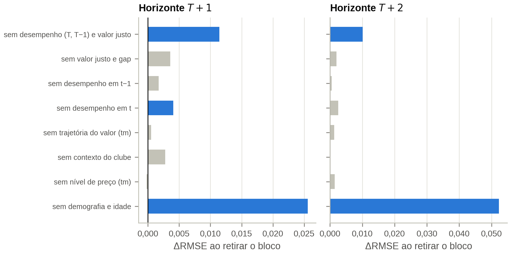

# 04 — Treinamento, Otimização e Avaliação dos Modelos

**Notebook:** `notebooks/04_model_training.ipynb` · **Código:** `src/football_analytics/modeling.py`
**Saídas:**
- protocolo pré-registrado em `reports/protocol_v3.json` (*commit* `5573d7e`);
- modelos finais em `models/04_model_training/final/`, com `manifest.json`;
- previsões fora da amostra em `data/processed/predictions_{oof,best}.parquet`;
- 8 figuras em `figures/04_model_training/` e 18 tabelas em `tables/04_model_training/`.

[← Índice](README.md)

## 1. Desenho experimental

| Elemento | Definição |
|---|---|
| Alvo de treino | log-retorno $y=\ln(V_{T+k}/V_T)$; as previsões são convertidas em $\Delta V\%$ e ΔV (€) |
| Algoritmos | mediana do treino por categoria (ingênuo), OLS (vetor compacto), Ridge, Random Forest, XGBoost e CatBoost. A referência "sem variação" ($V_{T+k}=V_T$) entra só na avaliação |
| *Ensemble* | média simples de CatBoost, XGBoost e Ridge globais, **fixada a priori** (Smith e Wallis, 2009) |
| Arquiteturas | **global** (faixa etária e posição como variáveis); **segmentada** nas matrizes 4 × 3 (C1–C12) e 3 × 3 de Khalife et al. (K1–K9), com mediana, Ridge e CatBoost; ***pooling* parcial** $w\cdot$segmento $+ (1-w)\cdot$global, com $w = n/(n+\kappa)$ |
| Validação | janela expandida. $T+1$: 6 dobras (teste de 2019/20 a 2024/25); $T+2$: 4 dobras com purga de uma temporada (2020/21 a 2023/24) |
| Teste final | $T+1$: **2024/25, pré-registrado**; $T+2$: 2023/24, semi-independente (consultado nas versões 1 e 2) |
| Otimização | bayesiana com processo gaussiano (`skopt.gp_minimize`), minimizando a RMSE média das **3 últimas dobras de validação** |
| Pré-processamento na dobra | imputação pela mediana do treino; nos lineares, também winsorização p1/p99 e padronização |
| Inferência | *bootstrap* por cluster clube × temporada; teste pareado de perdas do tipo Diebold–Mariano com erro-padrão agrupado; correção de Holm; conjunto de confiança de modelos (MCS) |

**Volume e custo.** São 234 tarefas, todas com cache em disco:
- 12 globais;
- 72 segmentos 4 × 3 e 54 segmentos 3 × 3;
- 72 de ablação;
- 24 de robustez e quantis.

Elas somam 440 minutos de CPU, cerca de 1 hora com 8 processos de uma *thread*. A reexecução com
cache leva cerca de 5 minutos.

## 2. Otimização de hiperparâmetros

Na versão 2, os ótimos caíam na fronteira dos espaços, sobretudo no número de árvores. A versão 3
reformulou a busca:

- **Taxa de aprendizado fixa** (0,05) no XGBoost e no CatBoost.
- **Número de árvores por parada antecipada temporal:** a última temporada do treino serve de
  validação interna, com purga de uma temporada em $T+2$, paciência de 40 e teto de 1.000 árvores. A
  1ª dobra, com uma temporada só, usa 200 árvores.
- **Espaços centrados em complexidade e regularização:**
  - XGBoost: profundidade 2–8, `min_child_weight` 1–100, $\lambda$ 0,1–100, `subsample` 0,5–1,
    `colsample` 0,3–1;
  - CatBoost: profundidade 3–8, `l2_leaf_reg` 1–100, `random_strength` 0–5;
  - Random Forest (150 árvores): profundidade 5–25, `min_samples_leaf` 1–50, `max_features` em
    {sqrt; 0,1; 0,2};
  - Ridge: $\alpha$ de $10^{-2}$ a $10^4$.
- **Orçamento:** 20 avaliações nos modelos globais (10 aleatórias), 15 no Ridge e 10 nos segmentos.

| Modelo final | $T+1$ | $T+2$ |
|---|---|---|
| XGBoost | profundidade 4, `min_child_weight` 83, $\lambda$ = 38, `subsample` 0,51, `colsample` 0,38; **479 árvores** | profundidade **2**, `min_child_weight` **1**, $\lambda$ = **100**, `colsample` **1**; **299 árvores** |
| CatBoost | profundidade **3**, `l2_leaf_reg` 12; **714 árvores** | profundidade 4, `l2_leaf_reg` 99; **246 árvores** |
| Ridge | $\alpha$ = 274 | $\alpha$ = 120 |

Em negrito, os valores na fronteira do espaço.

**Leitura.**
- **A busca escolheu regularização forte.** Em $T+2$, quatro dos cinco hiperparâmetros do XGBoost
  ficaram na fronteira (árvores rasas, $\lambda$ máximo), o que indica uma relação quase aditiva e
  pouco sinal de interação.
- **O melhor ponto saiu da fase guiada pelo processo gaussiano** no CatBoost, no XGBoost e no Ridge.
  No XGBoost de $T+2$, ele saiu na última avaliação, sinal de busca ainda não convergida.
- **O ganho da otimização é desprezível.** Nas três dobras de otimização de $T+1$, o *ensemble*
  otimizado erra 0,0003–0,0004 menos por dobra que o de hiperparâmetros-padrão. No teste final, os
  hiperparâmetros-padrão não diferem dos otimizados (seção 8). Ampliar os espaços não mudaria as
  conclusões.

## 3. Protocolo pré-registrado

Antes de qualquer métrica de 2024/25, a execução com o teste oculto gravou
`reports/protocol_v3.json`, *commitado* em `5573d7e` (23/10/2026, 00h31). O protocolo fixa:

- o hash do painel, as 108 variáveis e as 4 variáveis excluídas pela regra de cobertura;
- as dobras, as de otimização e os testes finais;
- os hiperparâmetros, o *ensemble*, a arquitetura final e o $\kappa$ do *pooling*;
- as camadas de magnitude e de intervalo;
- o hash do código (`config`, `sample`, `validation`, `modeling` e as células do notebook);
- as regras de decisão e os critérios das hipóteses H1–H5.

A execução com `FA_REVEAL_HOLDOUT=1` verificou que o protocolo estava *commitado* e idêntico ao que ela
reproduz ("Protocolo verificado (commit 5573d7e)") e só então calculou as métricas do teste. Até ali,
os notebooks 02 a 04 não haviam exibido nenhum alvo de $T+1$ de 2024/25.

**Decisão tomada nas dobras de desenvolvimento, antes do protocolo:** a 1ª dobra saiu do histórico das
camadas de magnitude e de intervalo (seção 10).

## 4. Resultados no teste final

| Modelo global | RMSE $T+1$ | $R^2$ $T+1$ | $\rho$ $T+1$ | RMSE $T+2$ | $R^2$ $T+2$ | $\rho$ $T+2$ |
|---|---|---|---|---|---|---|
| Sem variação ($V_{T+k}=V_T$) | 0,673 | −0,03 | — | 0,992 | −0,17 | — |
| Mediana do treino por categoria | 0,614 | 0,14 | 0,46 | 0,789 | 0,26 | 0,52 |
| OLS | 0,551 | 0,31 | 0,53 | 0,731 | 0,37 | 0,58 |
| Ridge | 0,544 | 0,33 | 0,56 | 0,728 | 0,37 | 0,59 |
| Random Forest | 0,547 | 0,32 | 0,55 | 0,733 | 0,36 | 0,60 |
| XGBoost | 0,546 | 0,32 | 0,55 | 0,728 | 0,37 | 0,60 |
| CatBoost | 0,548 | 0,32 | 0,55 | 0,730 | 0,37 | 0,60 |
| ***Ensemble*** | **0,543** | **0,33** | **0,56** | **0,724** | **0,38** | **0,60** |
| *Pooling* 3 × 3 (arquitetura final de $T+2$) | 0,545 | 0,33 | 0,56 | 0,728 | 0,37 | 0,60 |

$T+1$: 2024/25, $n$ = 1.952, 96 clubes. $T+2$: 2023/24, $n$ = 1.879.

**Arquitetura final.** Pelo protocolo, é o *ensemble* global em $T+1$ e o *pooling* 3 × 3 em $T+2$.

| Arquitetura final, teste | $T+1$ (2024/25) | $T+2$ (2023/24) |
|---|---|---|
| RMSE do log-retorno [IC 95%] | 0,543 [0,503; 0,587] | 0,728 |
| $R^2$ do log-retorno [IC 95%] | 0,33 [0,29; 0,36] | 0,37 |
| $\rho$ de Spearman [IC 95%] | 0,56 [0,52; 0,59] | 0,60 |
| Redução do RMSE frente a "sem variação" | −19,2% | −26,6% |
| Decil superior previsto que se valorizou (média) | 70,8% (27,5%) | 65,8% (26,0%) |
| $R^2$ em ΔV (€) | 0,19 | 0,21 |

ICs por *bootstrap* de clubes × temporada (2.000 reamostragens). Em $T+2$, os ICs são do *ensemble*
global: RMSE 0,724 [0,692; 0,758]; $R^2$ 0,38 [0,33; 0,41]; $\rho$ 0,60 [0,56; 0,64].

**Comparações pareadas** (diferença de perda quadrática frente ao *ensemble*, erro-padrão por clube ×
temporada, Holm sobre 13 comparações; `tab06`):
- Em $T+1$, o *ensemble* é significativamente melhor que as duas referências ingênuas, o CatBoost
  isolado (+0,004 de RMSE, $p_{Holm}$ = 0,039) e os modelos segmentados com CatBoost (+0,012 a
  +0,014). Ele **não difere** do Ridge, do XGBoost, do Random Forest, do OLS, dos segmentos com Ridge
  nem dos dois *poolings*.
- Em $T+2$, o *ensemble* é significativamente melhor que as referências ingênuas e que as quatro
  arquiteturas segmentadas (+0,017 a +0,024). Os algoritmos isolados e os *poolings* não diferem dele
  ($p_{Holm} \ge 0{,}07$).

**Conjunto de confiança dos modelos** (MCS a 10%, Hansen, Lunde e Nason, 2011; `tab06b`):

| Horizonte | No conjunto | Fora do conjunto |
|---|---|---|
| $T+1$ | *ensemble*, Ridge, XGBoost, Random Forest, *poolings* 4 × 3 e 3 × 3, segmentos com Ridge | OLS ($p$ = 0,046), CatBoost (0,044), segmentos com CatBoost, mediana |
| $T+2$ | *ensemble*, Ridge, *poolings* 4 × 3 e 3 × 3, OLS, XGBoost, Random Forest | CatBoost (0,097), os quatro segmentados, mediana |

**Leitura.**
1. A variação futura do valor é **parcialmente previsível**: 33% da variância do log-retorno em $T+1$
   e 37–38% em $T+2$, num teste temporal estrito e pré-registrado.
2. O *ensemble* é o único modelo sempre no conjunto de confiança, mas sua vantagem sobre os melhores
   algoritmos isolados não é significativa. **Árvores e lineares empatam.**
3. A arquitetura escolhida para $T+2$ nas dobras de desenvolvimento (*pooling* 3 × 3) ficou 0,004 de
   RMSE atrás do *ensemble* global no teste, sem significância ($p$ = 0,15). O ganho de validação não
   se repetiu.

## 5. Desenvolvimento e estabilidade temporal

| Arquitetura final, por temporada de teste | 2019/20 | 2020/21 | 2021/22 | 2022/23 | 2023/24 | **2024/25** |
|---|---|---|---|---|---|---|
| $R^2$ do log-retorno, $T+1$ | 0,18 | 0,21 | 0,26 | 0,26 | 0,29 | **0,33** |
| $\rho$ de Spearman, $T+1$ | 0,60 | 0,45 | 0,50 | 0,49 | 0,51 | **0,56** |
| $R^2$ do log-retorno, $T+2$ | — | 0,26 | 0,35 | 0,36 | **0,37** | — |

Em negrito, o teste final de cada horizonte.

- **O desempenho cresce com a janela de treino.** O teste de 2024/25 continua a tendência das dobras
  de desenvolvimento, e não é um ponto fora da curva.
- **A 1ª dobra é atípica.** Ela treina só com 2018/19, cujo alvo de $T+1$ é a revisão extraordinária
  de abril de 2020. Com uma temporada, o regime de mercado é constante no treino, e o nível da
  previsão erra: média prevista de −0,32 contra −0,12 observada.
- **Média das dobras de desenvolvimento** (`tab04`), no *ensemble* global: RMSE de 0,518 e $R^2$ de
  0,24 em $T+1$; 0,722 e 0,32 em $T+2$.

## 6. Arquitetura: global, segmentada ou *pooling* (H2)

**Regra pré-declarada.** A arquitetura final é o *ensemble* global, salvo se uma alternativa tiver
RMSE de validação menor e $p$ de Holm < 0,05 no teste pareado agrupado. A família de Holm são as 6
alternativas de cada horizonte.

| Alternativa (desenvolvimento) | RMSE $T+1$ | $p_{Holm}$ | RMSE $T+2$ | $p_{Holm}$ |
|---|---|---|---|---|
| *Ensemble* global (referência) | 0,5183 | — | 0,7222 | — |
| Segmentada 4 × 3, CatBoost | 0,5281 | < 0,001 (pior) | 0,7315 | 0,001 (pior) |
| Segmentada 3 × 3, CatBoost | 0,5281 | < 0,001 (pior) | 0,7308 | 0,003 (pior) |
| Segmentadas com Ridge | 0,530 | < 0,001 (pior) | 0,745–0,746 | < 0,001 (pior) |
| *Pooling* 4 × 3 | 0,5180 | 0,37 | 0,7206 | 0,031 |
| *Pooling* 3 × 3 | 0,5181 | 0,37 | **0,7200** | **0,016** |

**Decisão:** *ensemble* global em $T+1$ e *pooling* 3 × 3 com $\kappa$ = 800 em $T+2$.

**Curva do $\kappa$** (`tab04a`). A curva tem forma de U, com $\kappa$ = 0 (segmentação pura) no pior
ponto e $\kappa = \infty$ (o global) perto do ótimo. O ótimo fica em $\kappa$ = 3.200 em $T+1$ e 800 em
$T+2$. Na última dobra de desenvolvimento, isso dá ao segmento peso de 6–37% em $T+1$ e de 12–58% em
$T+2$. No modelo final de $T+2$ (3 × 3, com todas as temporadas), o peso vai de 47% a 74%.

**Atacantes veteranos** (`tab09b`, RMSE com todas as dobras de teste):

| Categoria | Global | *Pooling* 4 × 3 | *Pooling* 3 × 3 | Segmento 4 × 3 (CatBoost) | Segmento 3 × 3 (CatBoost) |
|---|---|---|---|---|---|
| $T+1$ · ATA 29–32 (C9) | 0,410 | 0,410 | 0,410 | 0,419 | 0,422 |
| $T+1$ · ATA 33+ (C12) | 0,414 | 0,414 | 0,413 | 0,417 | 0,416 |
| $T+1$ · ATA 30+ (K9) | 0,404 | 0,403 | 0,403 | 0,410 | 0,411 |
| $T+2$ · ATA 29–32 (C9) | 0,582 | 0,580 | 0,581 | 0,604 | 0,599 |
| $T+2$ · ATA 33+ (C12) | 0,615 | 0,611 | 0,609 | **0,600** | 0,613 |
| $T+2$ · ATA 30+ (K9) | 0,583 | 0,581 | 0,581 | 0,588 | 0,593 |

O único ganho visível da segmentação aparece nos atacantes de 33+ em $T+2$ (−0,014 de RMSE). É uma
categoria pequena, sem teste formal, e o ganho some nas demais categorias de veteranos.

**Veredito da H2 (critério do protocolo):** **não sustentada.** No teste final, o MCS contém o
*ensemble* global e as arquiteturas 3 × 3 nos dois horizontes. A segmentação pura é pior que o modelo
global, e o *pooling* parcial empata com ele. A heterogeneidade por idade e posição é mais bem
capturada como variável de um modelo único do que por modelos separados, seja qual for a matriz.

## 7. Ablação por blocos (H1)

O *ensemble* foi reestimado sem cada bloco de variáveis, com os hiperparâmetros do modelo completo
(a parada antecipada recalcula as árvores). A significância vem do teste pareado agrupado, com Holm
sobre as 12 especificações.

| Especificação, teste final | Variáveis | Δ RMSE $T+1$ | $p_{Holm}$ | Δ RMSE $T+2$ | $p_{Holm}$ |
|---|---|---|---|---|---|
| Sem demografia e idade | 96 | +0,026 | < 0,001 | +0,052 | < 0,001 |
| **Sem desempenho (T, T−1) e valor justo** | 35 | **+0,011** | **< 0,001** | **+0,010** | **0,015** |
| Sem desempenho em $T$ | 50 | +0,004 | 0,003 | +0,003 | 0,43 |
| Sem desempenho em $T-1$ | 95 | +0,002 | 0,23 | +0,000 | 1,00 |
| Sem valor justo e gap | 106 | +0,004 | 0,27 | +0,002 | 1,00 |
| Sem contexto do clube | 100 | +0,003 | 0,28 | +0,000 | 1,00 |
| Sem nível de preço (TM) | 103 | −0,000 | 1,00 | +0,001 | 1,00 |
| Sem trajetória do valor (TM) | 98 | +0,001 | 1,00 | +0,001 | 1,00 |

**Caminho aninhado** ($R^2$ do log-retorno no teste final):

| Especificação | Variáveis | $T+1$ | $T+2$ |
|---|---|---|---|
| M0: demografia e idade + contexto do clube (com liga, faixa etária e posição) | 20 | 0,251 | 0,317 |
| M1: M0 + nível de preço | 25 | 0,290 | 0,353 |
| M2: M1 + trajetória do valor no Transfermarkt | 35 | 0,300 | 0,360 |
| M3: M2 + desempenho em $T$ e $T-1$ | 106 | 0,320 | 0,374 |
| Modelo completo: M3 + valor justo e gap | 108 | **0,329** | **0,378** |

**Leitura.**
- **A idade domina** e é o bloco mais insubstituível: retirá-la custa mais que retirar qualquer outro.
- **Desempenho e valor justo agregam informação** que o Transfermarkt não contém. Isso vale para nível,
  trajetória e *momentum*: de M2 para o modelo completo, o $R^2$ sobe 0,03 em $T+1$ e 0,02 em $T+2$.
  É um ganho modesto, mas significativo nos dois horizontes.
- **A trajetória do valor é redundante.** Ela inclui *momentum*, revisões, volatilidade e distância
  ao pico. Diante do desempenho e do gap, retirá-la não muda o erro. A variante "fiel às
  especificações", com o Transfermarkt só como controle (M1 + desempenho + valor justo), equivale ao
  modelo completo.

**Veredito da H1 (critério do protocolo):** **sustentada** nos dois horizontes.

## 8. Robustez

| Especificação, teste final | RMSE $T+1$ | $p$ | RMSE $T+2$ | $p$ |
|---|---|---|---|---|
| *Ensemble* principal | 0,5433 | — | 0,7243 | — |
| Hiperparâmetros-padrão, sem otimização | 0,5416 | 0,12 | 0,7238 | 0,65 |
| Taxas por 90 cruas, sem encolhimento | 0,5427 | 0,51 | 0,7249 | 0,28 |
| Sem 2018/19 no treino (janelas da pandemia) | 0,5444 | 0,18 | 0,7287 | 0,005 |
| XGBoost principal | 0,5456 | — | 0,7277 | — |
| XGBoost + contrato reconstruído (*look-ahead*) | 0,5432 | — | 0,7234 | — |

**Leitura.**
- **Otimização.** Os hiperparâmetros-padrão empatam com os otimizados. Nas dobras de desenvolvimento,
  eles chegam a ganhar no agregado, mas só por causa da 1ª dobra, que fica fora da otimização e tem
  uma temporada de treino. O sinal está nas variáveis, não na sintonia fina.
- **Encolhimento.** Não muda a precisão. Seu efeito é a estabilidade das métricas entre temporadas
  (relatório 03, §5.1) e, com ela, a das explicações (relatório 05).
- **Janelas da pandemia.** Retirar 2018/19 do treino não ajuda; em $T+2$, piora com significância.
  Mais dados compensam o choque.
- **Contrato reconstruído.** Melhora o XGBoost em 0,002–0,004, um limite superior, porque essas
  variáveis carregam informação posterior a $T$. Excluí-las custa pouco.

## 9. Ordenação e calibração

Taxa de atletas que se valorizaram, por decil de valorização prevista (todas as dobras de teste):

| | 1º decil | 5º decil | 10º decil | Média |
|---|---|---|---|---|
| $T+1$ | 1,6% | 22,8% | 62,9% | 27,7% |
| $T+2$ | 0,7% | 20,8% | 65,5% | 25,7% |

O gradiente é monotônico. No teste final, os 10% com maior valorização prevista se valorizaram a **2,6
vezes** a taxa média em $T+1$ e a **2,5 vezes** em $T+2$.

## 10. Camada de magnitude

A camada converte o log-retorno previsto em $\Delta V\%$ com recalibração linear $\hat y' = a + b\hat y$
e *smearing* de Duan (1983) por faixa etária, $f_g = \overline{\exp(y-\hat y')}$, estimados **só com as
dobras anteriores**. Ela produz a **mediana** $e^{\hat y'}-1$ e a **esperança** $f_g e^{\hat y'}-1$.

**Correção na versão 3.** Na primeira execução com o teste oculto, a camada usava todas as dobras
anteriores. A 1ª dobra, com o erro de nível descrito na seção 5, deslocava a recalibração das
seguintes: +0,09 em log nas dobras 3 a 5 de $T+1$. Ela também inflava o *smearing*. Resultado: $R^2$ em
€ de 0,005 e cobertura de 86,5% para 80% nominais. A 1ª dobra passou a ficar fora do histórico
(`modeling.calibration_history`), e a camada vale a partir da 3ª dobra. A decisão foi tomada nas dobras
de desenvolvimento, antes do protocolo, pelo motivo estrutural: com uma só temporada de treino, o
nível da previsão não é identificável.

| | v2, 2023/24 | v3, 2023/24 (desenvolvimento) | **v3, teste 2024/25** |
|---|---|---|---|
| $R^2$ em $\Delta V\%$ (esperança) | 0,151 | 0,187 | **0,138** |
| $R^2$ em ΔV (€), esperança | 0,177 | 0,170 | **0,183** |
| Erro absoluto mediano em $\Delta V\%$ (esperança) | 26,8 p.p. | 27,1 p.p. | **27,1 p.p.** |
| MAE entre os que se valorizaram | 101,6 p.p. | 97,7 p.p. | **147,3 p.p.** |
| Inclinação de calibração ($y$ sobre $\hat y'$) | 1,33 | 1,14 | **1,24** |

Linhas de $T+1$ da `tab12`. Para o erro absoluto, o ponto adequado é a mediana prevista, sem
*smearing*: 23,4 p.p. em 2023/24 e 21,5 p.p. no teste de 2024/25 (`tab05`). Em $T+2$ (teste 2023/24), o
$R^2$ em $\Delta V\%$ passou de 0,110 (v2) para 0,125, e o $R^2$ em € caiu de 0,273 para 0,238.

**Fatores de *smearing* do modelo final:** 1,34 (16–23), 1,12 (24–28), 1,08 (29–32) e 1,04 (33+) em
$T+1$; de 1,59 a 1,15 em $T+2$. Os jovens têm a distribuição de valorização mais assimétrica.

**Calibração por decil** (dobras a partir da 3ª, com o teste final; `tab12b`). Do 1º ao 9º decil de
$T+1$, a esperança prevista fica a no máximo 6 p.p. da média observada. **Limite:** os maiores saltos
continuam subestimados. No 10º decil, o previsto é +96% contra +194% observados em $T+1$, e +197% contra
+356% em $T+2$.

## 11. Intervalos de previsão

Intervalo de 80% (P10–P90): CatBoost quantílico conformalizado sequencialmente (Romano, Patterson e
Candès, 2019), com o mesmo histórico da camada de magnitude.

| | Cobertura bruta | Cobertura conformalizada | Largura mediana |
|---|---|---|---|
| $T+1$, desenvolvimento (dobras 3–5) | 77,8% | 81,7% | 107 p.p. |
| $T+1$, **teste 2024/25** | 79,5% | **82,4%** | 104 p.p. |
| $T+2$, desenvolvimento (dobra 3) | 79,3% | 83,4% | 148 p.p. |
| $T+2$, **teste 2023/24** | 79,6% | **82,3%** | 135 p.p. |

A cobertura fica próxima da nominal, com leve excesso. O intervalo é largo e assimétrico, e informa a
decisão *buy-low*: perda limitada e ganho potencial várias vezes maior.

## 12. Conclusões para o artigo

1. **Previsibilidade parcial, confirmada fora da amostra.** No teste pré-registrado de 2024/25, o
   modelo explica 33% da variância do log-retorno ($T+1$) e reduz o erro em 19% frente a "sem
   variação". Ele também concentra a valorização: 71% do decil superior previsto se valorizou, contra
   28% na média.
2. **Os $R^2$ de 0,65–0,87 da Tabela 6.1 da especificação são típicos de *nowcasting*** (nível do
   valor). O valor justo deste estudo, que estima o nível, atinge 0,79 (relatório 03).
3. **Algoritmo importa pouco.** Árvores e lineares empatam, e a otimização de hiperparâmetros não muda
   o resultado. O *ensemble* é o mais consistente.
4. **Segmentar não ajuda** (H2 não sustentada). A segmentação pura piora o erro, e o *pooling*
   parcial empata com o modelo global.
5. **O desempenho agrega informação ao Transfermarkt** (H1 sustentada). O ganho é modesto e
   significativo, e torna redundante a trajetória do valor, o que valida o desenho "Transfermarkt
   como controle" das especificações.
6. **A magnitude é utilizável, com limites.** A camada calibrada e os intervalos conformalizados
   acertam a média até o 9º decil e cobrem 82% dos casos; os saltos extremos seguem subestimados.
