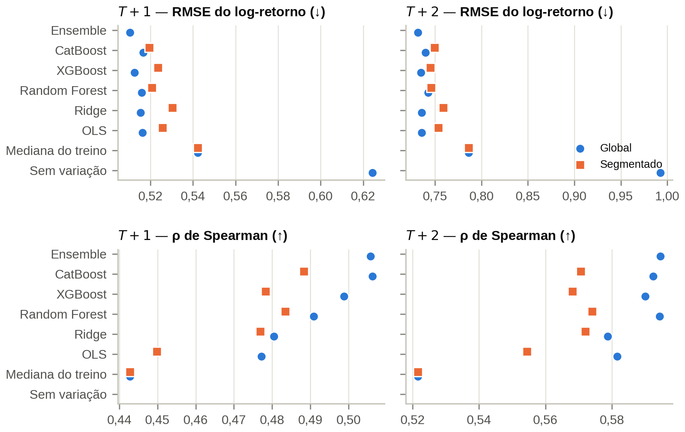
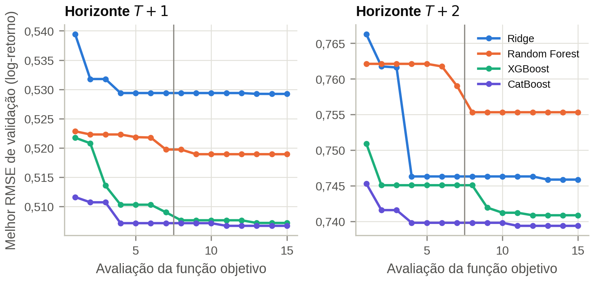
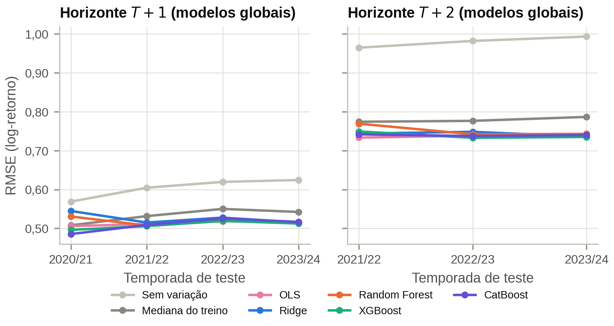
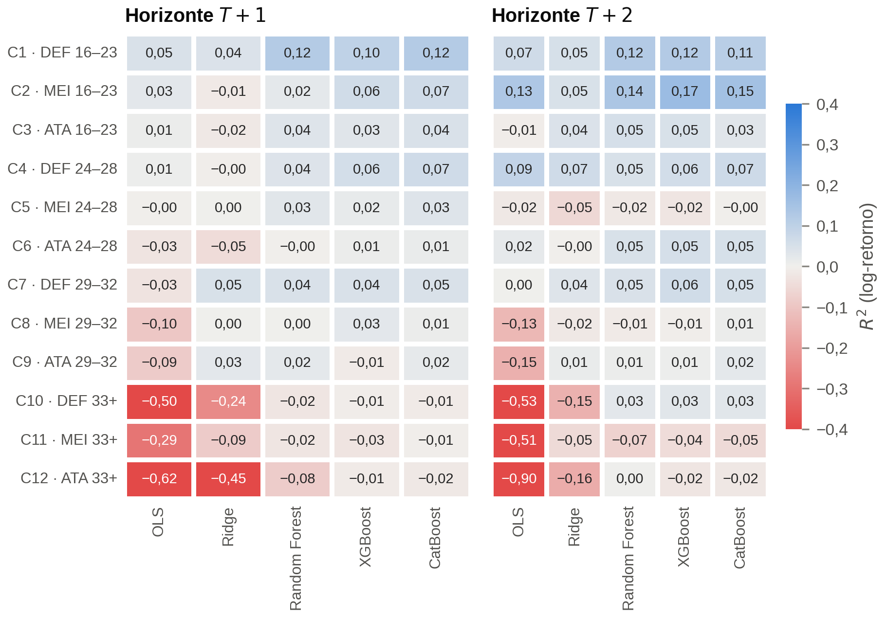
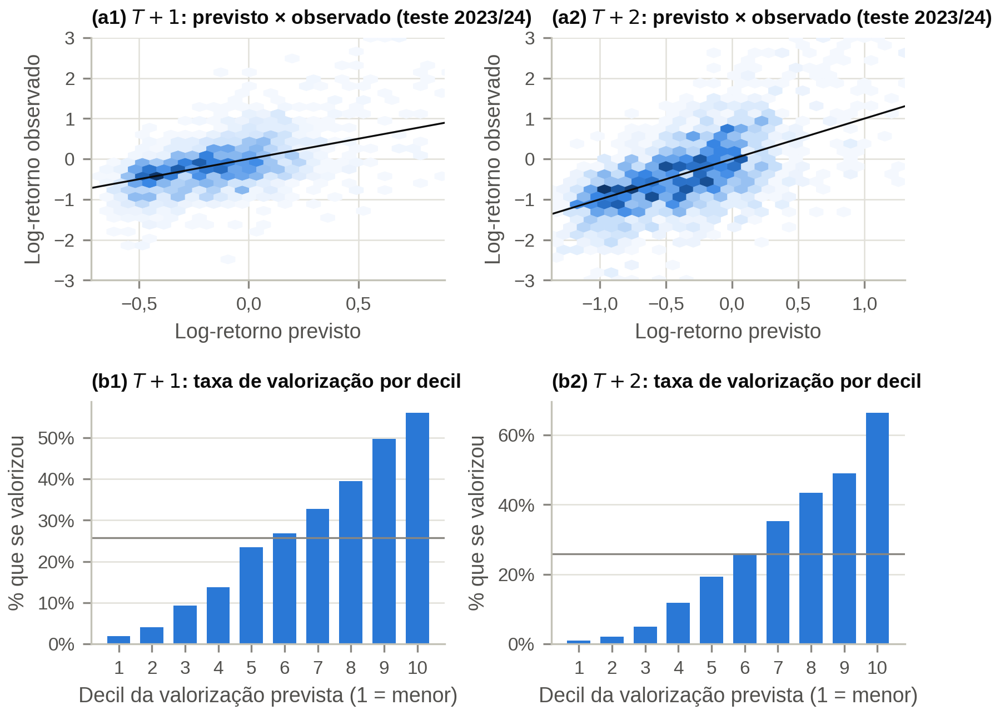
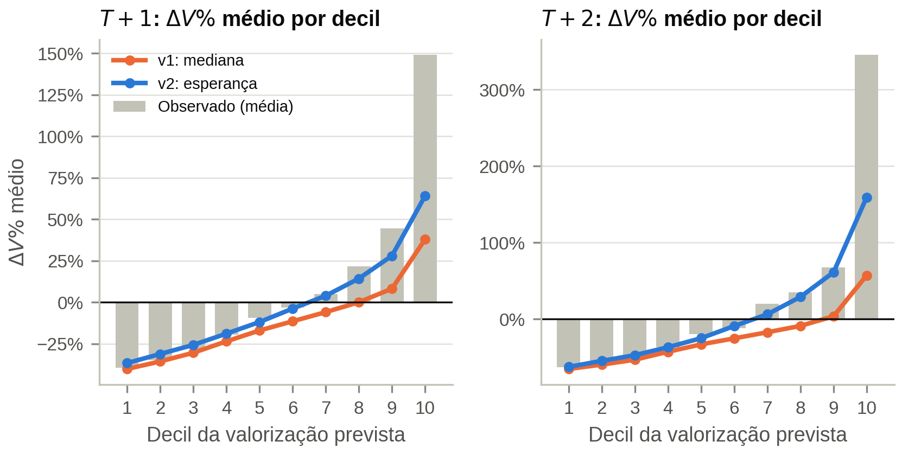
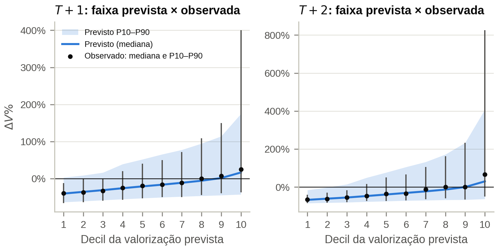

# 04 — Treinamento, Otimização e Avaliação dos Modelos

**Notebook:** `notebooks/04_model_training.ipynb` · **Código:** `src/football_analytics/modeling.py`
**Saídas:**
- modelos finais em `models/04_model_training/final/`, com `manifest.json`;
- previsões fora da amostra em `data/processed/predictions_{oof,best}.parquet`;
- 7 figuras em `figures/04_model_training/` e 14 tabelas em `tables/04_model_training/`.

[← Índice](README.md)

## 1. Desenho experimental

| Elemento | Definição |
|---|---|
| Alvo de treino | log-retorno $y=\ln(V_{T+k}/V_T)$. As previsões são convertidas em $\Delta V\%$ e ΔV (€) |
| Algoritmos | mediana do treino (ingênuo), OLS (vetor compacto de 22 variáveis), Ridge, Random Forest, XGBoost, CatBoost. A referência "sem variação" ($V_{T+k}=V_T$) entra só na avaliação |
| Arquiteturas | **global** (faixa etária e posição como *dummies*) e **segmentada** (12 modelos, um por categoria) |
| Validação | janela expandida: 4 dobras em $T+1$; 3 em $T+2$, com purga |
| Otimização | bayesiana com processo gaussiano (`skopt.gp_minimize`), minimizando a RMSE média nas dobras de **validação** |
| Teste final | 2023/24, nunca usado na otimização nem na seleção |
| Pré-processamento na dobra | mediana do treino por posição. Nos lineares, também winsorização p1/p99 e escalonamento robusto |
| Métricas | RMSE, MAE e $R^2$ em log-retorno, $\Delta V\%$ e €; $\rho$ de Spearman; acerto do decil superior; inclinação de calibração; cobertura dos intervalos |

**Volume e custo.** São 156 tarefas: 2 horizontes × 13 escopos (o global e as 12 categorias) × 6
algoritmos. Elas rodam em paralelo (8 *workers* de uma *thread*), com cache por tarefa, e a
execução a frio levou **48,7 minutos**.

**Cortes em relação à especificação**, impostos pelo processador i5-10300H em modo de economia:
- **Orçamento de otimização:** 15 avaliações por otimização no modelo global e 10 por categoria.
- **XGBoost:** até 800 árvores (especificação: 1.000), histograma com 64 *bins*.
- **CatBoost:** até 800 iterações (especificação: 1.200), profundidade até 8 (especificação: 10),
  `rsm = 0,5` e 64 *bins*.
- **Random Forest:** até 500 árvores (especificação: 800), com `max_features` em
  {sqrt, log2, 0,3}.

## 2. Versão 1 → versão 2: melhorias para a magnitude

A versão 1 ordenava bem os atletas, mas estimava mal **quanto** cada um se valoriza. O diagnóstico
apontou três causas:
- **Encolhimento:** o desvio-padrão das previsões era a metade do observado.
- **Viés de retransformação:** $e^{\hat y}-1$ é a mediana, não a média.
- **Variância** de um único modelo.

A versão 2 introduziu quatro melhorias:

1. **Novas *features*** (relatório 03): dinâmica das reavaliações e gap de avaliação.
2. ***Ensemble*** de CatBoost, XGBoost e Ridge globais, por média simples.
3. **Camada de magnitude.** Recalibração linear $\hat y' = a + b\hat y$ e fator de *smearing* de Duan
   (1983) por faixa etária, $f_g = \overline{\exp(y-\hat y')}$, estimados **só com as dobras
   anteriores**. Ela produz dois pontos:
   - a **mediana** $e^{\hat y'}-1$, para o erro típico;
   - a **esperança** $f_g e^{\hat y'}-1$, para o erro quadrático e somas em €.
4. **Intervalo de 80%** (P10–P90) por CatBoost quantílico, conformalizado sequencialmente (Romano et
   al., 2019).

## 3. Resultados no teste final (2023/24)

| Modelo global | RMSE $T+1$ | $R^2$ $T+1$ | $\rho$ $T+1$ | RMSE $T+2$ | $R^2$ $T+2$ | $\rho$ $T+2$ |
|---|---|---|---|---|---|---|
| Sem variação ($V_{T+k}=V_T$) | 0,624 | −0,08 | — | 0,993 | −0,17 | — |
| Mediana do treino por categoria | 0,542 | 0,19 | 0,44 | 0,786 | 0,27 | 0,52 |
| OLS | 0,516 | 0,26 | 0,48 | 0,736 | 0,36 | 0,58 |
| Ridge | 0,515 | 0,27 | 0,48 | 0,735 | 0,36 | 0,58 |
| Random Forest | 0,516 | 0,26 | 0,49 | 0,743 | 0,35 | 0,59 |
| XGBoost | 0,512 | 0,27 | 0,50 | 0,735 | 0,36 | 0,59 |
| CatBoost | 0,517 | 0,26 | 0,51 | 0,740 | 0,35 | 0,59 |
| ***Ensemble*** **(final)** | **0,510** | **0,28** | **0,51** | **0,732** | **0,37** | **0,59** |

**Significância** (*bootstrap* pareado da diferença de RMSE frente ao CatBoost global, 2.000
reamostragens; `tab04b`):
- Só o ***ensemble*** é significativamente melhor: −0,006 em $T+1$ e −0,008 em $T+2$, com IC de 95%
  inteiramente negativo.
- Entre os algoritmos individuais, **nenhuma diferença é significativa**: árvores e lineares
  empatam.
- A arquitetura **segmentada** é significativamente pior que o CatBoost global em 6 de 10
  comparações, e não é melhor em nenhuma.
- As duas referências ingênuas são significativamente piores.

**Arquitetura final:** *ensemble* global nos dois horizontes. A RMSE de validação foi 0,5058 em
$T+1$ e 0,7343 em $T+2$, contra 0,5117 e 0,7382 da composição segmentada com o melhor modelo por
categoria.

O desempenho é estável entre as temporadas de teste. No XGBoost e no CatBoost, o melhor ponto da
otimização apareceu ainda na fase aleatória, uma consequência do orçamento reduzido.

## 4. Desempenho por categoria

Dentro de cada categoria, o $R^2$ é baixo:
- **jovens (C1–C2):** 0,07–0,17;
- **24–32 anos:** próximo de zero;
- **veteranos:** negativo para o OLS, que superajusta com 40–90 observações por temporada.

Os modelos explicam sobretudo as diferenças **entre** categorias, somadas ao *momentum*, à dinâmica
de reavaliação e ao gap de avaliação. O vencedor por categoria está em `tab08` (formato da Tabela
6.1 da especificação). O CatBoost vence em 5 das 6 primeiras categorias em $T+1$.

## 5. Ordenação e calibração

Taxa de atletas que se valorizaram, por decil de valorização prevista (todas as dobras):

| | 1º decil | 10º decil | Média |
|---|---|---|---|
| $T+1$ | 1,9% | 56,0% | 25,7% |
| $T+2$ | 1,1% | 66,3% | 25,9% |

O gradiente é monotônico. No teste final, os 10% com maior valorização prevista se valorizaram a
**2,1 vezes** a taxa média em $T+1$ e a **2,5 vezes** em $T+2$.

## 6. Magnitude: v1 × v2

| Teste 2023/24 | v1 $T+1$ | **v2 $T+1$** | v1 $T+2$ | **v2 $T+2$** |
|---|---|---|---|---|
| $R^2$ em $\Delta V\%$ (esperança) | 0,102 | **0,151** (+48%) | 0,045 | **0,110** (×2,4) |
| RMSE em $\Delta V\%$ (p.p.) | 143,5 | **139,6** | 426,9 | **412,1** |
| MAE entre os que se valorizaram (p.p.) | 118,2 | **101,6** (−14%) | 245,5 | **211,1** (−14%) |
| $R^2$ em ΔV (€) | 0,151 | **0,177** | 0,176 | **0,273** (+55%) |
| Erro absoluto mediano em $\Delta V\%$ (mediana) | 23,5 | **22,7** | 25,8 | **25,0** |

**Efeito por decil.** No 9º decil de $T+1$, o $\Delta V\%$ médio previsto passou de +8% para +28%,
contra +45% observados. Em $T+2$, o 9º decil ficou quase sem viés (+61% contra +67%).

**Fatores de *smearing* por faixa etária:**

| Faixa | $T+1$ | $T+2$ |
|---|---|---|
| 16–23 | 1,37 | 1,76 |
| 33+ | 1,06 | 1,11 |

Os jovens têm a distribuição de valorização mais assimétrica.

**Limite.** Os maiores saltos continuam subestimados. No 10º decil de $T+1$, o previsto é +64%
contra +149% observados, e a inclinação de calibração no teste é 1,33.

## 7. Intervalos de previsão

| Teste 2023/24 | Cobertura bruta | Cobertura conformalizada | Largura mediana |
|---|---|---|---|
| $T+1$ | 78% | **82%** | ≈ 110 p.p. |
| $T+2$ | 76% | **86%** | ≈ 160 p.p. |

O intervalo é largo e assimétrico. No decil superior de $T+1$, o P10 fica em torno de −40% e o P90,
em cerca de +170%. Para a decisão *buy-low*, essa é a informação relevante: perda limitada e ganho
potencial várias vezes maior.

## 8. Robustez: contrato reconstruído

| XGBoost global, teste | $R^2$ $T+1$ | $R^2$ $T+2$ |
|---|---|---|
| Vetor principal | 0,273 | 0,361 |
| \+ anos de contrato e Bosman (*look-ahead*) | 0,281 | 0,371 |

O ganho é pequeno, e é um limite superior, porque essas variáveis carregam informação posterior a
$T$. Excluí-las custa pouco. O efeito Bosman não pôde ser medido de forma limpa com dados públicos.

## 9. Conclusões para o artigo

1. A variação do valor é **parcialmente previsível**: $R^2$ de 0,28 e 0,37 no log-retorno, com teste
   temporal estrito.
2. Os $R^2$ de 0,65–0,87 da Tabela 6.1 da especificação são típicos de *nowcasting*. O valor justo
   deste estudo, que estima o nível, atinge 0,75.
3. Árvores **não superam** lineares com significância, e só o *ensemble* ganha do melhor modelo
   isolado.
4. A **segmentação em 12 modelos piora** o desempenho. A heterogeneidade por idade e posição é mais
   bem capturada como variável.
5. A camada de magnitude e os intervalos conformalizados tornam a estimativa de **quanto**
   utilizável. O modelo continua conservador nos extremos.
