# 05 — Interpretação (XAI) e Simulação *Buy-Low / Sell-High*

**Notebook:** `notebooks/05_model_interpretation.ipynb` · **Código:** `src/football_analytics/interpretation.py`
**Saídas:** `data/processed/shap_values_T{1,2}.parquet`, 13 figuras em
`figures/05_model_interpretation/` e 26 tabelas em `tables/05_model_interpretation/`

[← Índice](README.md)

## 1. Método

- **Modelo explicado:** o *ensemble* global final (média de CatBoost, XGBoost e Ridge), ajustado em
  todas as temporadas com alvo. Em $T+2$, a arquitetura final é o *pooling* 3 × 3, cujo componente
  global é esse mesmo *ensemble*; o SHAP explica o componente global, e o ajuste do segmento aparece à
  parte quando relevante.
- **SHAP por componente:**
  - **CatBoost e XGBoost:** `shap.TreeExplainer`;
  - **Ridge:** forma fechada, $\phi_j = w_j(x'_j-\bar x'_j)$.

  Os SHAP do *ensemble* são a média dos três, o que preserva a aditividade
  $\hat y_i = \phi_0 + \sum_j\phi_{ij}$; ela é verificada numericamente.
- **Variáveis categóricas:** as *dummies* de liga, faixa etária e posição são somadas de volta.
- **Leitura das unidades:** em log-retorno, $\phi = +0{,}10$ equivale a cerca de +10,5% de variação no
  valor.
- **Leitura "por categoria":** agrega as explicações do modelo global dentro de cada categoria C1–C12.
  Não são 12 modelos distintos: o notebook 04 mostrou que a segmentação não supera o modelo global (H2).
- **Incerteza:** ICs por *bootstrap* de clubes × temporada para as participações por faixa etária (H5)
  e, para a incerteza do ajuste, os modelos reajustados no treino de cada dobra (seção 6).

**Valor-base** ($\phi_0$): −0,165 em $T+1$ e −0,397 em $T+2$, ou seja, −15% e −33% de variação mediana. A desvalorização típica da amostra é o ponto de partida de toda
previsão.

## 2. Determinantes globais

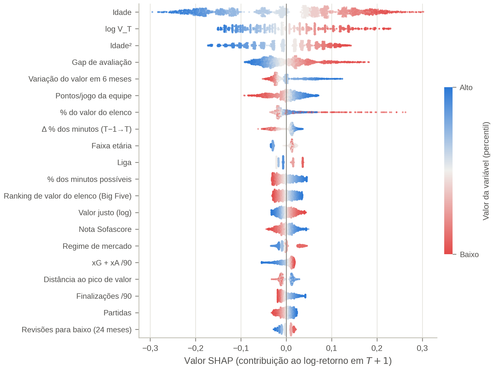

| Grupo | Participação no $\vert\phi\vert$ total ($T+1$ / $T+2$) | Destaques |
|---|---|---|
| Desempenho tático-técnico | 29% / 25% | nota Sofascore, grandes chances perdidas/90, % de jogos completos, duelos aéreos, dribles, finalizações |
| Demográfico | 27% / 34% | idade, idade², faixa etária |
| Contexto | 11% / 7% | clube rebaixado ao fim de $T$, regime de mercado e da liga, pontos/jogo da equipe, liga |
| Valor justo | 10% / 10% | gap de avaliação, valor justo |
| Defasagem | 9% / 8% | Δ % dos minutos, jogou nas Big Five em $T-1$, *momentum* |
| Mercado | 8% / 10% | $\log V_T$ (efeito negativo), % do valor do elenco, *ranking* do elenco |
| Dinâmica de mercado | 7% / 5% | variação do valor em 6 meses, distância ao pico |

As variáveis mais importantes em $T+1$, em ordem, são: idade, idade², **gap de avaliação**, $\log V_T$,
variação do valor em 6 meses, Δ % dos minutos, faixa etária, nota Sofascore, valor justo e **clube
rebaixado ao fim de $T$**, variável nova da versão 3. Em $T+2$, as três primeiras se mantêm, e o valor
justo sobe para 5º lugar.

**Mudanças em relação à versão 2.**
- O **gap de avaliação** subiu de 4º para 3º lugar em $T+1$.
- O **contexto do clube** passou de 7% para 11% da explicação em $T+1$. Das variáveis novas, pesam o
  rebaixamento (2,2% do total), o saldo de gols por jogo (0,9%), a promoção (0,9%) e a posição final
  (0,7%). A participação europeia quase não contribui (0,1%).
- As variáveis de **dinâmica do valor** (variação em 6 meses, revisões, volatilidade, distância ao pico)
  somam 7% em $T+1$, e só a variação em 6 meses passa de 1,5%. A ablação do notebook 04 mostrou que,
  junto com o *momentum*, elas são redundantes diante do desempenho e do gap.

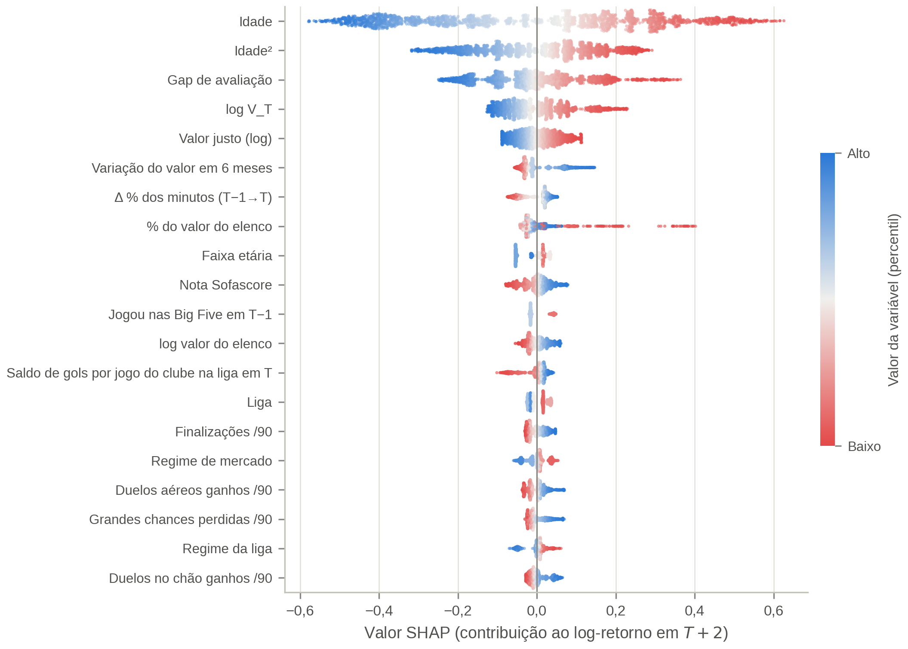

## 3. Determinantes ao longo da carreira (H5)

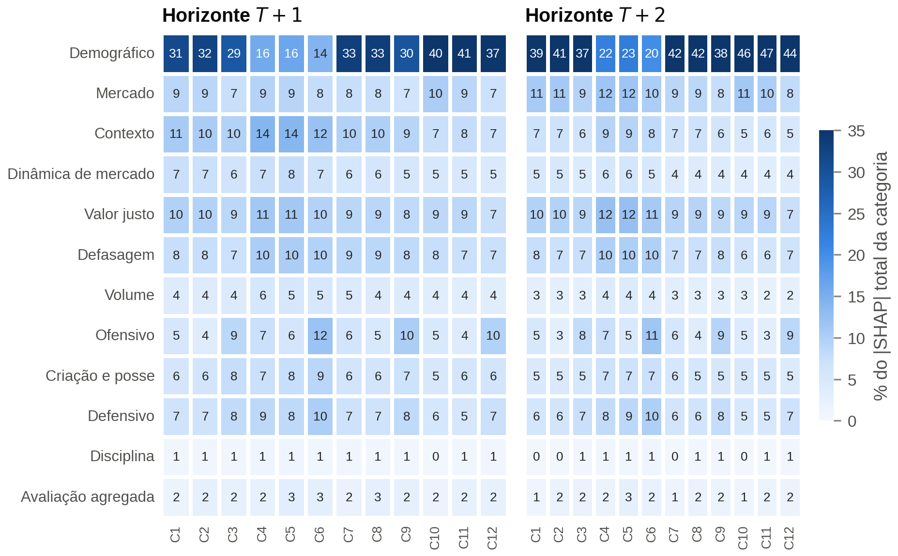

Participação em $T+1$, em % do $\vert\phi\vert$ total de cada categoria:

| Faixa | Demográfico | Desempenho | Valor justo + dinâmica | Contexto |
|---|---|---|---|---|
| 16–23 (C1–C3) | 29–32 | 24–32 | 15–17 | 10–11 |
| 24–28 (C4–C6) | **14–16** | **31–40** | 16–19 | 12–14 |
| 29–32 (C7–C9) | 30–33 | 26–33 | 14–15 | 9–10 |
| 33+ (C10–C12) | **37–41** | 21–30 | 12–14 | 7–8 |

- **No auge** (24–28), o desempenho e o gap têm o maior peso; nessas categorias, o gap é a variável mais
  importante, à frente da idade.
- **Nos veteranos**, a idade domina: 37–41% em $T+1$ e 44–47% em $T+2$.
- **Por posição**, os atacantes dependem mais das métricas ofensivas em todas as faixas (9–12% do total,
  contra 4–7% de defensores e meio-campistas).

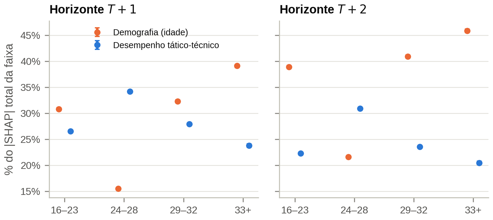

**Teste da H5** (ICs por *bootstrap* de clubes × temporada, 1.000 reamostragens):

| | Desempenho, 24–28 | Desempenho, 33+ | Diferença [IC 95%] |
|---|---|---|---|
| $T+1$ | 34% | 24% | **+10,4 p.p.** [10,0; 10,8] |
| $T+2$ | 31% | 20% | **+10,5 p.p.** [10,1; 10,9] |

**Veredito da H5 (critério do protocolo): sustentada.** A idade tem o padrão inverso: 16% no auge contra
39% nos veteranos ($T+1$).

**Confronto com a especificação.** A especificação, apoiada em Khalife et al. (2025), previa que o
rendimento operacional governasse a valoração dos veteranos. Os dados indicam o contrário: para os
atletas de 33 anos ou mais, a idade explica cerca de 40% da variação prevista, e o desempenho pesa 10
p.p. menos que no auge. O mercado premia o desempenho sobretudo enquanto ele sinaliza trajetória futura.

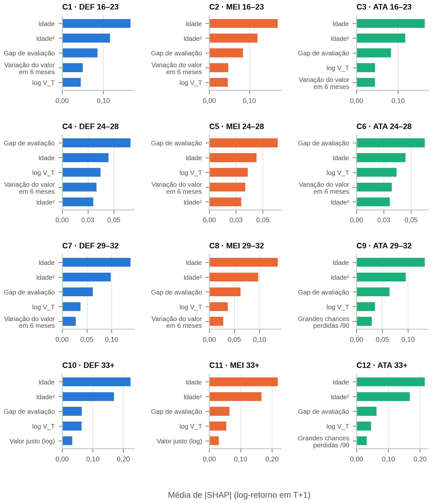

A tabela `tab03_top3_shap_por_categoria.csv`, equivalente da coluna "SHAP Top 3" da Tabela 6.1 da
especificação, mostra idade, idade² e gap de avaliação na liderança de quase todas as categorias. Nos
atletas de 24–28 anos ($T+1$), a ordem é gap, idade e $\log V_T$.

## 4. Variáveis tático-técnicas mais determinantes

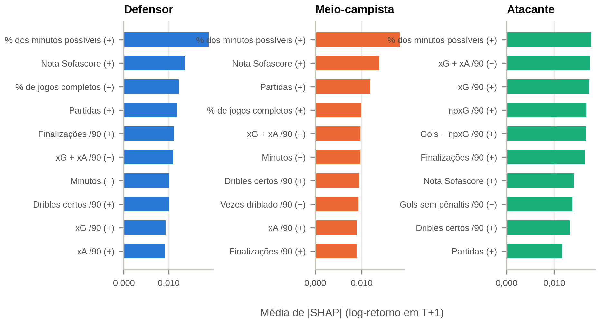

**Nas três posições,** lideram a **avaliação e a regularidade**: nota média do Sofascore, % de jogos
completos e partidas, todas com efeito (+).

**Por posição:**

| Posição | Métricas de destaque |
|---|---|
| Atacante | grandes chances perdidas/90, finalizações/90, dribles certos/90, duelos aéreos ganhos/90 |
| Meio-campista | duelos aéreos ganhos/90, dribles certos/90, grandes chances perdidas/90; "vezes driblado" com efeito (−) |
| Defensor | grandes chances perdidas e finalizações (participação ofensiva), duelos aéreos e no chão ganhos; "vezes driblado" com efeito (−) |

"Grandes chances perdidas/90" com efeito (+) mede **presença em situações claras de gol**, e não
ineficiência: condicionada às finalizações e à nota, é a participação nessas chances que o mercado
premia. Efeitos de variáveis correlacionadas se dividem entre elas e não devem ser lidos isoladamente; o
encolhimento das taxas aumentou essas correlações.

## 5. Dependências

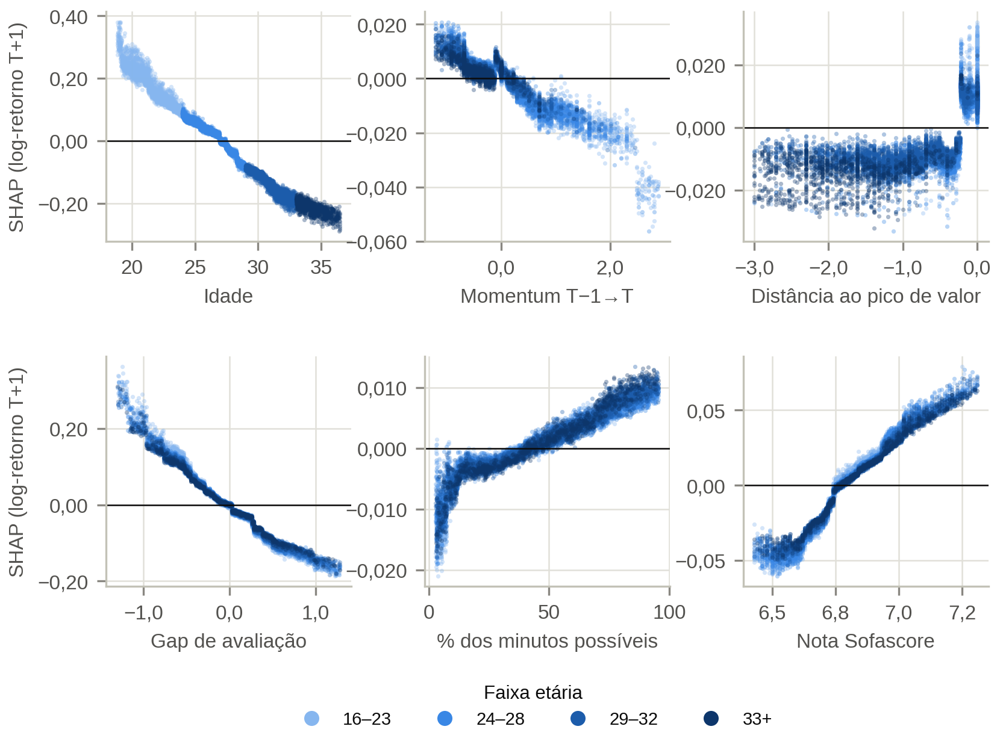

- **Idade:** efeito praticamente linear, de cerca de +0,30 aos 19 anos a −0,25 aos 36, com cruzamento
  do zero por volta dos 27.
- **Gap de avaliação:** efeito monotônico e assimétrico. Os mais subavaliados (gap ≈ −1,2) recebem até
  +0,30 (≈ +35%), e os sobreavaliados (gap ≈ +1,2), cerca de −0,17 (≈ −16%). A correção é mais forte para
  quem está barato.
- **Nota Sofascore:** relação em forma de S, de −0,05 (nota 6,5) a +0,065 (nota 7,25), cerca de 12 p.p.
  de valorização entre os extremos.
- **% dos minutos possíveis:** relação positiva, mas pequena (de −0,01 a +0,01), com queda abrupta
  abaixo de 10%. Com o encolhimento, a minutagem atua sobretudo pela confiabilidade das taxas.
- ***Momentum* anual:** contribuição pequena e decrescente. Altas passadas muito grandes (log-retorno
  > 2) recebem −0,02 a −0,05, sinal de reversão após saltos extremos.
- **Distância ao pico:** atletas no pico recebem efeito positivo (+0,01 a +0,03). Os que já estão abaixo
  dele recebem efeito negativo, sem expectativa de recuperação.

## 6. Estabilidade das explicações entre as dobras

Os componentes do *ensemble* foram reajustados no treino de cada dobra, com os hiperparâmetros do modelo
final, e explicam só a temporada de teste daquela dobra.

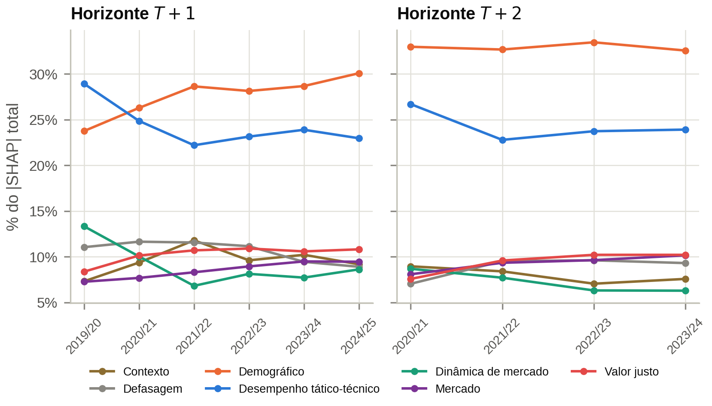

- **Mesmas variáveis, mesma ordem.** O $\tau$ de Kendall entre os rankings das 20 variáveis mais
  importantes é de 0,64 em média em $T+1$ (0,43–0,82) e de 0,74 em $T+2$ (0,64–0,86). O modelo da 1ª
  dobra, treinado só com 2018/19, é o mais diferente (0,43–0,57). Entre dobras consecutivas a partir da
  2ª, o $\tau$ vai de 0,72 a 0,82.
- **Participações estáveis.** Em $T+1$, desempenho e demografia trocam de posição só na 1ª dobra; nas
  demais, a demografia lidera com 26–30% e o desempenho fica em 22–25%. Em $T+2$, a demografia lidera em
  todas as dobras (33%).
- **H5 com a incerteza do ajuste** (`tab10c`). A diferença de participação do desempenho entre o auge e
  os veteranos é positiva em todos os modelos de dobra: de 6,8 a 9,5 p.p. em $T+1$ e de 9,0 a 10,7 p.p.
  em $T+2$. A conclusão não depende de uma temporada nem do modelo final.

## 7. Explicações individuais

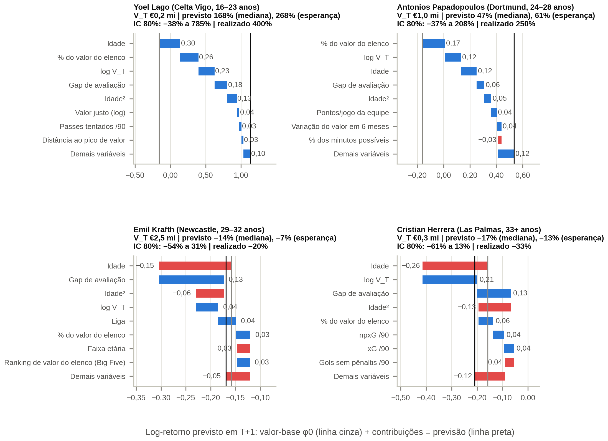

Atleta de maior valorização esperada em cada faixa, no teste pré-registrado (previsão em 30/06/2025). A
decomposição usa o **modelo da própria dobra do teste**, o mesmo que gerou a previsão exibida.

| Atleta | Faixa | $V_T$ | Previsto (mediana / esperança) | IC 80% | Realizado |
|---|---|---|---|---|---|
| Kyllian Antonio (Lens) | 16–23 | € 0,3 mi | +258% / +369% | −30% a +1.530% | **+900%** |
| Edmond-Paris Maghoma (Brentford) | 24–28 | € 0,8 mi | +130% / +159% | −34% a +814% | **+88%** |
| Denis Vavro (Wolfsburg) | 29–32 | € 7,0 mi | −6% / 0% | −47% a +45% | **−29%** |
| Dante (Nice) | 33+ | € 0,5 mi | −10% / −7% | −60% a +20% | **0%** |

- Nas faixas de até 28 anos, a previsão vem da idade, do gap favorável e da baixa participação no valor do
  elenco.
- A partir de 29 anos, nem o melhor caso tem previsão positiva: o gap favorável (+0,11 e +0,25) não
  compensa a idade.
- As quatro realizações caíram dentro do intervalo de 80%.
- As variáveis de desempenho aparecem pouco entre as maiores contribuições individuais: elas agem
  sobretudo pelo valor justo e pelo gap, que as resumem.

## 8. Premissa *buy-low*: gap de avaliação e valorização realizada (H3)

O gap de avaliação em $T$ (notebook 03) foi cruzado com o log-retorno **realizado**, por quintil do gap.
O $\rho$ parcial controla idade, idade² e $\log V_T$, porque o gap se correlaciona com o nível de preço.

| Teste final | Quintil mais subavaliado: mediana [IC 95%] | Quintil mais sobreavaliado | $\rho$ parcial |
|---|---|---|---|
| $T+1$ (2024/25) | **−5,9%** [−12,5; 0,0], 35% se valorizaram | −20,0% [−25,0; −16,7], 23% | −0,20 |
| $T+2$ (2023/24) | **−25,0%** [−33,3; −16,7], 35% | −38,5% [−42,9; −33,3], 28% | −0,15 |

- O ganho concentra-se no quintil mais barato. Nos demais, a mediana de $T+1$ fica entre −20% e −25%.
- Nas dobras de desenvolvimento, o padrão é o mesmo: −5,7% contra −25,0% em $T+1$, e $\rho$ parcial de
  −0,18.

**Veredito da H3 (critério do protocolo):** **sustentada em $T+1$.** Em $T+2$, os ICs se tocam em −33,3%,
e o critério estrito (ICs disjuntos) não é atendido, embora o sentido seja o mesmo.

## 9. Simulação de recrutamento (*backtest* fora da amostra, H4)

Em cada temporada de teste, a carteira compra 10% dos candidatos e é avaliada em $T+k$, com as previsões
fora da amostra do notebook 04. A versão 3 incorpora três mudanças:
- **Custos de transação:** compra por $V_T(1+c_b)$ e venda por $V_{T+k}(1-c_v)$, com
  $c_b \in \{0; 10\%; 25\%\}$ e $c_v \in \{0; 10\%\}$.
- **Intenção de tratar:** os atletas que depois saem da base entram como excluídos, valendo zero ou pelo
  último valor publicado.
- **Teste do sinal entre temporadas.**

O **cenário principal** tem custos de 10% na compra e na venda, e quem sai da base vale zero.

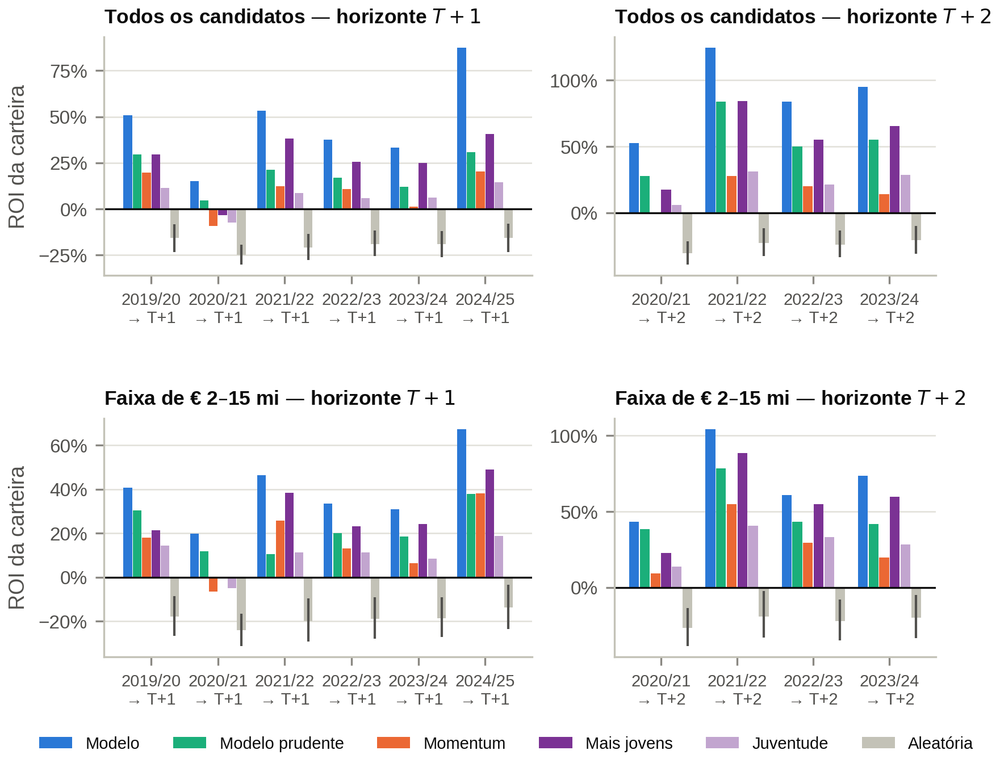

| ROI médio das temporadas, cenário principal | Modelo | Modelo prudente (P10) | *Momentum* | Mais jovens | Juventude | Aleatória |
|---|---|---|---|---|---|---|
| $T+1$, todos os candidatos | **46%** | 19% | 9% | 26% | 6,5% | −19% |
| $T+1$, faixa de € 2–15 mi | **40%** | 21% | 16% | 26% | 10% | −19% |
| $T+2$, todos os candidatos | **89%** | 54% | 15% | 55% | 22% | −24% |
| $T+2$, faixa de € 2–15 mi | **70%** | 50% | 28% | 56% | 29% | −22% |

- **Teste do sinal.** O modelo vence a carteira aleatória e o *momentum* em 6 de 6 temporadas de $T+1$
  ($p$ = 0,016) e em 4 de 4 de $T+2$ ($p$ = 0,063). Isso vale em todos os cenários de custo e de
  tratamento dos ausentes.
- **Mais jovens** (os 10% de menor idade). É a heurística mais forte, porque a idade é a variável mais
  importante do modelo. O modelo também a vence em 6 de 6 e em 4 de 4 temporadas, em todos os cenários.
  Como foi acrescentada depois da revelação do teste (seção 9.2), ela não entra no veredito da H4.
- **Teste pré-registrado (2024/25):** ROI de 87%, contra −16% ao acaso, 20% do *momentum*, 14,5% da
  juventude e 41% dos mais jovens.
- **Custos.**
  - Sem custos, o ROI médio é de 79% ($T+1$) e 131% ($T+2$).
  - Com ágio de 25% na compra, é de 29% e 66%.
  - O ágio de equilíbrio vai de 27% (2020/21) a 106% (2024/25) em $T+1$.
- **Intenção de tratar.** Poucos atletas da carteira saem da base (até 5 por temporada), e os três
  tratamentos dão ROI quase idêntico.
- **Concentração.** Sem os três maiores acertos de cada carteira, o ROI sem custos de $T+1$ cai de 7 a 16
  p.p., e continua acima de 34% em todas as temporadas.
- **Ganho líquido.** 57% (T+1) e 60% (T+2) dos atletas da carteira têm ganho líquido de custos, contra
  21% ao acaso. Perdas graves (abaixo de −50%): 7% e 17%, contra 12% e 27% do *momentum*.
- **Calibração da carteira.** Sem custos, nas dobras com camada de magnitude: ROI previsto de 72% contra
  87% realizado em $T+1$; 140% contra 131% em $T+2$.

**Veredito da H4 (critério do protocolo): sustentada.** Ressalva: de 2019/20 a 2023/24, as previsões vêm
de dobras usadas na otimização; só 2024/25 é inteiramente limpa.

### 9.1 Cenário de orçamento e risco

Clube médio: € 40 mi por janela e até 6 atletas de € 2–15 mi, comprados em ordem de retorno esperado. A
carteira é diversificada, com no máximo 2 atletas por posição e 3 por faixa etária. A referência são
2.000 carteiras com ordem de compra aleatória e as mesmas restrições. O risco do modelo é estimado por
*bootstrap* dos atletas selecionados. Custos e ausentes seguem o cenário principal.

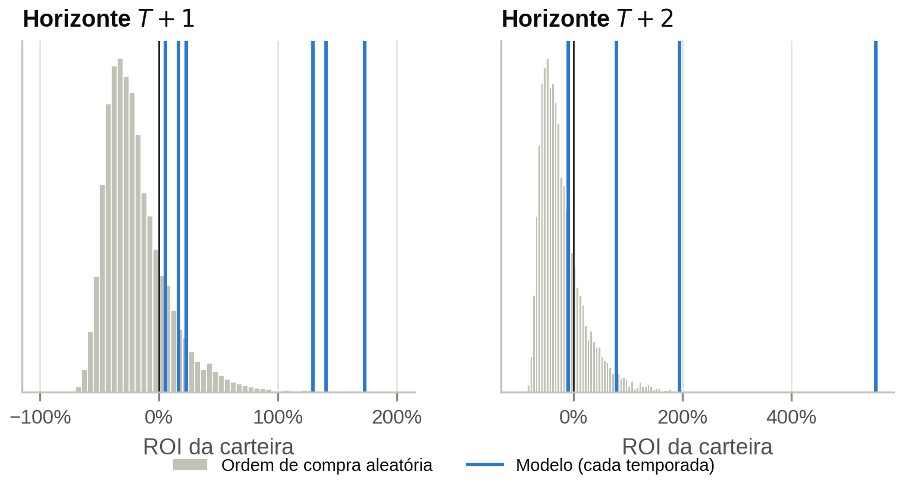

| Temporada ($T+1$) | Investimento | ROI do modelo | Percentil vs. aleatório | P(perda) do modelo |
|---|---|---|---|---|
| 2019/20 | € 33,6 mi | +129% | > 99,9 | 0% |
| 2020/21 | € 19,3 mi | +5% | 91 | 43% |
| 2021/22 | € 18,2 mi | +17% | 91 | 32% |
| 2022/23 | € 18,2 mi | +173% | 100 | 4% |
| 2023/24 | € 24,2 mi | +23% | 93 | 22% |
| **2024/25 (teste)** | **€ 22,0 mi** | **+141%** | **99,9** | **1%** |

**Carteiras aleatórias:**
- ROI médio de −25% a −13%;
- probabilidade de perda de 73–89%;
- VaR a 5% de −52% a −49% e CVaR de −57% a −53%.

Em $T+2$, o modelo fica entre os percentis 75 e 100: −10% (2020/21), +555%, +195% e +79% no teste de
2023/24.

**Implicação gerencial.** O modelo desloca a distribuição de retorno para a direita, mas uma carteira de 6
atletas continua exposta a choques. A probabilidade de perda chega a 22–43% nos anos fracos de $T+1$ e a
60% em $T+2$ (2020/21, logo após a revisão de valores da pandemia). A recomendação combina a previsão com
o intervalo de 80% e com diversificação.

### 9.2 O modelo como regra de compra (análise secundária)

O uso gerencial do modelo é decidir **quem comprar**, e não acertar quanto cada atleta vai valorizar.
Esta seção avalia as mesmas previsões fora da amostra como regra de decisão, sem nenhum ajuste novo.

**Valorização significativa** é a que paga a operação. Comprar por $V_T(1+c_b)$ e vender por
$V_{T+k}(1-c_v)$ só dá lucro se $\Delta V\% > (1+c_b)/(1-c_v) - 1$.
- **Limiar:** no cenário principal ($c_b = c_v = 10\%$), é de **22,2%**. Ele decorre dos custos
  fixados no protocolo, e não dos resultados.
- **Quem sai da base** conta como prejuízo total.
- **Taxa-base:** cerca de 21% dos atletas passam do limiar em cada temporada.

*Status:* a análise foi definida depois da revelação do teste de 2024/25 e, portanto, **não foi
pré-registrada**. Ela não altera modelos, previsões nem o veredito da H4.

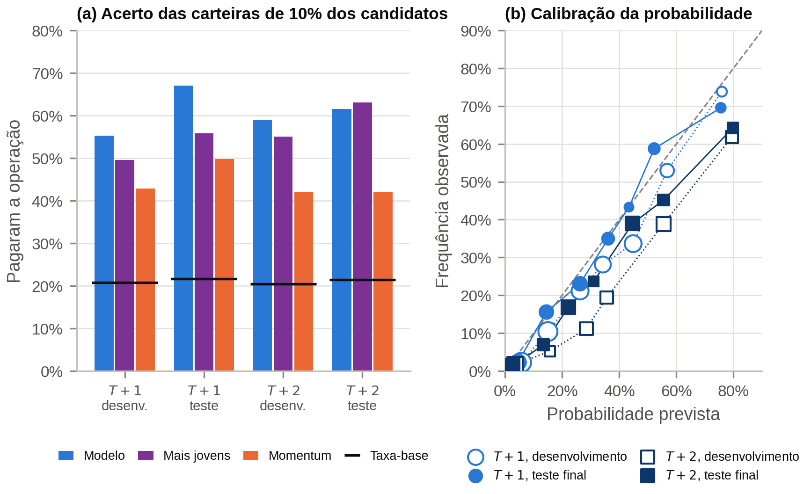

| Pagar custos de 10% + 10% | $T+1$ desenv. | $T+1$ teste | $T+2$ desenv. | $T+2$ teste |
|---|---|---|---|---|
| Taxa-base | 21% | 22% | 20% | 21% |
| AUC do modelo | 0,79 | **0,82** [0,80; 0,84] | 0,82 | **0,83** [0,81; 0,86] |
| AUC dos 10% mais jovens | 0,76 | 0,80 | 0,81 | 0,84 |
| AUC do *momentum* | 0,68 | 0,68 | 0,67 | 0,68 |
| Decil superior do modelo: % que pagou | 55% | **67%** | 59% | **62%** |
| 10% mais jovens: % que pagou | 50% | 56% | 55% | 63% |
| Decil inferior do modelo: % que pagou | 1% | 0% | 1% | 0% |

- **Discriminação** (`tab13`). No teste, em 82–83% dos pares formados por um atleta que pagou a
  operação e outro que não pagou, o modelo põe o primeiro à frente. O decil superior paga a operação
  cerca de três vezes a taxa-base; o inferior, praticamente nunca. Os outros limiares dão o mesmo quadro: AUC
  de 0,81–0,83 para "valorizou" e de 0,83 para custos de 25% + 10%.
- **O peso da idade** (`tab13c`). Comprar os 10% mais jovens já separa bem quem paga a operação. No
  teste, o modelo supera essa heurística em $T+1$: +0,020 de AUC [0,009; 0,031] e 67% contra 56% de
  acerto. Em $T+2$, empata: −0,002 [−0,013; 0,009] e 62% contra 63%. A vantagem sobre o *momentum* é
  ampla nos dois horizontes (+0,13 e +0,15).
- **Dentro das faixas etárias** (`tab14`). O modelo mantém vantagem sobretudo no auge:
  - **24–28 anos ($T+1$):** 42% (desenvolvimento) e 39% (teste) do decil superior pagaram a operação,
    contra 25% e 19% dos mais jovens da faixa e uma taxa-base de 20–22%;
  - **16–23 anos:** a vantagem aparece no desenvolvimento (70% contra 55%) e some no teste de $T+1$ (67%
    contra 71%);
  - **acima de 29 anos:** quase ninguém paga a operação (0–4%).
- **Retorno.** É onde o modelo mais se distingue da idade. Na seção 9, a carteira do modelo rende 46%
  ($T+1$) e 89% ($T+2$) no cenário principal, contra 26% e 55% dos mais jovens, e vence essa heurística
  em todas as temporadas.
- **Probabilidade calibrada** (`tab15`, `tab15b`). Ajustada por regressão isotônica só com as temporadas
  anteriores, a probabilidade de pagar a operação é confiável em $T+1$. No teste, quem recebeu de 40% a
  50% pagou em 43% dos casos, e quem recebeu mais de 60%, em 70%. O escore de Brier melhora sobre a
  taxa-base:
  - 18–23% em $T+1$, com pelo menos duas temporadas de histórico (5% em 2021/22, com uma só);
  - 15–21% em $T+2$, onde a probabilidade é otimista: acima de 60% previstos, 62–64% observados, contra
    79–80% previstos.
- **Regra por limiar** (`tab15c`). Comprar quando a probabilidade passa de 60%:
  - **$T+1$:** seleciona de 0,1% a 5% dos candidatos (3 a 92 atletas), com acerto de 67–80%, contra
    52–67% do decil superior. A carteira acompanha o mercado em vez de ter tamanho fixo, mas fica
    pequena e concentrada em promessas de clubes de elite.
  - **$T+2$:** como a probabilidade é otimista, a regra seleciona 7–12% dos candidatos sem acertar mais
    que o decil superior.

**Implicação.** O modelo responde bem à pergunta "este atleta vai se valorizar o bastante para pagar a
operação?", mas boa parte da resposta vem da idade. A contribuição própria do modelo está em três
pontos:
- ordenar os atletas no auge da carreira;
- descartar quem não tem chance;
- escolher, entre os jovens, os de maior valorização, o que aparece no retorno.

Por isso, a regressão do log-retorno continua sendo o motor da decisão: a magnitude prevista é o que
separa o modelo da regra "compre os jovens".

## 10. Mapa de oportunidades e lista de observação (teste 2024/25)

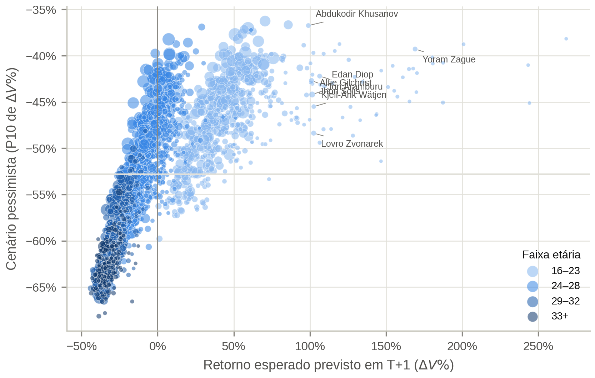

O mapa posiciona cada atleta pelo retorno esperado e pelo cenário pessimista (P10). Na lista das 15
maiores oportunidades de € 2–15 mi apontadas em 30/06/2025 (`tab09`), **80% se valorizaram** até
30/06/2026. O ROI da lista foi de **259%** sem custos e de **194%** no cenário principal, e 73% dos
realizados caíram dentro do intervalo de 80%.

| Destaques | $V_T$ → $V_{T+1}$ |
|---|---|
| Ibrahim Mbaye (PSG) | € 3 mi → € 30 mi |
| Ayden Heaven (Manchester United) | € 5 mi → € 30 mi |
| Marc Bernal (Barcelona) | € 5 mi → € 30 mi |
| Jaydee Canvot (Toulouse) | € 4 mi → € 28 mi |
| Pau Navarro (Villarreal) | € 3 mi → € 15 mi |
| Yoram Zague (PSG) | € 2,5 mi → € 1,8 mi |

**Leitura crítica.** Os 15 atletas têm de 16 a 23 anos, e 10 jogam em clubes de elite (PSG, Manchester
United, Manchester City, Barcelona, Juventus e Aston Villa). O modelo aprendeu que um jovem barato num
elenco caro tende a ser reavaliado para cima quando ganha minutos. Isso identifica **onde** a valorização
acontece, mas não garante que ela possa ser **comprada**: o $V_T$ de uma promessa de um clube de elite não
é o preço pelo qual ela seria vendida. Para um clube médio, a carteira diversificada da seção 9.1 é a
referência mais realista.

## 11. Lista prospectiva (2024/25 → 30/06/2027)

O modelo final de $T+2$ foi aplicado aos atletas de 2024/25, com informação até 30/06/2025. A lista das 15
maiores oportunidades de € 2–15 mi (`tab12_lista_prospectiva_2425_T2.csv`) foi gravada em 23/10/2026, com
o *commit* `5573d7e`, para conferência quando o Transfermarkt publicar os valores de junho de 2027.

- Ela repete o perfil da lista de observação: só jovens de 16–23 anos, 9 defensores, e 11 dos 15 em PSG,
  Manchester United, Manchester City, Barcelona, Juventus e Chelsea.
- Lidera Axel Tapé (PSG), com +304% previstos na mediana e P10 de −48%.
- **Ressalva:** na data de emissão, o valor intermediário de 30/06/2026 já é público; o modelo não o usa.
  A lista serve à verificação científica do horizonte de duas temporadas, e não como recomendação de
  compra.

## 12. Conclusões para o artigo

1. **Desempenho e idade lideram a explicação**, seguidos por contexto do clube, gap de avaliação e
   preço. O **gap de avaliação** é o determinante mais alinhado à lógica *buy-low* (3ª variável nos dois
   horizontes).
2. **O desempenho importa mais no auge da carreira** (H5 sustentada, robusta entre dobras). Para os
   veteranos, a idade domina, o que contraria a premissa da especificação.
3. **Os subavaliados se valorizam mais** em $T+1$ (H3 sustentada); em $T+2$, o sentido se mantém sem
   atender ao critério estrito.
4. **A estratégia baseada no modelo supera heurísticas e o acaso** em todas as temporadas, líquida de
   custos e incluindo quem sai da base (H4 sustentada), com ROI de valor de mercado de 46% em $T+1$ e 89%
   em $T+2$ no cenário principal.
5. **Como regra de compra, o modelo separa quem paga a operação** (AUC de 0,82–0,83 no teste), mas boa
   parte dessa separação vem da idade. A vantagem própria do modelo aparece no auge da carreira e no
   retorno (análise secundária, seção 9.2).
6. **O risco de carteiras concentradas permanece**, e as melhores oportunidades concentram-se em
   promessas de clubes de elite, cujo preço real tende a superar o $V_T$.

**Ressalvas.** O SHAP descreve o modelo, não relações causais. O ROI é de **valor de mercado**: os custos
entram como cenário, mas não salários nem a diferença entre valor estimado e preço pago.
