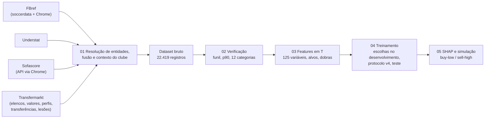

# Relatório Técnico — Previsão da Valorização de Mercado de Jogadores (Big Five, 2018/19–2024/25)

Documentação dos processos e resultados do pipeline de cinco notebooks do projeto *Football
Transfer Risk & AI Scouting*. Os relatórios descrevem o que foi feito, com que decisões e com
quais resultados, e apontam para as figuras e tabelas exportadas, que estão prontas para o artigo.

> **Execução de referência: versão 4 (17/11/2026).** Aplica a revisão externa `documents/ENHANCEMENTS.md`.
> - **Protocolo:** `reports/protocol_v4.json`, *commit* `8883da8`, versionado antes de reavaliar os testes.
> - **Testes:** 2024/25 em $T+1$ e 2023/24 em $T+2$, ambos semi-independentes. O de $T+1$ foi
>   pré-registrado e revelado na v3 (`5573d7e`).
> - **Versões anteriores:** em `archive/` (v3 de 23/10/2026, v2 de 19/10/2026, v1 como linha de base).

## Índice

| Relatório | Notebook | Conteúdo |
|---|---|---|
| [01 — Extração e fusão das fontes](01_extracao_e_fusao.md) | `01_data_extraction.ipynb` | FBref, Understat, Sofascore e Transfermarkt (inclusive lesões); contexto do clube; resolução de entidades; dataset bruto |
| [02 — Verificação dos dados](02_verificacao_dos_dados.md) | `02_eda.ipynb` | Funil amostral (com a ponte para os registros brutos), corte $p_{90}$, minutagem, ausentes, atrito, 12 categorias, alvos |
| [03 — Engenharia de *features*](03_engenharia_de_features.md) | `03_preprocessing.ipynb` | Painel de 125 variáveis: prioris por papel tático, probabilidades de cauda, lesões, trajetória, valor justo agrupado por clube |
| [04 — Modelagem e avaliação](04_modelagem_e_avaliacao.md) | `04_model_training.ipynb` | Escolha do alvo, interações restritas, regra de arquitetura com dois agrupamentos, camadas de magnitude, classificadores, protocolo v4, teste |
| [05 — Interpretação e simulação](05_interpretacao_e_simulacao.md) | `05_model_interpretation.ipynb` | SHAP com coalizão etária (H5), gap (H3), carteiras com custos, carregamento, preço observado e universo comprável (H4), mochila, regra de compra, listas |
| [06 — Decisões, hipóteses e limitações](06_decisoes_limitacoes_proximos_passos.md) | — | Regras do protocolo, vereditos, tratamento de cada item da revisão externa, limitações e próximos passos |

## Resumo executivo

**Pergunta.** É possível prever a variação do valor de mercado de jogadores de linha das Big Five
uma e duas temporadas à frente ($\Delta V$ e $\Delta V\%$ em $T+1$ e $T+2$) a partir de informação
disponível em $T$? O que a determina, e a previsão sustenta decisões de compra?

**Dados.**
- **Bruto:** 22.419 registros jogador–clube–temporada de FBref, Understat, Sofascore e Transfermarkt.
- **Amostra analítica:** 13.748 observações de 5.007 atletas (2018/19–2024/25).
- **Novidade da v4:** o histórico de lesões dos 5.136 atletas do universo-alvo.
- **Não coletadas:** as escalações por partida do Understat (site em manutenção) e as convocações.

**Desenho.**
- **Alvo:** log-retorno nominal, escolhido por regra sobre o excesso ao *drift* de mercado.
- **Variáveis:** 125.
- **Validação:** janela expandida.
- **Modelo final:** em $T+1$, *ensemble* com interações restritas; em $T+2$, *ensemble* global, ambos pela
  regra pré-declarada.
- **Camadas:** de magnitude e de decisão escolhidas no desenvolvimento.
- **Intervalos:** de 80% por CatBoost multiquantil conformalizado.

| Métrica (teste final) | $T+1$ (2024/25) | $T+2$ (2023/24) | v3 pré-registrada |
|---|---|---|---|
| $R^2$ do log-retorno | 0,337 [0,304; 0,369] | 0,382 [0,341; 0,416] | 0,329 / 0,371 |
| $\rho$ de Spearman | 0,570 | 0,608 | 0,560 / 0,604 |
| Redução do RMSE frente a "valor constante" | −20% | −27% | −19% / −27% |
| Decil superior que se valorizou ($\Delta V\% > 0$) | 71% (média 27,5%) | 64% (média 26%) | 71% / 66% |
| AUC: pagar custos de 10% + 10% ($\Delta V\%$ > 22,2%) | 0,82 (10% mais jovens: 0,80) | 0,83 (mais jovens: 0,84) | 0,82 / 0,83 |
| Decil superior que pagou esses custos | 66% (taxa-base 21,7%) | 63% pelo escore do protocolo (21,4%) | 67% / 62% |
| Erro do 10º decil de $\Delta V\%$ (p.p.) | 134 | 121 | 181 / 192 |
| Cobertura do intervalo de 80% | 83% | 83% | 82% / 82% |

**Hipóteses** (relatório 06):

| Hipótese | Veredito |
|---|---|
| H1. O desempenho agrega poder preditivo além do Transfermarkt e da idade | **Sustentada em $T+1$** ($T+2$: $p_{\text{Holm}} = 0{,}07$) |
| H2. A matriz 4 × 3 supera a 3 × 3 e o global | **Não sustentada** |
| H3. Subavaliados valorizam-se mais | **Sustentada em $T+1$** |
| H4. A carteira do modelo supera heurísticas e o acaso | **Sustentada** (6 de 6 temporadas) |
| H5. O desempenho pesa mais no auge | **Sustentada** (+9,6 e +9,5 p.p.) |

**Principais achados**
1. **Ordenação mais que magnitude.** A previsão é útil para ordenar e decidir. A cauda direita melhorou
   (erro do 10º decil de 181 para 134 p.p. em $T+1$), mas continua subestimada.
2. **Segmentação.** A heterogeneidade por idade e posição é mais bem tratada num modelo único com
   interações restritas. Segmentar em células piora.
3. **Algoritmos.** Árvores e lineares empatam, e não por empilhamento: sem o valor justo, as árvores perdem
   mais que o Ridge.
4. **Carteiras.**
   - ROI médio de 58% ($T+1$) e 97% ($T+2$) no cenário principal.
   - Alfa de +32 e +41 p.p. sobre os 10% mais jovens.
   - O resultado se mantém com custo de carregamento, com o preço de aquisição observado e fora dos
     elencos de elite.
5. **Risco.** A penalidade de risco na carteira sob orçamento não foi robusta.

## Arquitetura do pipeline



## Reprodução

```bash
.venv/bin/pip install -r requirements.txt && .venv/bin/pip install -e .
cd notebooks
# FA_OFFLINE=1 reproduz os dados congelados só com o cache
for nb in 01_data_extraction 02_eda 03_preprocessing 04_model_training; do
  FA_OFFLINE=1 ../.venv/bin/jupyter nbconvert --to notebook --execute $nb.ipynb --inplace \
      --ExecutePreprocessor.timeout=-1 --ExecutePreprocessor.kernel_name=football-analytics
done
# o notebook 04 grava reports/protocol_v4.json; faça o commit e revele o teste
FA_REVEAL_HOLDOUT=1 ../.venv/bin/jupyter nbconvert --to notebook --execute 04_model_training.ipynb --inplace \
    --ExecutePreprocessor.timeout=-1 --ExecutePreprocessor.kernel_name=football-analytics
../.venv/bin/jupyter nbconvert --to notebook --execute 05_model_interpretation.ipynb --inplace \
    --ExecutePreprocessor.timeout=-1 --ExecutePreprocessor.kernel_name=football-analytics
```

**Custos.**
- **Notebook 04:** cerca de 100 minutos a frio, com cache em `models/04_model_training/cache/`.
- **Notebook 05:** cerca de 40 minutos.
- **Testes:** `.venv/bin/pytest`, 135 testes.
- **Modo de teste:** `FA_SMOKE_TEST=1` roda os notebooks 04 e 05 com 15% das linhas.

## Mapa de artefatos

| Tipo | Local |
|---|---|
| Figuras (PNG, 300 dpi, 16 cm; legendas ABNT em `figures_index.md`) | `reports/figures/<notebook>/` |
| Tabelas (CSV UTF-8 com BOM) | `reports/tables/<notebook>/` |
| Protocolos pré-registrados | `reports/protocol_v4.json`; `reports/archive/v3_2026-10-23/protocol_v3.json` |
| Dataset bruto | `data/raw/football_raw_dataset.parquet` (+ `.csv`, `_schema.json`) |
| Painel de modelagem e dicionário | `data/processed/train_test_lags.parquet`, `feature_sets.json` |
| Previsões fora da amostra | `data/processed/predictions_oof.parquet`, `predictions_best.parquet` |
| Valores SHAP | `data/processed/shap_values_T1.parquet`, `shap_values_T2.parquet` |
| Modelos finais | `models/04_model_training/final/` (`manifest.json`) |
| Versões anteriores | `reports/archive/v3_2026-10-23/`, `v2_2026-10-19/`, `v1_baseline/` |
