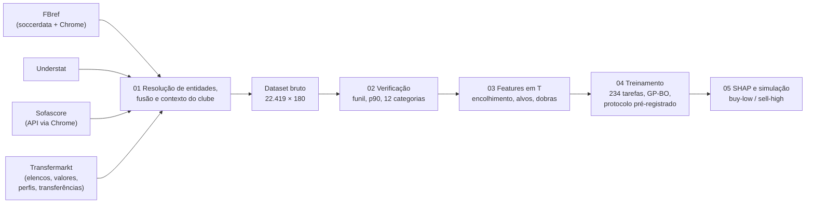

# Relatório Técnico — Previsão da Valorização de Mercado de Jogadores (Big Five, 2018/19–2024/25)

Documentação dos processos e resultados do pipeline de cinco notebooks do projeto *Football
Transfer Risk & AI Scouting*. Os relatórios descrevem o que foi feito, com que decisões e com
quais resultados, e apontam para as figuras e tabelas exportadas, que estão prontas para o artigo.

> **Execução de referência: versão 3 (22–23/10/2026)**, com o teste de $T+1$ de 2024/25 pré-registrado:
> protocolo `reports/protocol_v3.json`, *commit* `5573d7e`. Os números citados vêm dessa execução. As
> versões anteriores estão em `archive/` (v2 de 19/10/2026; v1 como linha de base).

## Índice

| Relatório | Notebook | Conteúdo |
|---|---|---|
| [01 — Extração e fusão das fontes](01_extracao_e_fusao.md) | `01_data_extraction.ipynb` | FBref, Understat, Sofascore e Transfermarkt; contexto do clube; resolução de entidades; dataset bruto |
| [02 — Verificação dos dados](02_verificacao_dos_dados.md) | `02_eda.ipynb` | Funil amostral, corte $p_{90}$, minutagem, ausentes, atrito, 12 categorias, distribuição dos alvos |
| [03 — Engenharia de *features*](03_engenharia_de_features.md) | `03_preprocessing.ipynb` | Painel jogador–temporada, encolhimento empírico-bayesiano, contrato em T, contexto, valor justo, janela expandida |
| [04 — Modelagem e avaliação](04_modelagem_e_avaliacao.md) | `04_model_training.ipynb` | Protocolo pré-registrado, 6 algoritmos, segmentação 4 × 3 e 3 × 3, *pooling*, ablação (H1, H2), magnitude, intervalos |
| [05 — Interpretação e simulação](05_interpretacao_e_simulacao.md) | `05_model_interpretation.ipynb` | SHAP e estabilidade (H5), gap de avaliação (H3), *backtest buy-low / sell-high* com custos (H4), risco, lista prospectiva |
| [06 — Decisões, hipóteses e limitações](06_decisoes_limitacoes_proximos_passos.md) | — | Vereditos H1–H5, desvios das especificações, limitações, ameaças à validade, referências |

## Resumo executivo

**Pergunta.** É possível prever a variação do valor de mercado de jogadores de linha das Big Five
uma e duas temporadas à frente ($\Delta V$ e $\Delta V\%$ em $T+1$ e $T+2$) a partir de informação
disponível em $T$? Que variáveis determinam essa valorização, e o desempenho em campo agrega algo ao
que o próprio Transfermarkt já sabe?

**Dados.** Quatro fontes públicas foram integradas por resolução de entidades:
- **FBref:** espinha dorsal da amostra e minutagem.
- **Understat:** xG, xA e os resultados das partidas, usados para a classificação.
- **Sofascore:** métricas táticas que o FBref deixou de publicar em jan/2026, e participação europeia.
- **Transfermarkt:** valores de mercado datados, perfil, contrato e transferências.

O resultado é um dataset bruto de 22.419 registros jogador–clube–temporada (2017/18 a 2024/25, com
2017/18 só para defasagens), com 99,94% de pareamento com o Transfermarkt no universo-alvo.

**Amostra.** Após a exclusão de goleiros, o filtro de pelo menos 90 minutos e o corte do percentil 90
de $V_T$ (por temporada), a amostra analítica tem **13.748 observações jogador–temporada de 5.007
atletas**, 40% a mais que a versão 2.

**Desenho.**
- **Alvo:** log-retorno $\ln(V_{T+k}/V_T)$, avaliado também em $\Delta V\%$ e €.
- **Variáveis:** 108, com taxas por 90 encolhidas (empírico-bayesiano) e contexto do clube.
- **Validação:** janela expandida. O teste de $T+1$ (2024/25) foi **pré-registrado**: arquitetura,
  hiperparâmetros e critérios das hipóteses foram *commitados* antes de qualquer métrica do teste.
- **Modelo final:** *ensemble* global (média de CatBoost, XGBoost e Ridge) em $T+1$; *pooling* parcial 3 ×
  3 em $T+2$. Ambos têm camada de magnitude e intervalos de 80% conformalizados.
- **Inferência:** *bootstrap* por clube × temporada, teste pareado do tipo Diebold–Mariano com Holm e
  conjunto de confiança de modelos (MCS).

| Métrica (teste final) | $T+1$ (2024/25, pré-registrado) | $T+2$ (2023/24) |
|---|---|---|
| $R^2$ do log-retorno | 0,33 [0,29; 0,36] | 0,37 |
| $\rho$ de Spearman (ordenação) | 0,56 | 0,60 |
| Redução do RMSE frente a "valor constante" | −19% | −27% |
| $R^2$ em ΔV (€) | 0,19 | 0,21 |
| Erro absoluto mediano em $\Delta V\%$ | 21,5 p.p. | 25,9 p.p. |
| Atletas do decil superior previsto que se valorizaram | 71% (média: 28%) | 66% (média: 26%) |
| Cobertura do intervalo de 80% | 82% | 82% |

**Hipóteses** (critérios fixados no protocolo; relatório 06):

| Hipótese | Veredito |
|---|---|
| H1. O desempenho agrega poder preditivo além do Transfermarkt e da idade | **Sustentada** nos dois horizontes |
| H2. A matriz 4 × 3 supera a 3 × 3 de Khalife et al. (2025) e o modelo global | **Não sustentada** |
| H3. Atletas subavaliados (gap < 0) valorizam-se mais | **Sustentada em $T+1$**; em $T+2$, só no sentido |
| H4. A carteira do modelo supera heurísticas e o acaso, líquida de custos | **Sustentada** (6 de 6 temporadas, $p$ = 0,016) |
| H5. O desempenho pesa mais no auge que entre os veteranos | **Sustentada** (+10 p.p.) |

**Principais achados**
1. **A variação futura do valor é parcialmente previsível**, e o maior valor do modelo está em
   **ordenar** os atletas. No decil inferior previsto, 1–2% se valorizam; no superior, 63–66%.
2. **O desempenho em campo agrega informação** que o Transfermarkt ainda não incorporou. O ganho é
   modesto e significativo: +0,03 de $R^2$ em $T+1$. Diante dele, a trajetória do valor no Transfermarkt é
   redundante.
3. **Algoritmo e segmentação importam pouco.** Árvores e lineares empatam, a otimização de
   hiperparâmetros não muda o resultado, e modelos separados por categoria são piores que um modelo
   único com idade e posição como variáveis.
4. **Determinantes (SHAP):**
   - desempenho tático-técnico: 25–29% da explicação;
   - idade: 27–34%;
   - contexto do clube: 7–11%;
   - gap de avaliação e valor justo: 10%; o gap é a 3ª variável mais importante.

   O desempenho pesa 10 p.p. mais no auge (24–28 anos) que nos veteranos, nos quais a idade domina.
5. **Simulação fora da amostra.** No cenário principal (custos de 10% na compra e na venda; quem sai da
   base vale zero), as carteiras do modelo rendem ROI médio de **46% em $T+1$** e **89% em $T+2$**. As
   referências ficam em −19% e −24% (acaso) e em 6–22% (heurísticas de *momentum* e juventude). No teste
   pré-registrado, o ROI foi de 87%. O risco de carteiras concentradas permanece, e as melhores
   oportunidades concentram-se em promessas de clubes de elite, cujo preço real tende a superar o $V_T$.

## Arquitetura do pipeline



## Reprodução

```bash
.venv/bin/pip install -r requirements.txt && .venv/bin/pip install -e .
cd notebooks
for nb in 01_data_extraction 02_eda 03_preprocessing 04_model_training; do
  ../.venv/bin/jupyter nbconvert --to notebook --execute $nb.ipynb --inplace \
      --ExecutePreprocessor.timeout=-1 --ExecutePreprocessor.kernel_name=football-analytics
done
# o notebook 04 grava reports/protocol_v3.json; faça o commit e revele o teste
FA_REVEAL_HOLDOUT=1 ../.venv/bin/jupyter nbconvert --to notebook --execute 04_model_training.ipynb --inplace \
    --ExecutePreprocessor.timeout=-1 --ExecutePreprocessor.kernel_name=football-analytics
../.venv/bin/jupyter nbconvert --to notebook --execute 05_model_interpretation.ipynb --inplace \
    --ExecutePreprocessor.timeout=-1 --ExecutePreprocessor.kernel_name=football-analytics
```

**Custos.**
- **Notebook 01:** a coleta leva várias horas a frio, mas fica em cache em `data/raw/`. O Transfermarkt
  bloqueia sessões longas (relatório 01, §2).
- **Notebook 04:** cerca de 1 hora a frio, com cache em `models/04_model_training/cache/`; a
  reexecução leva cerca de 5 minutos.
- **Notebook 05:** cerca de 9 minutos.
- **Demais notebooks:** minutos.

Testes: `.venv/bin/pytest` (98 testes).

## Mapa de artefatos

| Tipo | Local |
|---|---|
| Figuras (PNG, 300 dpi, 16 cm, sem título embutido; legendas ABNT em `figures_index.md`) | `reports/figures/<notebook>/` |
| Tabelas (CSV UTF-8 com BOM) | `reports/tables/<notebook>/` |
| Protocolo pré-registrado do teste final | `reports/protocol_v3.json` |
| Dataset bruto | `data/raw/football_raw_dataset.parquet` (+ `.csv`, `_schema.json`) |
| Painel de modelagem e dicionário | `data/processed/train_test_lags.parquet`, `feature_sets.json` |
| Previsões fora da amostra | `data/processed/predictions_oof.parquet`, `predictions_best.parquet` |
| Valores SHAP | `data/processed/shap_values_T1.parquet`, `shap_values_T2.parquet` |
| Modelos finais | `models/04_model_training/final/` (`manifest.json`) |
| Versões anteriores (tabelas-chave, previsões e manifesto) | `reports/archive/v2_2026-10-19/`, `reports/archive/v1_baseline/` |
