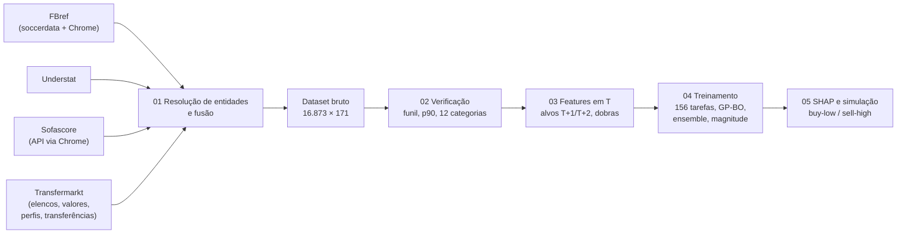

# Relatório Técnico — Previsão da Valorização de Mercado de Jogadores (Big Five, 2019/20–2023/24)

Documentação dos processos e resultados do pipeline de cinco notebooks do projeto *Football
Transfer Risk & AI Scouting*. Os relatórios descrevem o que foi feito, com que decisões e com
quais resultados, e apontam para as figuras e tabelas exportadas, que estão prontas para o artigo.

> Execução de referência: **19/10/2026**. Os números citados vêm dessa execução. Se os notebooks
> forem reexecutados, por exemplo após recoletar os 44 jogadores pendentes do Transfermarkt, os
> valores podem variar marginalmente.

## Índice

| Relatório | Notebook | Conteúdo |
|---|---|---|
| [01 — Extração e fusão das fontes](01_extracao_e_fusao.md) | `01_data_extraction.ipynb` | FBref, Understat, Sofascore e Transfermarkt; resolução de entidades; dataset bruto |
| [02 — Verificação dos dados](02_verificacao_dos_dados.md) | `02_eda.ipynb` | Funil amostral, corte $p_{90}$, minutagem, ausentes, 12 categorias, distribuição dos alvos |
| [03 — Engenharia de *features*](03_engenharia_de_features.md) | `03_preprocessing.ipynb` | Painel jogador–temporada, contrato em T, defasagens, valor justo, janela expandida |
| [04 — Modelagem e avaliação](04_modelagem_e_avaliacao.md) | `04_model_training.ipynb` | 6 algoritmos × 2 arquiteturas × 2 horizontes, otimização bayesiana, magnitude, intervalos |
| [05 — Interpretação e simulação](05_interpretacao_e_simulacao.md) | `05_model_interpretation.ipynb` | SHAP, determinantes por categoria e posição, *backtest buy-low / sell-high*, risco |
| [06 — Decisões, limitações e próximos passos](06_decisoes_limitacoes_proximos_passos.md) | — | Desvios em relação às especificações, limitações e trabalho futuro |

## Resumo executivo

**Pergunta.** É possível prever a variação do valor de mercado de jogadores de linha das Big Five
uma e duas temporadas à frente ($\Delta V$ e $\Delta V\%$ em $T+1$ e $T+2$) a partir de informação
disponível em $T$? E que variáveis determinam essa valorização?

**Dados.** Quatro fontes públicas foram integradas por resolução de entidades:
- **FBref:** espinha dorsal da amostra e minutagem.
- **Understat:** xG e xA.
- **Sofascore:** métricas táticas que o FBref deixou de publicar em jan/2026.
- **Transfermarkt:** valores de mercado datados, perfil, contrato e transferências.

O resultado é um dataset bruto de 16.873 registros jogador–clube–temporada, com 99,96% de
pareamento com o Transfermarkt no universo-alvo.

**Amostra.** Após a exclusão de goleiros, o filtro de pelo menos 90 minutos e o corte do percentil
90 de $V_T$ (por temporada), a amostra analítica tem **9.810 observações jogador–temporada de 4.084
atletas** (especificação: cerca de 10.350 e 4.217).

**Modelo final.** *Ensemble* global, a média de CatBoost, XGBoost e Ridge, treinado no log-retorno
$\ln(V_{T+k}/V_T)$. Ele tem uma camada de magnitude (recalibração e *smearing* de Duan) e intervalos
de 80% conformalizados. A validação usa janela expandida, e o teste final é 2023/24, nunca usado na
otimização.

| Métrica (teste 2023/24) | $T+1$ | $T+2$ |
|---|---|---|
| $R^2$ do log-retorno | 0,28 | 0,37 |
| $\rho$ de Spearman (ordenação) | 0,51 | 0,59 |
| Redução do RMSE frente a "valor constante" | −18% | −26% |
| $R^2$ em $\Delta V\%$ (esperança) | 0,15 | 0,11 |
| $R^2$ em ΔV (€) | 0,18 | 0,27 |
| Erro absoluto mediano em $\Delta V\%$ | 22,7 p.p. | 25,0 p.p. |
| Atletas do decil superior previsto que se valorizaram | 53% (média: 26%) | 66% (média: 26%) |
| Cobertura do intervalo de 80% | 82% | 86% |

**Principais achados**
1. **A variação futura do valor é parcialmente previsível**, e o maior valor do modelo está em
   **ordenar** os atletas. No decil inferior previsto, 2% se valorizam; no superior, 56%.
2. **Determinantes (SHAP):**
   - idade: 27–35% da explicação;
   - desempenho tático-técnico: 24–32%;
   - trajetória do valor (gap de avaliação, reavaliações recentes): 20–24%;
   - nível de preço: 11–14%.

   O desempenho pesa mais no auge (24–28 anos); nos veteranos, a idade domina.
3. **Algoritmos lineares e de árvores empatam estatisticamente.** Só o *ensemble* supera o melhor
   modelo isolado com significância. O **modelo global supera os 12 modelos segmentados**.
4. **Gap de avaliação.** Atletas mais baratos do que o desempenho sugere se valorizam mais (entre
   os jovens, +33% contra 0% na mediana). É a evidência direta da premissa *buy-low*.
5. **Simulação fora da amostra.** Carteiras escolhidas pelo modelo rendem ROI médio de **59–61% em
   $T+1$** e **113–153% em $T+2$**, contra cerca de −3% ao acaso e 27–67% de heurísticas simples.
   A estratégia supera as alternativas em todas as temporadas, mas carteiras concentradas seguem
   expostas a choques de mercado (2020/21: −3%).

## Arquitetura do pipeline



## Reprodução

```bash
.venv/bin/pip install -r requirements.txt && .venv/bin/pip install -e .
cd notebooks
for nb in 01_data_extraction 02_eda 03_preprocessing 04_model_training 05_model_interpretation; do
  ../.venv/bin/jupyter nbconvert --to notebook --execute $nb.ipynb --inplace \
      --ExecutePreprocessor.timeout=-1 --ExecutePreprocessor.kernel_name=football-analytics
done
```

Custos: a coleta do notebook 01 leva várias horas a frio, mas fica em cache em `data/raw/`. O
treinamento do notebook 04 leva cerca de 50 minutos a frio e fica em cache em
`models/04_model_training/cache/`. Os demais notebooks rodam em minutos. Testes: `.venv/bin/pytest`
(73 testes).

## Mapa de artefatos

| Tipo | Local |
|---|---|
| Figuras (PNG, 300 dpi, 16 cm, sem título embutido; legendas ABNT em `figures_index.md`) | `reports/figures/<notebook>/` |
| Tabelas (CSV UTF-8 com BOM) | `reports/tables/<notebook>/` |
| Dataset bruto | `data/raw/football_raw_dataset.parquet` (+ `.csv`, `_schema.json`) |
| Painel de modelagem e dicionário | `data/processed/train_test_lags.parquet`, `feature_sets.json` |
| Previsões fora da amostra | `data/processed/predictions_oof.parquet`, `predictions_best.parquet` |
| Valores SHAP | `data/processed/shap_values_T1.parquet`, `shap_values_T2.parquet` |
| Modelos finais | `models/04_model_training/final/` (`manifest.json`) |
| Métricas da versão 1 do modelo (comparação) | `reports/tables/04_model_training/v1_baseline/` |
